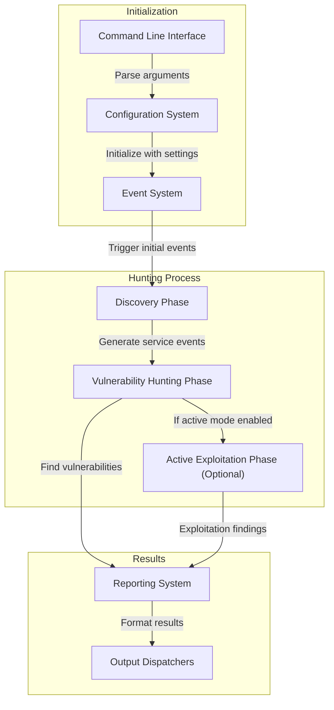
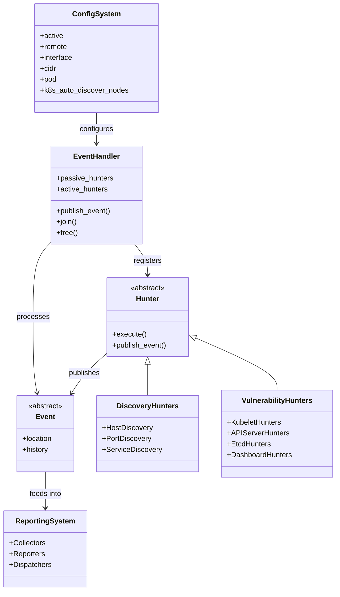
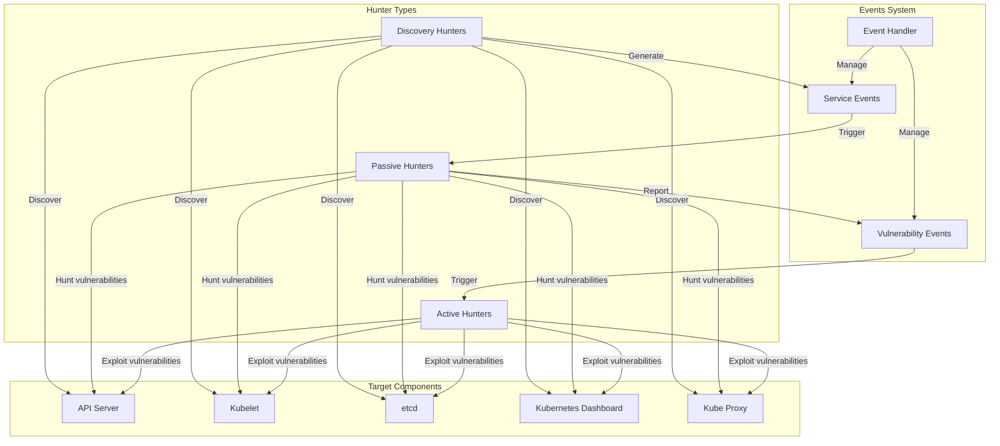

# Overview

Relevant source files

The following files were used as context for generating this wiki page:

- [README.md](https://github.com/aquasecurity/kube-hunter/blob/bc47f08e/README.md)
- [kube-hunter.py](https://github.com/aquasecurity/kube-hunter/blob/bc47f08e/kube-hunter.py)
- [setup.cfg](https://github.com/aquasecurity/kube-hunter/blob/bc47f08e/setup.cfg)

kube-hunter is a tool designed to identify security weaknesses in Kubernetes clusters. It scans and hunts for vulnerabilities in Kubernetes environments, providing insights into potential security risks. This page introduces kube-hunter's purpose, architecture, and operational flow.

> **Notice**: kube-hunter is not under active development anymore. For scanning Kubernetes clusters for known vulnerabilities, [Trivy](https://github.com/aquasecurity/trivy) is now recommended.

For installation instructions, see [Installation and Setup](#1.1). For detailed feature information, see [Features and Capabilities](#1.2).

Sources: [README.md:1-11](https://github.com/aquasecurity/kube-hunter/blob/bc47f08e/README.md#L1-L11)

## Purpose and Target Audience

kube-hunter was developed by Aqua Security to increase awareness and visibility of security issues in Kubernetes environments. It provides security professionals, cluster administrators, and DevOps teams with an "attacker's eye view" of a Kubernetes cluster. The tool simulates various reconnaissance and discovery techniques that potential attackers might use to identify vulnerabilities.

**Important:** kube-hunter should only be run on Kubernetes clusters that you own or have permission to test.

Sources: [README.md:6-7](https://github.com/aquasecurity/kube-hunter/blob/bc47f08e/README.md#L6-L7), [README.md:54-62](https://github.com/aquasecurity/kube-hunter/blob/bc47f08e/README.md#L54-L62)

## System Overview

kube-hunter operates as an event-driven system that progresses through several phases to discover and report vulnerabilities in Kubernetes clusters. It can be deployed in multiple ways and offers different scanning modes to provide flexibility in testing.

**System Overview Diagram**

Sources: [kube-hunter.py:10-49](https://github.com/aquasecurity/kube-hunter/blob/bc47f08e/kube-hunter.py#L10-L49), [README.md:15-39](https://github.com/aquasecurity/kube-hunter/blob/bc47f08e/README.md#L15-L39)

## Core Components and Flow

kube-hunter consists of several key components that work together to discover and identify vulnerabilities:

**Core Components Diagram**

The operational flow of kube-hunter follows these steps:

1. **Initialization**: kube-hunter parses command-line arguments to configure the hunt
2. **Event Generation**: Initial events (like `HuntStarted` and `HostScanEvent` or `RunningAsPodEvent`) are published
3. **Discovery Phase**: Discovery hunters identify potential targets and services
4. **Vulnerability Hunting Phase**: Hunters examine discovered services for vulnerabilities
5. **Active Hunting Phase** (optional): If enabled, kube-hunter attempts to exploit discovered vulnerabilities
6. **Reporting Phase**: Findings are collected, formatted, and dispatched according to configuration

Sources: [kube-hunter.py:97-140](https://github.com/aquasecurity/kube-hunter/blob/bc47f08e/kube-hunter.py#L97-L140), [README.md:102-143](https://github.com/aquasecurity/kube-hunter/blob/bc47f08e/README.md#L102-L143)

## Scanning Modes

kube-hunter offers multiple scanning modes to accommodate different testing scenarios:

| Mode | Description | Configuration Option |
|------|-------------|---------------------|
| Remote Scanning | Scans specific IPs or DNS names | `--remote` |
| Interface Scanning | Scans subnets on all local network interfaces | `--interface` |
| CIDR Scanning | Scans a specified IP range | `--cidr` |
| Pod Scanning | Runs from within a Kubernetes pod | `--pod` |
| K8s Node Auto-discovery | Queries Kubernetes API for nodes and scans them | `--k8s-auto-discover-nodes` |

Each scanning mode provides a different perspective on the security posture of the Kubernetes cluster:

- **Remote scanning** shows what an external attacker can discover
- **Interface scanning** reveals attack surface from network vantage points
- **Pod scanning** shows what a compromised container could discover or exploit

Sources: [README.md:65-91](https://github.com/aquasecurity/kube-hunter/blob/bc47f08e/README.md#L65-L91), [kube-hunter.py:52-76](https://github.com/aquasecurity/kube-hunter/blob/bc47f08e/kube-hunter.py#L52-L76)

## Hunting Capabilities

kube-hunter uses a hunter-based system to discover and identify vulnerabilities:

**Hunting System Diagram**

kube-hunter provides two primary hunting modes:

1. **Passive Hunting** (default): Identifies vulnerabilities without changing the state of the cluster
2. **Active Hunting** (optional): Exploits vulnerabilities to explore for further issues, potentially changing cluster state

Sources: [README.md:106-116](https://github.com/aquasecurity/kube-hunter/blob/bc47f08e/README.md#L106-L116), [kube-hunter.py:79-93](https://github.com/aquasecurity/kube-hunter/blob/bc47f08e/kube-hunter.py#L79-L93)

## Deployment Options

kube-hunter can be deployed and executed in multiple ways:

1. **Direct Execution**:
   - Install via pip: `pip install kube-hunter`
   - Run from source: Clone repository and execute `python3 kube_hunter`

2. **Container**:
   - Run as a Docker container: `docker run -it --rm --network host aquasec/kube-hunter`

3. **Pod**:
   - Deploy as a Kubernetes job/pod using the provided job.yaml file

Each deployment method offers different perspectives on the Kubernetes environment's security posture.

Sources: [README.md:188-253](https://github.com/aquasecurity/kube-hunter/blob/bc47f08e/README.md#L188-L253), [setup.cfg:1-28](https://github.com/aquasecurity/kube-hunter/blob/bc47f08e/setup.cfg#L1-L28)

## Integration with Kubernetes ATT&CK Matrix

kube-hunter's vulnerabilities align with the MITRE ATT&CK framework for Kubernetes, providing a standardized way to understand attack techniques. The vulnerabilities discovered by kube-hunter represent specific steps that attackers might take, which correspond to general techniques in the ATT&CK matrix.

Sources: [README.md:41-51](https://github.com/aquasecurity/kube-hunter/blob/bc47f08e/README.md#L41-L51)

## Summary

kube-hunter provides a comprehensive framework for discovering security weaknesses in Kubernetes clusters. Its event-driven architecture, flexible scanning modes, and modular hunting system enable thorough security assessments from multiple perspectives. By simulating attacker behavior, kube-hunter helps identify vulnerabilities before they can be exploited by malicious actors.

For more details on the architecture, see [Architecture](#2). To understand the discovery process, see [Discovery System](#3). For information about vulnerability hunting capabilities, see [Vulnerability Hunting](#4).