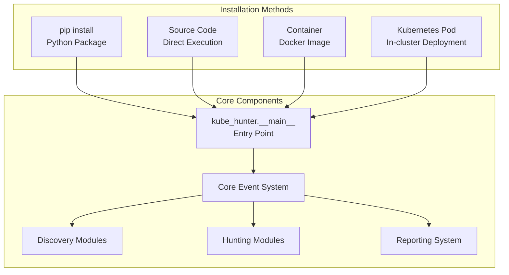
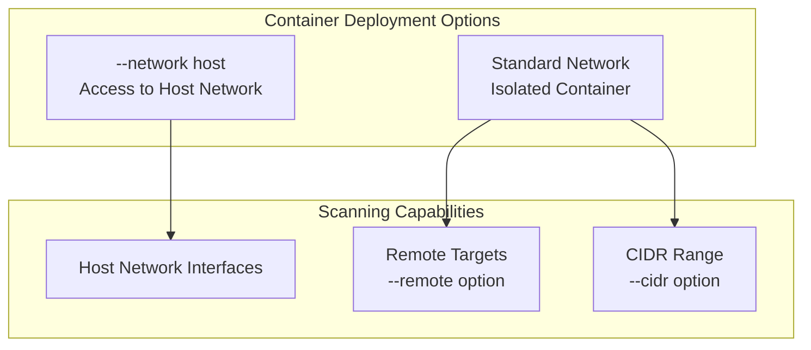
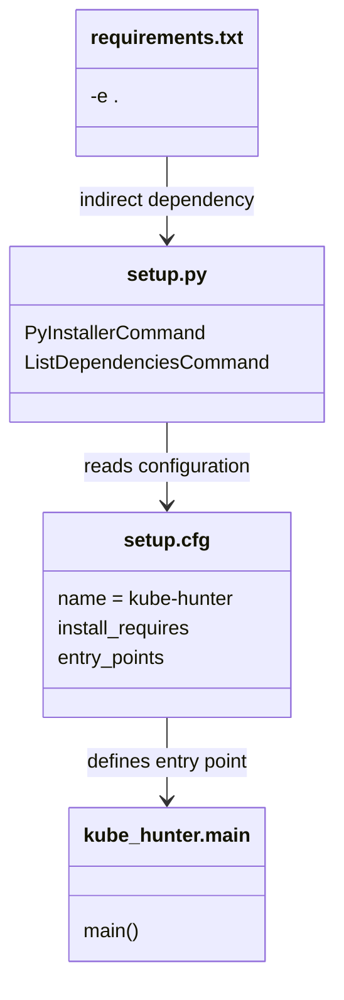

# Installation and Setup

<details>
<summary>Relevant source files</summary>

The following files were used as context for generating this wiki page:

- [.gitignore](https://github.com/aquasecurity/kube-hunter/blob/bc47f08e/.gitignore)
- [Makefile](https://github.com/aquasecurity/kube-hunter/blob/bc47f08e/Makefile)
- [README.md](https://github.com/aquasecurity/kube-hunter/blob/bc47f08e/README.md)
- [pyinstaller_hooks/hook-prettytable.py](https://github.com/aquasecurity/kube-hunter/blob/bc47f08e/pyinstaller_hooks/hook-prettytable.py)
- [requirements-dev.txt](https://github.com/aquasecurity/kube-hunter/blob/bc47f08e/requirements-dev.txt)
- [requirements.txt](https://github.com/aquasecurity/kube-hunter/blob/bc47f08e/requirements.txt)
- [setup.cfg](https://github.com/aquasecurity/kube-hunter/blob/bc47f08e/setup.cfg)
- [setup.py](https://github.com/aquasecurity/kube-hunter/blob/bc47f08e/setup.py)

</details>


This document provides technical instructions for installing and configuring kube-hunter, a tool designed to hunt for security weaknesses in Kubernetes clusters. For information about kube-hunter's features and capabilities after installation, see [Features and Capabilities](#1.2).

## Overview of Installation Methods

Kube-hunter offers multiple deployment options to accommodate different use cases and environments. Each method provides the same core functionality but operates in different contexts.



Sources: [README.md:31-37](https://github.com/aquasecurity/kube-hunter/blob/bc47f08e/README.md#L31-L37), [setup.cfg:54-56](https://github.com/aquasecurity/kube-hunter/blob/bc47f08e/setup.cfg#L54-L56)

## Prerequisites

Before installing kube-hunter, ensure your environment meets these requirements:

| Installation Method | Prerequisites |
|---------------------|---------------|
| Python (pip/source) | Python 3.6+ and pip |
| Container | Docker |
| Kubernetes Pod | Access to a Kubernetes cluster and kubectl |

Sources: [README.md:196-199](https://github.com/aquasecurity/kube-hunter/blob/bc47f08e/README.md#L196-L199), [setup.cfg:52](https://github.com/aquasecurity/kube-hunter/blob/bc47f08e/setup.cfg#L52)

## Python Package Installation

### Using pip

The simplest installation method is using pip:

```bash
pip install kube-hunter
```

This installs kube-hunter and all its dependencies as specified in `setup.cfg`. After installation, you can run the tool using the `kube-hunter` command.

Sources: [README.md:204-211](https://github.com/aquasecurity/kube-hunter/blob/bc47f08e/README.md#L204-L211), [setup.cfg:54-56](https://github.com/aquasecurity/kube-hunter/blob/bc47f08e/setup.cfg#L54-L56)

### Dependencies

Kube-hunter requires several Python packages to function properly:

```
netaddr, pyroute2, requests, PrettyTable, urllib3>=1.24.3, ruamel.yaml, 
future, packaging, dataclasses, pluggy, kubernetes==12.0.1
```

Sources: [setup.cfg:32-43](https://github.com/aquasecurity/kube-hunter/blob/bc47f08e/setup.cfg#L32-L43)

## Installing from Source

For development or customization, you can install from source:

1. Clone the repository:
   ```bash
   git clone https://github.com/aquasecurity/kube-hunter.git
   ```

2. Install dependencies:
   ```bash
   cd kube-hunter
   pip install -r requirements.txt
   ```

3. Run kube-hunter directly:
   ```bash
   python3 kube_hunter
   ```

Alternatively, install in development mode:
```bash
pip install -e .
```

Sources: [README.md:214-228](https://github.com/aquasecurity/kube-hunter/blob/bc47f08e/README.md#L214-L228), [requirements.txt:1](https://github.com/aquasecurity/kube-hunter/blob/bc47f08e/requirements.txt#L1)

## Container Deployment

Kube-hunter is available as a Docker container that can be deployed in various network contexts.



### Basic Usage

```bash
docker run -it --rm --network host aquasec/kube-hunter
```

### With Specific Scanning Options

```bash
docker run --rm aquasec/kube-hunter --cidr 192.168.0.0/24
```

**Note for Docker Desktop Users:** The `--network host` option provides access to the VM's network interfaces, not your local machine's interfaces.

Sources: [README.md:232-244](https://github.com/aquasecurity/kube-hunter/blob/bc47f08e/README.md#L232-L244)

## Kubernetes Pod Deployment

Running kube-hunter as a Pod provides an inside perspective of what a compromised Pod could access within your cluster.

### Deployment Steps

1. Create a job using the provided job.yaml file:
   ```bash
   kubectl create -f job.yaml
   ```

2. Find the Pod name:
   ```bash
   kubectl describe job kube-hunter
   ```

3. View results:
   ```bash
   kubectl logs <pod-name>
   ```

When running as a Pod, kube-hunter automatically uses the service account token mounted in the Pod for authentication to discovered services.

Sources: [README.md:246-253](https://github.com/aquasecurity/kube-hunter/blob/bc47f08e/README.md#L246-L253), [README.md:101-103](https://github.com/aquasecurity/kube-hunter/blob/bc47f08e/README.md#L101-L103)

## Advanced Installation

### Building a Standalone Executable

You can create a standalone executable using PyInstaller:

```bash
make pyinstaller
```

For a statically linked executable:
```bash
make pyinstaller_static
```

This requires `patchelf` to be installed on your system.

Sources: [Makefile:36-50](https://github.com/aquasecurity/kube-hunter/blob/bc47f08e/Makefile#L36-L50), [setup.py:27-57](https://github.com/aquasecurity/kube-hunter/blob/bc47f08e/setup.py#L27-L57)

### Entry Point Configuration

The kube-hunter package defines an entry point in setup.cfg that maps the `kube-hunter` command to `kube_hunter.__main__:main`:

```
[options.entry_points]
console_scripts =
    kube-hunter = kube_hunter.__main__:main
```

This creates the command-line executable when installed with pip.

Sources: [setup.cfg:54-56](https://github.com/aquasecurity/kube-hunter/blob/bc47f08e/setup.cfg#L54-L56)

## Package Structure and Installation Files



Sources: [setup.py:27-63](https://github.com/aquasecurity/kube-hunter/blob/bc47f08e/setup.py#L27-L63), [setup.cfg:1-43](https://github.com/aquasecurity/kube-hunter/blob/bc47f08e/setup.cfg#L1-L43), [setup.cfg:54-56](https://github.com/aquasecurity/kube-hunter/blob/bc47f08e/setup.cfg#L54-L56), [requirements.txt:1](https://github.com/aquasecurity/kube-hunter/blob/bc47f08e/requirements.txt#L1)

## Environment Variables

When using the HTTP dispatch method for reporting, configure:

- `KUBEHUNTER_HTTP_DISPATCH_URL` (defaults to https://localhost)
- `KUBEHUNTER_HTTP_DISPATCH_METHOD` (defaults to POST)

Sources: [README.md:140-143](https://github.com/aquasecurity/kube-hunter/blob/bc47f08e/README.md#L140-L143)

## Installation Verification

After installation, verify kube-hunter works correctly by running:

```bash
kube-hunter --help
```

This should display the help menu with available options and commands.