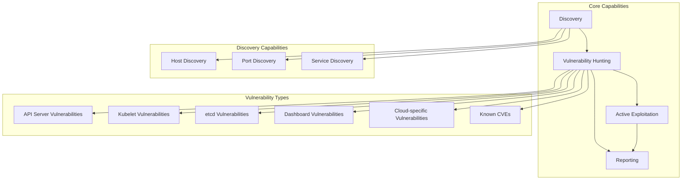
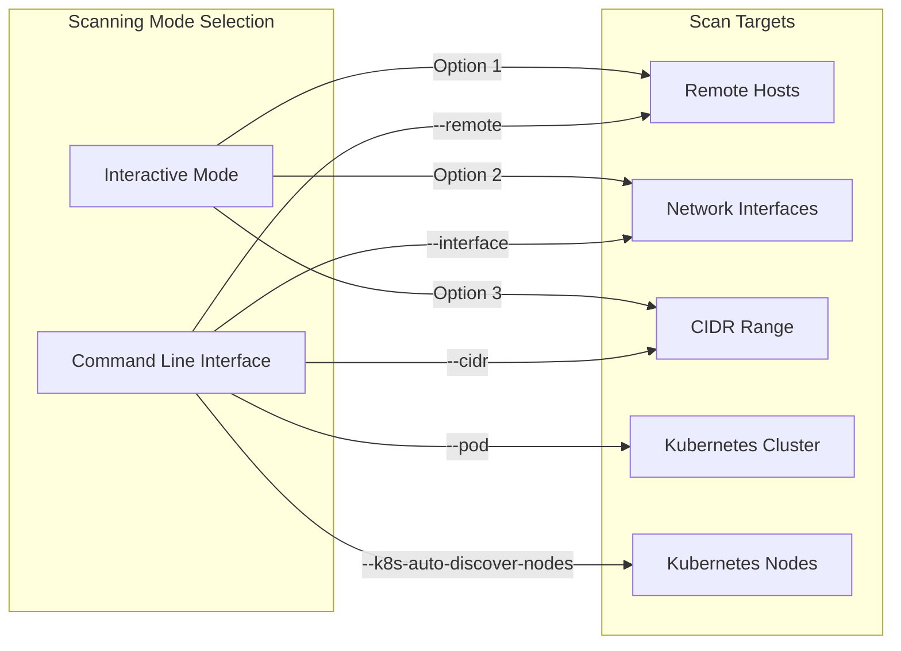
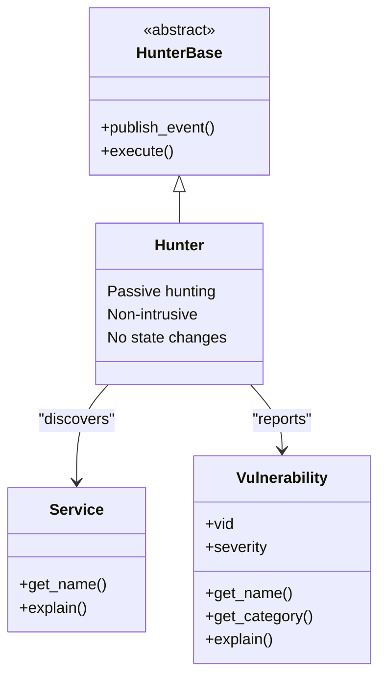
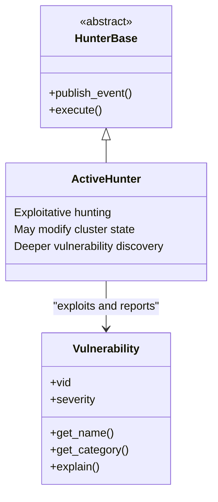
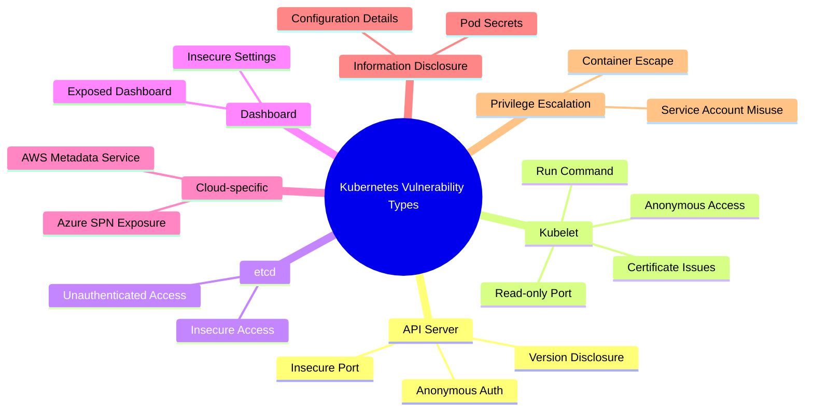
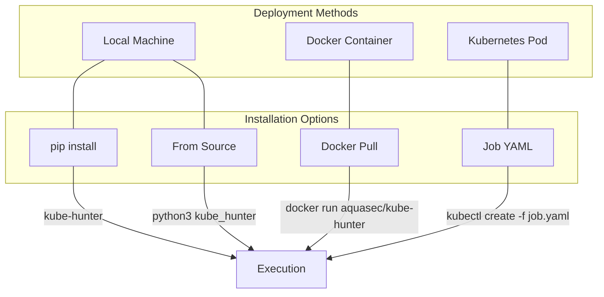

# Features and Capabilities

<details>
<summary>Relevant source files</summary>

The following files were used as context for generating this wiki page:

- [README.md](https://github.com/aquasecurity/kube-hunter/blob/bc47f08e/README.md)
- [kube-hunter-screenshot.png](https://github.com/aquasecurity/kube-hunter/blob/bc47f08e/kube-hunter-screenshot.png)
- [kube-hunter.png](https://github.com/aquasecurity/kube-hunter/blob/bc47f08e/kube-hunter.png)
- [kube-hunter.py](https://github.com/aquasecurity/kube-hunter/blob/bc47f08e/kube-hunter.py)
- [setup.cfg](https://github.com/aquasecurity/kube-hunter/blob/bc47f08e/setup.cfg)

</details>


This page provides an overview of kube-hunter's capabilities, including its scanning modes, vulnerability detection methods, and deployment options. For installation instructions, see [Installation and Setup](#1.1), and for details on the internal architecture, refer to [Architecture](#2).

## Core Capabilities

kube-hunter is a security assessment tool designed to discover weaknesses in Kubernetes clusters. It operates through a systematic approach of discovery, vulnerability hunting, and reporting, all managed by an event-driven system.



Sources: [README.md:5-10](https://github.com/aquasecurity/kube-hunter/blob/bc47f08e/README.md#L5-L10), [kube-hunter.py:102-110](https://github.com/aquasecurity/kube-hunter/blob/bc47f08e/kube-hunter.py#L102-L110)

## Scanning Modes

kube-hunter offers multiple scanning modes to facilitate different security assessment approaches:

| Mode | Description | Flag | Use Case |
|------|-------------|------|----------|
| Remote | Scans specific IP addresses or domains | `--remote` | External penetration testing |
| Interface | Scans subnets on all local network interfaces | `--interface` | Internal network scanning |
| CIDR | Scans a given IP range | `--cidr` | Network segment assessment |
| Pod | Runs from within a Kubernetes pod | `--pod` | Understanding internal attack surface |
| K8s Auto-discovery | Auto-discovers nodes via Kubernetes API | `--k8s-auto-discover-nodes` | Comprehensive cluster scanning |



Sources: [README.md:54-90](https://github.com/aquasecurity/kube-hunter/blob/bc47f08e/README.md#L54-L90), [kube-hunter.py:52-76](https://github.com/aquasecurity/kube-hunter/blob/bc47f08e/kube-hunter.py#L52-L76)

### Where to Run kube-hunter

kube-hunter can be executed from different perspectives to provide varied security insights:

1. **External Perspective**: Run from outside the cluster (e.g., your laptop) to simulate an external attacker's view
2. **Host Perspective**: Run on a cluster host machine to assess local network exposure
3. **Pod Perspective**: Run as a pod within the cluster to simulate a compromised container scenario

Each perspective offers unique insights into the cluster's security posture and potential attack vectors.

Sources: [README.md:54-63](https://github.com/aquasecurity/kube-hunter/blob/bc47f08e/README.md#L54-L63)

## Hunting Capabilities

kube-hunter employs a two-tiered approach to vulnerability hunting:

### Passive Hunting

Passive hunting identifies vulnerabilities without attempting exploitation or making state changes to the cluster. This is the default mode and is suitable for production environments.



Sources: [README.md:106-112](https://github.com/aquasecurity/kube-hunter/blob/bc47f08e/README.md#L106-L112), [kube-hunter.py:79-85](https://github.com/aquasecurity/kube-hunter/blob/bc47f08e/kube-hunter.py#L79-L85)

### Active Hunting

Active hunting enables kube-hunter to exploit vulnerabilities it finds to uncover further security issues. This mode can potentially modify cluster state and should be used with caution.



To enable active hunting, use the `--active` flag:

```
kube-hunter --remote some.domain.com --active
```

Sources: [README.md:106-112](https://github.com/aquasecurity/kube-hunter/blob/bc47f08e/README.md#L106-L112), [kube-hunter.py:87-93](https://github.com/aquasecurity/kube-hunter/blob/bc47f08e/kube-hunter.py#L87-L93)

## Vulnerability Categories

kube-hunter detects various types of Kubernetes vulnerabilities, organized according to the Kubernetes ATT&CK Matrix:



Each detected vulnerability is associated with a Vulnerability ID (VID) that can be referenced in the kube-hunter knowledge base for detailed information.

Sources: [README.md:41-51](https://github.com/aquasecurity/kube-hunter/blob/bc47f08e/README.md#L41-L51), [README.md:10-11](https://github.com/aquasecurity/kube-hunter/blob/bc47f08e/README.md#L10-L11)

## Additional Features

### Authentication Options

By default, kube-hunter requires no authentication to simulate an attacker in early stages, but it provides options for authenticated scanning:

- **Service Account Token**: Provide a specific JWT bearer token with the `--service-account-token` flag
- **Pod Authentication**: When running with the `--pod` flag, uses the mounted service account token

Sources: [README.md:92-103](https://github.com/aquasecurity/kube-hunter/blob/bc47f08e/README.md#L92-L103)

### Node Mapping

For reconnaissance without full vulnerability scanning, use the `--mapping` option to display a network map of Kubernetes nodes:

```
kube-hunter --cidr 192.168.0.0/24 --mapping
```

Sources: [README.md:121-124](https://github.com/aquasecurity/kube-hunter/blob/bc47f08e/README.md#L121-L124)

### Custom Hunting

Advanced users can specify which hunter modules to use with the `--custom` flag, providing granular control over the scanning process:

```
kube-hunter --custom <HunterName1> <HunterName2>
```

To view available hunter names:

```
kube-hunter --active --list --raw-hunter-names
```

Sources: [README.md:147-183](https://github.com/aquasecurity/kube-hunter/blob/bc47f08e/README.md#L147-L183)

### Cloud Environment Support

When running in Azure or AWS environments, kube-hunter can automatically fetch subnet information from the Instance Metadata Service. The `--quick` flag can be used to limit subnet scanning to a `/24` CIDR for faster execution.

Sources: [README.md:147-150](https://github.com/aquasecurity/kube-hunter/blob/bc47f08e/README.md#L147-L150)

## Deployment Options

kube-hunter offers multiple deployment methods to accommodate different operational needs:



| Method | Description | Advantages |
|--------|-------------|------------|
| Local Machine | Run on your workstation | Simple setup, direct access to results |
| Container | Run as a Docker container | Isolated environment, no dependency conflicts |
| Pod | Deploy directly in cluster | Assess internal attack surface |

Sources: [README.md:188-254](https://github.com/aquasecurity/kube-hunter/blob/bc47f08e/README.md#L188-L254)

## Output and Reporting

kube-hunter provides flexible reporting options to integrate with different workflows:

### Log Levels

Control verbosity with the `--log` option:
- `DEBUG`: Detailed debugging information
- `INFO`: Default level with standard information
- `WARNING`: Only warning messages

### Report Formats

Specify output format with the `--report` option (default format is plain text).

### Dispatching Methods

Control where reports are sent with the `--dispatch` option:
- `stdout`: Default, prints to terminal
- `http`: Sends to configurable HTTP endpoint

Configuration for HTTP dispatch is managed through environment variables:
- `KUBEHUNTER_HTTP_DISPATCH_URL` (defaults to https://localhost)
- `KUBEHUNTER_HTTP_DISPATCH_METHOD` (defaults to POST)

Sources: [README.md:126-144](https://github.com/aquasecurity/kube-hunter/blob/bc47f08e/README.md#L126-L144), [kube-hunter.py:47-49](https://github.com/aquasecurity/kube-hunter/blob/bc47f08e/kube-hunter.py#L47-L49)

## Kubernetes ATT&CK Matrix Integration

kube-hunter's vulnerabilities map to the Kubernetes ATT&CK Matrix, providing a standardized framework for understanding discovered vulnerabilities in the context of common attack techniques.

This integration allows security teams to categorize findings according to industry-standard attack patterns and develop appropriate mitigation strategies.