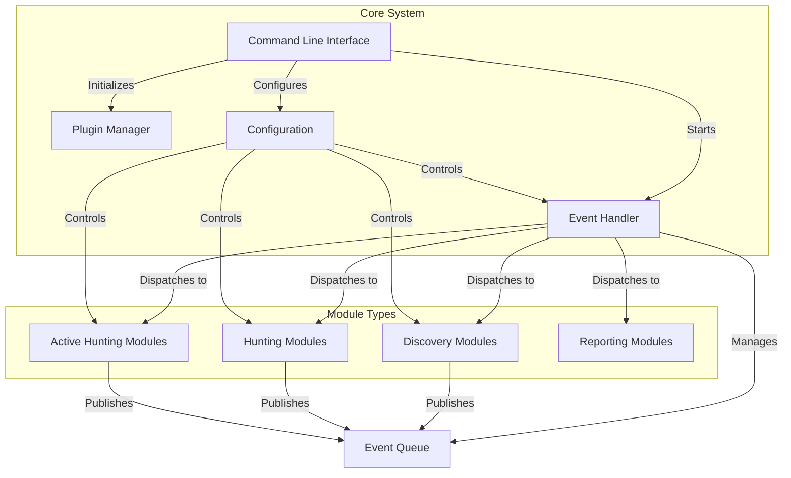
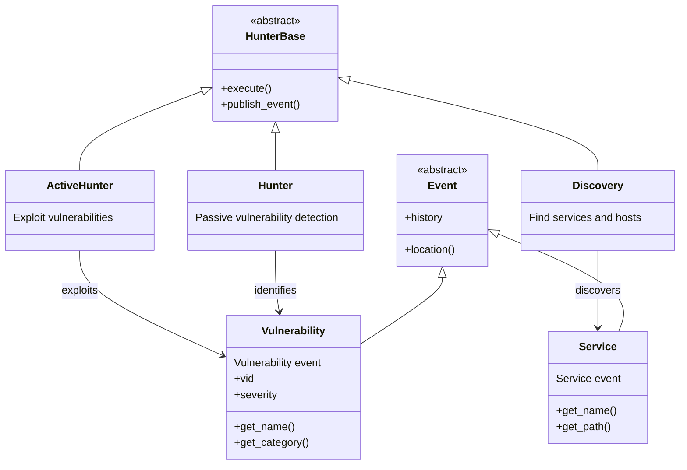
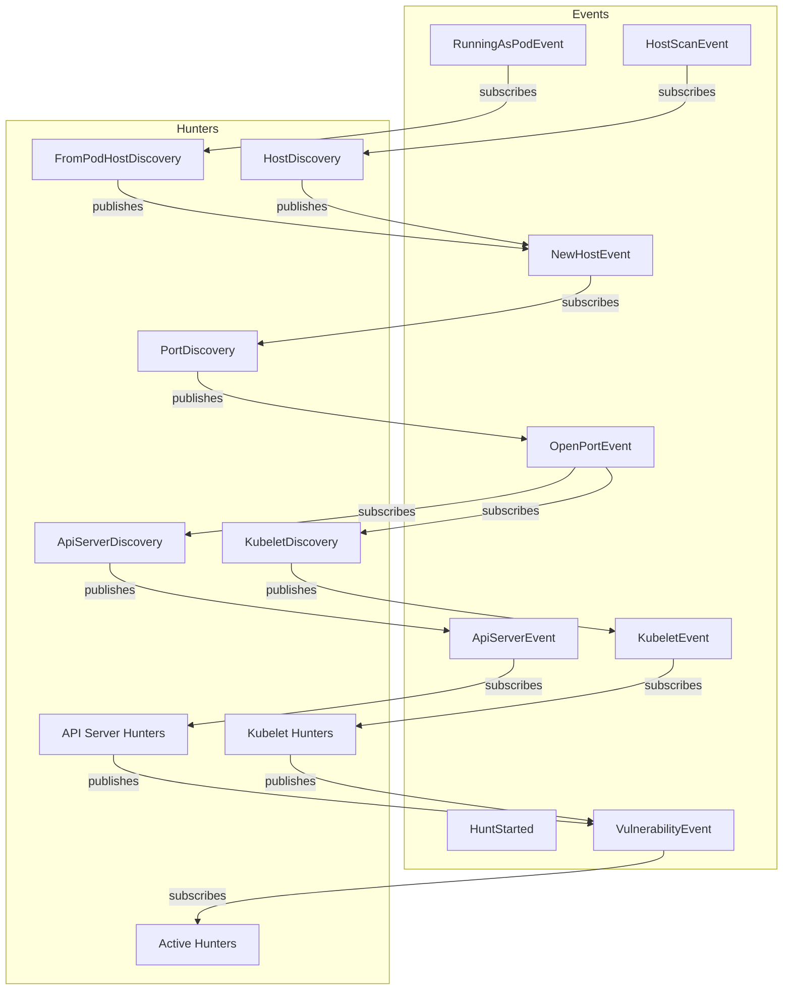

# Architecture

Relevant source files

The following files were used as context for generating this wiki page:

- [kube-hunter.py](https://github.com/aquasecurity/kube-hunter/blob/bc47f08e/kube-hunter.py)
- [kube_hunter/README.md](https://github.com/aquasecurity/kube-hunter/blob/bc47f08e/kube_hunter/README.md)
- [kube_hunter/__init__.py](https://github.com/aquasecurity/kube-hunter/blob/bc47f08e/kube_hunter/__init__.py)
- [kube_hunter/__main__.py](https://github.com/aquasecurity/kube-hunter/blob/bc47f08e/kube_hunter/__main__.py)
- [kube_hunter/conf/__init__.py](https://github.com/aquasecurity/kube-hunter/blob/bc47f08e/kube_hunter/conf/__init__.py)
- [kube_hunter/conf/parser.py](https://github.com/aquasecurity/kube-hunter/blob/bc47f08e/kube_hunter/conf/parser.py)
- [kube_hunter/modules/discovery/__init__.py](https://github.com/aquasecurity/kube-hunter/blob/bc47f08e/kube_hunter/modules/discovery/__init__.py)
- [kube_hunter/modules/report/dispatchers.py](https://github.com/aquasecurity/kube-hunter/blob/bc47f08e/kube_hunter/modules/report/dispatchers.py)
- [tests/core/test_cloud.py](https://github.com/aquasecurity/kube-hunter/blob/bc47f08e/tests/core/test_cloud.py)

This document details the high-level architecture of kube-hunter, explaining the core components, their relationships, and how they interact to discover and identify security weaknesses in Kubernetes clusters. For information on running kube-hunter, see [Overview](#1) and for details on how to extend it, see [Development Guide](#8).

## Core Architecture Components

kube-hunter uses an event-driven architecture to coordinate the discovery, hunting, and reporting of potential security vulnerabilities in Kubernetes clusters. The system is composed of several key components that work together through an event propagation mechanism.

Sources: [kube-hunter.py:42-46](https://github.com/aquasecurity/kube-hunter/blob/bc47f08e/kube-hunter.py#L42-L46), [kube_hunter/__main__.py:42-46](https://github.com/aquasecurity/kube-hunter/blob/bc47f08e/kube_hunter/__main__.py#L42-L46), [kube_hunter/conf/__init__.py:9-52](https://github.com/aquasecurity/kube-hunter/blob/bc47f08e/kube_hunter/conf/__init__.py#L9-L52)

### Event Handler

The Event Handler is the central component that manages the flow of events throughout the system. It maintains an event queue and dispatches events to the appropriate subscribed Hunter modules.

Key attributes:
- Maintains a queue of events
- Provides the `publish_event` method for modules to generate new events
- Dispatches events to subscribed hunters
- Ensures thread-safe event processing
- Controls how many worker threads are used for processing events

Sources: [kube-hunter.py:42-43](https://github.com/aquasecurity/kube-hunter/blob/bc47f08e/kube-hunter.py#L42-L43), [kube-hunter.py:96-137](https://github.com/aquasecurity/kube-hunter/blob/bc47f08e/kube-hunter.py#L96-L137), [kube_hunter/__main__.py:42-43](https://github.com/aquasecurity/kube-hunter/blob/bc47f08e/kube_hunter/__main__.py#L42-L43), [kube_hunter/__main__.py:96-137](https://github.com/aquasecurity/kube-hunter/blob/bc47f08e/kube_hunter/__main__.py#L96-L137)

### Configuration System

The Configuration System centralizes all settings that control kube-hunter's behavior. It's implemented as the `Config` class which is initialized from command-line arguments and made globally accessible.

Key configuration settings:
- Scanning mode (remote, interface, CIDR, pod, k8s auto-discovery)
- Active hunting enablement
- Network timeout
- Number of worker threads
- Reporting format and destination
- CVE hunting enablement
- Custom hunter specification

Sources: [kube_hunter/conf/__init__.py:9-52](https://github.com/aquasecurity/kube-hunter/blob/bc47f08e/kube_hunter/conf/__init__.py#L9-L52), [kube_hunter/conf/parser.py:5-159](https://github.com/aquasecurity/kube-hunter/blob/bc47f08e/kube_hunter/conf/parser.py#L5-L159)

### Plugin Manager

The Plugin Manager enables extensibility by loading plugins that can modify kube-hunter's behavior. It supports hooks for:
- Adding command-line arguments
- Loading custom functionality before execution

Sources: [kube-hunter.py:12-40](https://github.com/aquasecurity/kube-hunter/blob/bc47f08e/kube-hunter.py#L12-L40), [kube_hunter/__main__.py:12-40](https://github.com/aquasecurity/kube-hunter/blob/bc47f08e/kube_hunter/__main__.py#L12-L40)

## Event Flow Architecture

kube-hunter operates using an event-driven workflow where discoveries trigger further investigations in a chain-like manner.

```mermaid
flowchart LR
    subgraph "Initialization"
        HuntStarted["HuntStarted Event"]
        InitialEvents["HostScanEvent/RunningAsPodEvent"]
    end
    
    subgraph "Discovery Phase"
        HostDiscovery["Host Discovery"]
        PortDiscovery["Port Discovery"]
        ServiceDiscovery["Service Discovery"]
    end
    
    subgraph "Hunting Phase"
        VulnerabilityHunting["Vulnerability Detection"]
        ActiveHunting["Active Exploitation\n(if enabled)"]
    end
    
    subgraph "Reporting Phase"
        Collection["Evidence Collection"]
        Reporting["Report Generation"]
    end
    
    HuntStarted --> InitialEvents
    InitialEvents --> HostDiscovery
    HostDiscovery -->|"NewHostEvent"| PortDiscovery
    PortDiscovery -->|"OpenPortEvent"| ServiceDiscovery
    ServiceDiscovery -->|"Service Events\n(ApiServer, Kubelet, etc.)"| VulnerabilityHunting
    VulnerabilityHunting -->|"Vulnerability Events"| ActiveHunting
    VulnerabilityHunting -->|"Vulnerability Events"| Collection
    ActiveHunting -->|"Exploitation Results"| Collection
    Collection --> Reporting
```

Sources: [kube-hunter.py:117-124](https://github.com/aquasecurity/kube-hunter/blob/bc47f08e/kube-hunter.py#L117-L124), [kube_hunter/__main__.py:117-124](https://github.com/aquasecurity/kube-hunter/blob/bc47f08e/kube_hunter/__main__.py#L117-L124)

### Event Chain Example

To illustrate the flow of events through the system, here is a concrete example of a potential event chain:

1. `HuntStarted` event is published
2. `HostScanEvent` or `RunningAsPodEvent` is published based on scan mode
3. Host Discovery modules find Kubernetes nodes → `NewHostEvent`
4. Port Discovery modules scan for open ports → `OpenPortEvent`
5. Service Discovery modules identify Kubernetes services → `ApiServerEvent`, `KubeletEvent`, etc.
6. Hunters examine services for vulnerabilities → `VulnerabilityEvent`
7. Active Hunters attempt to exploit vulnerabilities (if active mode enabled)
8. Collectors gather all findings
9. Reporters format and output the results

Sources: [kube-hunter.py:100-124](https://github.com/aquasecurity/kube-hunter/blob/bc47f08e/kube-hunter.py#L100-L124), [kube_hunter/__main__.py:100-124](https://github.com/aquasecurity/kube-hunter/blob/bc47f08e/kube_hunter/__main__.py#L100-L124), [kube_hunter/README.md:144-147](https://github.com/aquasecurity/kube-hunter/blob/bc47f08e/kube_hunter/README.md#L144-L147)

## Module Organization

kube-hunter organizes its functionality into specialized modules that each serve a distinct purpose in the security assessment process.

Sources: [kube_hunter/README.md:25-58](https://github.com/aquasecurity/kube-hunter/blob/bc47f08e/kube_hunter/README.md#L25-L58), [kube_hunter/README.md:117-137](https://github.com/aquasecurity/kube-hunter/blob/bc47f08e/kube_hunter/README.md#L117-L137)

### Discovery Modules

Discovery modules are responsible for finding potential targets for hunting. They operate in three main phases:

1. **Host Discovery**: Finds Kubernetes nodes and cluster components
   - `HostDiscovery`: Discovers hosts in remote/CIDR scanning modes
   - `FromPodHostDiscovery`: Discovers hosts when running as a pod

2. **Port Discovery**: Scans for open ports on discovered hosts
   - `PortDiscovery`: Probes common Kubernetes ports

3. **Service Discovery**: Identifies Kubernetes services based on open ports
   - `ApiServiceDiscovery`: Identifies the Kubernetes API server
   - `KubeletDiscovery`: Identifies the Kubelet service
   - `EtcdDiscovery`: Identifies the etcd key-value store
   - `DashboardDiscovery`: Identifies the Kubernetes dashboard

Sources: [kube_hunter/modules/discovery/__init__.py:1-12](https://github.com/aquasecurity/kube-hunter/blob/bc47f08e/kube_hunter/modules/discovery/__init__.py#L1-L12), [kube_hunter/README.md:66-67](https://github.com/aquasecurity/kube-hunter/blob/bc47f08e/kube_hunter/README.md#L66-L67)

### Hunting Modules

Hunting modules examine discovered services for vulnerabilities. They subscribe to specific service events and look for security issues.

Two types of hunting modules:

1. **Passive Hunters**: Identify vulnerabilities without making changes to the cluster
   - Examine service configurations
   - Check for misconfigurations
   - Detect information disclosure

2. **Active Hunters**: Attempt to exploit vulnerabilities (only run when active mode is enabled)
   - Try to access sensitive information
   - Attempt privilege escalation
   - Prove vulnerabilities through exploitation

Sources: [kube_hunter/README.md:45-55](https://github.com/aquasecurity/kube-hunter/blob/bc47f08e/kube_hunter/README.md#L45-L55), [kube_hunter/README.md:68-69](https://github.com/aquasecurity/kube-hunter/blob/bc47f08e/kube_hunter/README.md#L68-L69), [kube_hunter/README.md:185-187](https://github.com/aquasecurity/kube-hunter/blob/bc47f08e/kube_hunter/README.md#L185-L187)

### Reporting Modules

Reporting modules collect and format the findings. They consist of:

1. **Collectors**: Gather the results of hunting and discovery
2. **Reporters**: Format results in various formats (plain text, JSON, YAML)
3. **Dispatchers**: Send reports to various destinations (stdout, HTTP)

Sources: [kube_hunter/modules/report/dispatchers.py:1-31](https://github.com/aquasecurity/kube-hunter/blob/bc47f08e/kube_hunter/modules/report/dispatchers.py#L1-L31), [kube-hunter.py:48-49](https://github.com/aquasecurity/kube-hunter/blob/bc47f08e/kube-hunter.py#L48-L49), [kube_hunter/__main__.py:48-49](https://github.com/aquasecurity/kube-hunter/blob/bc47f08e/kube_hunter/__main__.py#L48-L49)

## Hunter and Event Relationships

Hunters subscribe to specific events and are triggered when these events occur. This subscription mechanism is the foundation of kube-hunter's event-driven architecture.

Sources: [kube_hunter/README.md:20-23](https://github.com/aquasecurity/kube-hunter/blob/bc47f08e/kube_hunter/README.md#L20-L23), [kube_hunter/README.md:30-42](https://github.com/aquasecurity/kube-hunter/blob/bc47f08e/kube_hunter/README.md#L30-L42), [kube_hunter/README.md:140-147](https://github.com/aquasecurity/kube-hunter/blob/bc47f08e/kube_hunter/README.md#L140-L147)

## Execution Process

1. **Initialization**:
   - Parse command-line arguments
   - Set up configuration
   - Initialize plugin manager
   - Set up event handler

2. **Hunt Start**:
   - Publish `HuntStarted` event
   - Based on configuration, publish either `RunningAsPodEvent` (for pod scanning) or `HostScanEvent` (for other modes)

3. **Discovery and Hunting**:
   - Events flow through the system, triggering hunters
   - Hunters publish new events based on their findings
   - Process continues until all events have been processed

4. **Hunt Completion**:
   - Publish `HuntFinished` event
   - Collect and report findings
   - Clean up resources

Sources: [kube-hunter.py:100-137](https://github.com/aquasecurity/kube-hunter/blob/bc47f08e/kube-hunter.py#L100-L137), [kube_hunter/__main__.py:100-137](https://github.com/aquasecurity/kube-hunter/blob/bc47f08e/kube_hunter/__main__.py#L100-L137)

## Configuration Options

kube-hunter supports multiple scanning modes, each determining how it discovers targets:

1. **Remote Scanning**: Targets specific hosts provided by the user
   - `--remote HOST1 HOST2...`

2. **Interface Scanning**: Scans subnets on all local network interfaces
   - `--interface`

3. **CIDR Scanning**: Scans a given IP range
   - `--cidr 192.168.0.0/24,!192.168.0.5/32`

4. **Pod Scanning**: Runs from within a Kubernetes cluster
   - `--pod`

5. **K8s Auto-Discovery**: Uses the Kubernetes API to find nodes
   - `--k8s-auto-discover-nodes`

Additional options:
- `--active`: Enables active hunting (exploitation)
- `--mapping`: Only maps components without hunting for vulnerabilities
- `--statistics`: Shows hunting statistics
- `--enable-cve-hunting`: Looks for known CVEs
- `--custom`: Limits hunting to specific hunter classes

Sources: [kube_hunter/conf/parser.py:5-142](https://github.com/aquasecurity/kube-hunter/blob/bc47f08e/kube_hunter/conf/parser.py#L5-L142), [kube_hunter/conf/__init__.py:9-52](https://github.com/aquasecurity/kube-hunter/blob/bc47f08e/kube_hunter/conf/__init__.py#L9-L52), [kube-hunter.py:51-76](https://github.com/aquasecurity/kube-hunter/blob/bc47f08e/kube-hunter.py#L51-L76), [kube_hunter/__main__.py:51-76](https://github.com/aquasecurity/kube-hunter/blob/bc47f08e/kube_hunter/__main__.py#L51-L76)

## Summary