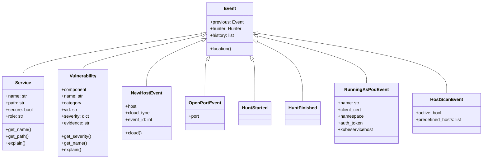
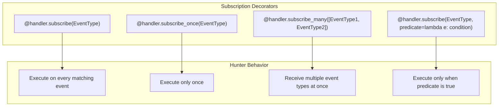
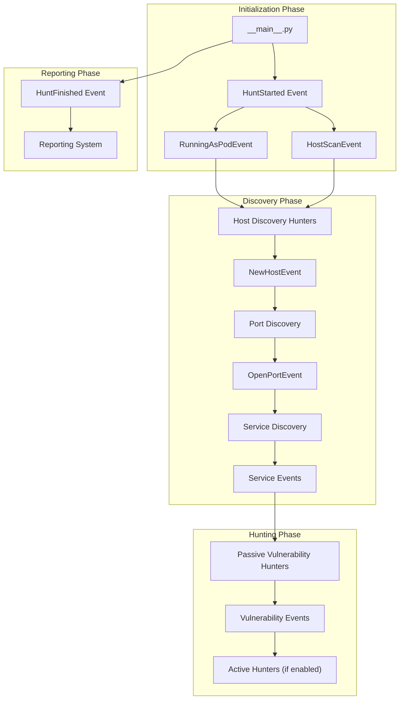
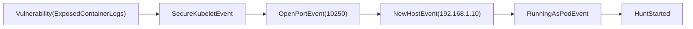

# Event-Driven System

<details>
<summary>Relevant source files</summary>

The following files were used as context for generating this wiki page:

- [kube_hunter/__main__.py](https://github.com/aquasecurity/kube-hunter/blob/bc47f08e/kube_hunter/__main__.py)
- [kube_hunter/conf/__init__.py](https://github.com/aquasecurity/kube-hunter/blob/bc47f08e/kube_hunter/conf/__init__.py)
- [kube_hunter/conf/parser.py](https://github.com/aquasecurity/kube-hunter/blob/bc47f08e/kube_hunter/conf/parser.py)
- [kube_hunter/core/events/types.py](https://github.com/aquasecurity/kube-hunter/blob/bc47f08e/kube_hunter/core/events/types.py)
- [kube_hunter/modules/discovery/hosts.py](https://github.com/aquasecurity/kube-hunter/blob/bc47f08e/kube_hunter/modules/discovery/hosts.py)
- [kube_hunter/modules/hunting/apiserver.py](https://github.com/aquasecurity/kube-hunter/blob/bc47f08e/kube_hunter/modules/hunting/apiserver.py)
- [kube_hunter/modules/hunting/kubelet.py](https://github.com/aquasecurity/kube-hunter/blob/bc47f08e/kube_hunter/modules/hunting/kubelet.py)
- [kube_hunter/modules/hunting/secrets.py](https://github.com/aquasecurity/kube-hunter/blob/bc47f08e/kube_hunter/modules/hunting/secrets.py)
- [kube_hunter/modules/report/dispatchers.py](https://github.com/aquasecurity/kube-hunter/blob/bc47f08e/kube_hunter/modules/report/dispatchers.py)
- [tests/core/test_subscribe.py](https://github.com/aquasecurity/kube-hunter/blob/bc47f08e/tests/core/test_subscribe.py)
- [tests/hunting/test_kubelet.py](https://github.com/aquasecurity/kube-hunter/blob/bc47f08e/tests/hunting/test_kubelet.py)

</details>


## Purpose and Overview

The event-driven system is the core orchestration mechanism in kube-hunter that coordinates the entire vulnerability hunting process. This page explains how the system works and how different components interact to discover and identify vulnerabilities in Kubernetes clusters.

Key functions of the event-driven system:
- Manages the flow and sequence of the scanning process
- Decouples discovery components from vulnerability detection
- Enables extensibility through modular hunters
- Tracks relationships between findings through event chains

For information about the specific hunter modules that leverage this system, see [Module Organization](#2.2).

## Core Components

### Event Class Hierarchy

All events in kube-hunter inherit from the base `Event` class defined in `kube_hunter/core/events/types.py`. This class provides fundamental properties like history tracking and location reporting.



Sources: [kube_hunter/core/events/types.py:48-80](https://github.com/aquasecurity/kube-hunter/blob/bc47f08e/kube_hunter/core/events/types.py#L48-L80), [kube_hunter/core/events/types.py:96-116](https://github.com/aquasecurity/kube-hunter/blob/bc47f08e/kube_hunter/core/events/types.py#L96-L116), [kube_hunter/core/events/types.py:119-172](https://github.com/aquasecurity/kube-hunter/blob/bc47f08e/kube_hunter/core/events/types.py#L119-L172), [kube_hunter/modules/discovery/hosts.py:21-49](https://github.com/aquasecurity/kube-hunter/blob/bc47f08e/kube_hunter/modules/discovery/hosts.py#L21-L49), [kube_hunter/modules/discovery/hosts.py:82-88](https://github.com/aquasecurity/kube-hunter/blob/bc47f08e/kube_hunter/modules/discovery/hosts.py#L82-L88)

### Event Handler

The event handler (`handler` from `kube_hunter.core.events.event_handler`) is a central component that manages event subscriptions and publications. This singleton object is imported throughout the codebase:

```python
from kube_hunter.core.events.event_handler import handler
```

The handler provides methods for:
- Registering hunters to respond to specific events
- Publishing events to trigger corresponding hunters
- Managing asynchronous event processing through a thread pool

Sources: [kube_hunter/__main__.py:42](https://github.com/aquasecurity/kube-hunter/blob/bc47f08e/kube_hunter/__main__.py#L42), [kube_hunter/modules/discovery/hosts.py:14](https://github.com/aquasecurity/kube-hunter/blob/bc47f08e/kube_hunter/modules/discovery/hosts.py#L14), [kube_hunter/modules/hunting/kubelet.py:12](https://github.com/aquasecurity/kube-hunter/blob/bc47f08e/kube_hunter/modules/hunting/kubelet.py#L12)

## Event Subscription System

The event handler provides several subscription mechanisms that allow hunters to respond to specific events.



Sources: [tests/core/test_subscribe.py:34-72](https://github.com/aquasecurity/kube-hunter/blob/bc47f08e/tests/core/test_subscribe.py#L34-L72), [kube_hunter/modules/hunting/apiserver.py:375-386](https://github.com/aquasecurity/kube-hunter/blob/bc47f08e/kube_hunter/modules/hunting/apiserver.py#L375-L386)

### Subscription Examples

Regular subscription (executed for every matching event):

```python
@handler.subscribe(ReadOnlyKubeletEvent)
class ReadOnlyKubeletPortHunter(Hunter):
    """Kubelet Readonly Ports Hunter
    Hunts specific endpoints on open ports in the readonly Kubelet server
    """
    def __init__(self, event):
        self.event = event
        # Initialize hunter...
    
    def execute(self):
        # Perform hunting logic...
```

Source: [kube_hunter/modules/hunting/kubelet.py:240-299]()

Conditional subscription (only executed when predicate is true):

```python
@handler.subscribe(ApiServer, predicate=lambda x: x.auth_token)
class AccessApiServerWithToken(AccessApiServer):
    """API Server Hunter
    Accessing the API server using the service account token obtained from a compromised pod
    """
    def __init__(self, event):
        super().__init__(event)
        assert self.event.auth_token
        self.headers = {"Authorization": f"Bearer {self.event.auth_token}"}
        self.category = AccessK8sApiServerTechnique
        self.with_token = True
```

Source: [kube_hunter/modules/hunting/apiserver.py:375-386]()

## Event Flow

The overall event flow in kube-hunter follows a structured sequence from initialization to reporting:



Sources: [kube_hunter/__main__.py:100-137](https://github.com/aquasecurity/kube-hunter/blob/bc47f08e/kube_hunter/__main__.py#L100-L137), [kube_hunter/modules/discovery/hosts.py:115-331](https://github.com/aquasecurity/kube-hunter/blob/bc47f08e/kube_hunter/modules/discovery/hosts.py#L115-L331)

### Hunt Initialization

The hunting process begins in `__main__.py` with the creation of initial events:

```python
handler.publish_event(HuntStarted())
if config.pod:
    handler.publish_event(RunningAsPodEvent())
else:
    handler.publish_event(HostScanEvent())
```

Source: [kube_hunter/__main__.py:113-121]()

### Discovery Phase

The discovery phase involves finding hosts, ports, and services:

```python
@handler.subscribe(RunningAsPodEvent)
class FromPodHostDiscovery(Discovery):
    """Host Discovery when running as pod
    Generates ip adresses to scan, based on cluster/scan type
    """
    def execute(self):
        # ...discover hosts and publish events
        for host in list_all_k8s_cluster_nodes(config.kubeconfig):
            self.publish_event(NewHostEvent(host=host))
```

Source: [kube_hunter/modules/discovery/hosts.py:115-156]()

This triggers port scanning and service discovery, creating a chain of events that feed into the vulnerability hunting phase.

### Hunting Phase

Vulnerability hunters subscribe to service events and check for security issues:

```python
@handler.subscribe(SecureKubeletEvent)
class SecureKubeletPortHunter(Hunter):
    """Kubelet Secure Ports Hunter
    Hunts specific endpoints on an open secured Kubelet
    """
    def execute(self):
        if self.event.anonymous_auth:
            self.publish_event(AnonymousAuthEnabled())
        # ...check for other vulnerabilities
```

Source: [kube_hunter/modules/hunting/kubelet.py:302-464]()

When in active mode, active hunters can exploit discovered vulnerabilities:

```python
@handler.subscribe(AnonymousAuthEnabled)
class ProveAnonymousAuth(ActiveHunter):
    """Foothold Via Secure Kubelet Port
    Attempts to demonstrate that a malicious actor can establish foothold into the cluster
    """
    def execute(self):
        # ...attempt to exploit the vulnerability
```

Source: [kube_hunter/modules/hunting/kubelet.py:523-653]()

## Event History Tracking

Each event maintains a reference to its "parent" event via the `previous` attribute, creating a chain that traces the discovery path:

```python
@property
def history(self):
    previous, history = self.previous, list()
    while previous:
        history.append(previous)
        previous = previous.previous
    return history
```

Source: [kube_hunter/core/events/types.py:72-79]()

This event chain provides valuable context for vulnerability reports:



Source: [kube_hunter/core/events/types.py:48-80]()

## Event Location Tracking

Events provide a `location()` method that helps identify where a vulnerability was found:

```python
def location(self):
    if self.host:
        location = str(self.host) + ":" + str(self.port)
    else:
        location = str(self.port)
    return location
```

Source: [kube_hunter/core/events/types.py:225-232]()

If an event doesn't implement `location()`, it inherits the location from its parent event, ensuring that all vulnerabilities have a proper location context.

## Practical Example

Let's trace a complete event flow through the system:

1. Main program initiates the hunt:
   ```python
   handler.publish_event(HuntStarted())
   handler.publish_event(RunningAsPodEvent())  # If running as pod
   ```
   Source: [kube_hunter/__main__.py:117-119]()

2. Pod-based host discovery finds cluster nodes:
   ```python
   # In FromPodHostDiscovery.execute()
   for host in list_all_k8s_cluster_nodes(config.kubeconfig):
       self.publish_event(NewHostEvent(host=host))
   ```
   Source: [kube_hunter/modules/discovery/hosts.py:127-128]()

3. Port scanning discovers an open kubelet port:
   ```python
   # In some port discovery hunter
   self.publish_event(OpenPortEvent(port=10250))
   ```

4. Service discovery identifies it as a kubelet:
   ```python
   # In kubelet discovery
   self.publish_event(SecureKubeletEvent(host=host, port=port))
   ```

5. Kubelet hunter checks for vulnerabilities:
   ```python
   # In SecureKubeletPortHunter.execute()
   if self.event.anonymous_auth:
       self.publish_event(AnonymousAuthEnabled())
   ```
   Source: [kube_hunter/modules/hunting/kubelet.py:455-456]()

6. Active hunter attempts to exploit vulnerability:
   ```python
   # In ProveAnonymousAuth.execute()
   if self.has_no_error_nor_exception(service_account_token):
       # Successfully exploited
       self.publish_event(ExposedExistingPrivilegedContainersViaSecureKubeletPort(...))
   ```
   Source: [kube_hunter/modules/hunting/kubelet.py:578-582]()

7. Hunt finishes and results are reported:
   ```python
   handler.publish_event(HuntFinished())
   ```
   Source: [kube_hunter/__main__.py:134]()

## Conclusion

The event-driven system is the backbone of kube-hunter, enabling its modular and extensible architecture. Events represent discoveries and findings, while hunters subscribe to specific event types to perform targeted security checks.

Key takeaways:
- Events form a chain that tracks the path from discovery to vulnerability
- Hunters use decorators to subscribe to specific event types
- The system supports different subscription mechanisms for flexibility
- Event processing is asynchronous, using a thread pool for efficiency

For information on how to create new hunters that leverage this event system, see [Creating New Hunters](#8.1).