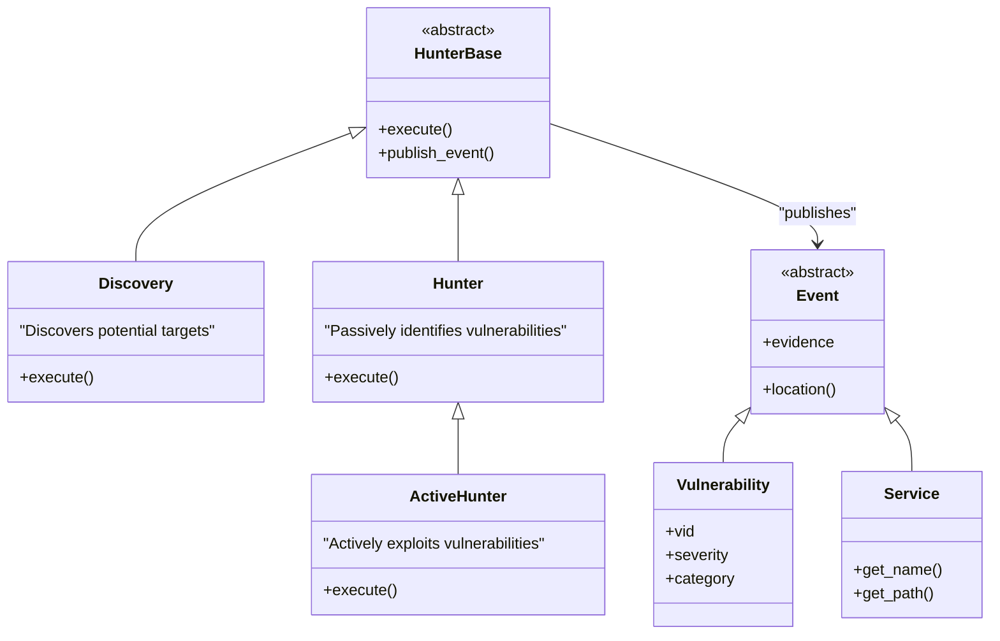
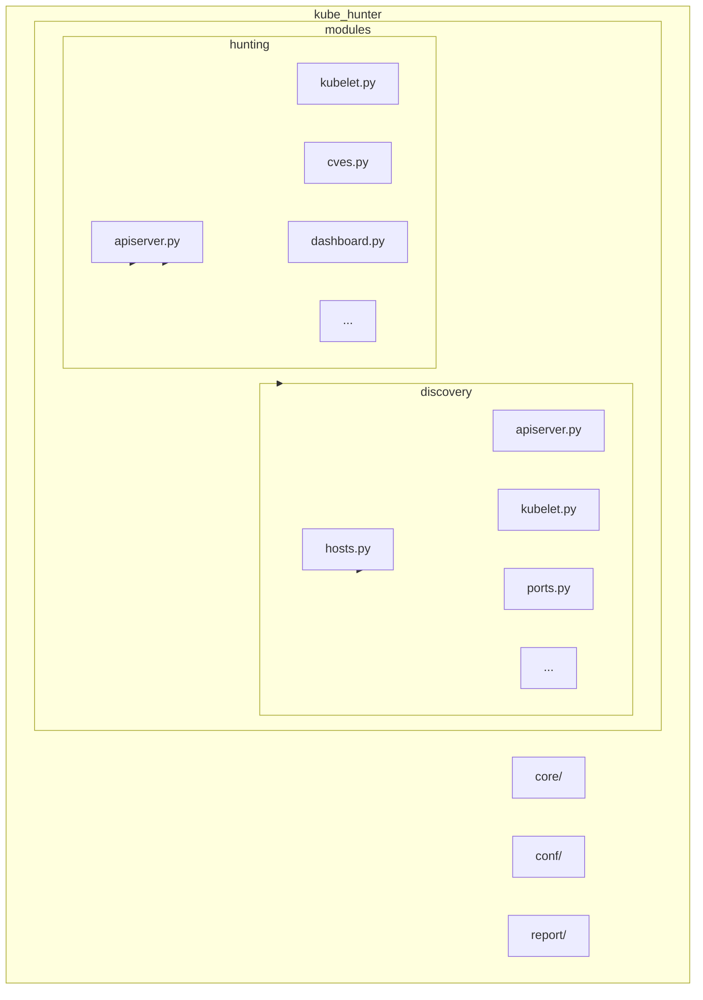
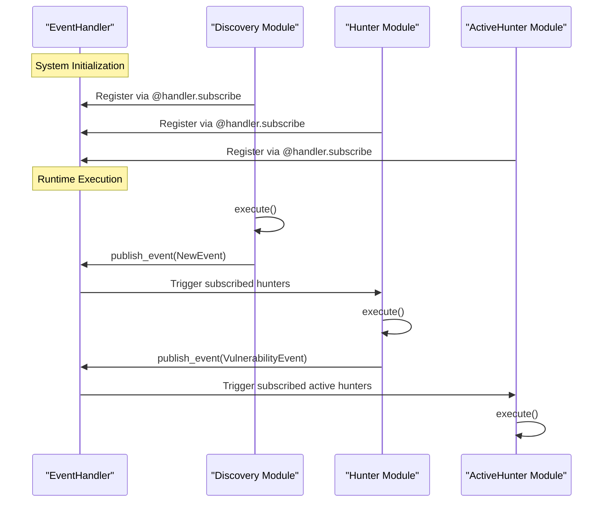
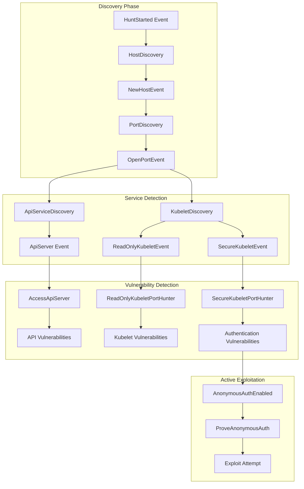
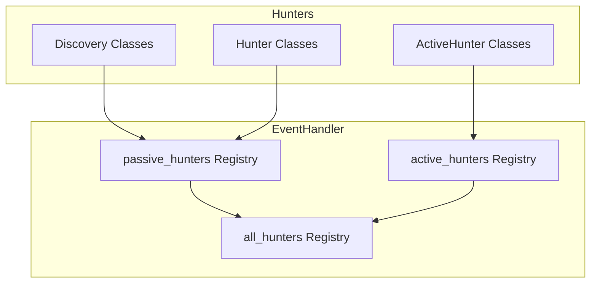

# Module Organization

<details>
<summary>Relevant source files</summary>

The following files were used as context for generating this wiki page:

- [.flake8](https://github.com/aquasecurity/kube-hunter/blob/bc47f08e/.flake8)
- [CONTRIBUTING.md](https://github.com/aquasecurity/kube-hunter/blob/bc47f08e/CONTRIBUTING.md)
- [Dockerfile](https://github.com/aquasecurity/kube-hunter/blob/bc47f08e/Dockerfile)
- [kube_hunter/conf/logging.py](https://github.com/aquasecurity/kube-hunter/blob/bc47f08e/kube_hunter/conf/logging.py)
- [kube_hunter/modules/discovery/hosts.py](https://github.com/aquasecurity/kube-hunter/blob/bc47f08e/kube_hunter/modules/discovery/hosts.py)
- [kube_hunter/modules/hunting/__init__.py](https://github.com/aquasecurity/kube-hunter/blob/bc47f08e/kube_hunter/modules/hunting/__init__.py)
- [kube_hunter/modules/hunting/apiserver.py](https://github.com/aquasecurity/kube-hunter/blob/bc47f08e/kube_hunter/modules/hunting/apiserver.py)
- [kube_hunter/modules/hunting/kubelet.py](https://github.com/aquasecurity/kube-hunter/blob/bc47f08e/kube_hunter/modules/hunting/kubelet.py)
- [tests/conf/test_logging.py](https://github.com/aquasecurity/kube-hunter/blob/bc47f08e/tests/conf/test_logging.py)
- [tests/core/test_handler.py](https://github.com/aquasecurity/kube-hunter/blob/bc47f08e/tests/core/test_handler.py)
- [tests/hunting/test_kubelet.py](https://github.com/aquasecurity/kube-hunter/blob/bc47f08e/tests/hunting/test_kubelet.py)

</details>


This document explains how kube-hunter is organized into modules for discovery, hunting, and reporting functions. It details the module types, their hierarchical structure, and how they interact through the event-driven system. For more information about the event-driven architecture itself, see [Event-Driven System](#2.1).

## Module Types and Hierarchy

Kube-hunter is organized into several module types, each with a specific purpose in the security scanning process. These modules follow a clear inheritance hierarchy and are organized into different directories by functionality.



Sources: [kube_hunter/modules/hunting/kubelet.py:24-25](https://github.com/aquasecurity/kube-hunter/blob/bc47f08e/kube_hunter/modules/hunting/kubelet.py#L24-L25). [kube_hunter/modules/hunting/apiserver.py:10-11](https://github.com/aquasecurity/kube-hunter/blob/bc47f08e/kube_hunter/modules/hunting/apiserver.py#L10-L11)

### Module Types

Kube-hunter organizes its scanning functionality into distinct module types that handle different aspects of the security assessment process:

| Module Type | Purpose | Base Class | Location |
|-------------|---------|------------|----------|
| Discovery   | Find Kubernetes components and services to scan | `Discovery` | kube_hunter/modules/discovery/ |
| Passive Hunting | Identify vulnerabilities without changing state | `Hunter` | kube_hunter/modules/hunting/ |
| Active Hunting | Attempt to exploit vulnerabilities | `ActiveHunter` | kube_hunter/modules/hunting/ |
| Reporting | Collect and format findings | Varies | kube_hunter/modules/report/ |

Sources: [tests/core/test_handler.py:45-86](https://github.com/aquasecurity/kube-hunter/blob/bc47f08e/tests/core/test_handler.py#L45-L86). [kube_hunter/modules/hunting/__init__.py:1-14](https://github.com/aquasecurity/kube-hunter/blob/bc47f08e/kube_hunter/modules/hunting/__init__.py#L1-L14)

## Directory Structure

The module organization is reflected in the directory structure of the codebase:



Sources: [kube_hunter/modules/hunting/__init__.py:1-14](https://github.com/aquasecurity/kube-hunter/blob/bc47f08e/kube_hunter/modules/hunting/__init__.py#L1-L14). [Dockerfile:12-17](https://github.com/aquasecurity/kube-hunter/blob/bc47f08e/Dockerfile#L12-L17)

## Registration and Event-Driven Execution

Kube-hunter uses a decorator-based event subscription system to connect modules. This allows for loose coupling between discovery and hunting modules.



Sources: [kube_hunter/modules/discovery/hosts.py:115-116](https://github.com/aquasecurity/kube-hunter/blob/bc47f08e/kube_hunter/modules/discovery/hosts.py#L115-L116). [kube_hunter/modules/hunting/kubelet.py:240-241](https://github.com/aquasecurity/kube-hunter/blob/bc47f08e/kube_hunter/modules/hunting/kubelet.py#L240-L241). [kube_hunter/modules/hunting/kubelet.py:302-303](https://github.com/aquasecurity/kube-hunter/blob/bc47f08e/kube_hunter/modules/hunting/kubelet.py#L302-L303)

### Event Subscription and Publication

Modules subscribe to events they want to handle and can publish new events as they find information or vulnerabilities:

```python
# Example from kubelet.py
@handler.subscribe(ReadOnlyKubeletEvent)
class ReadOnlyKubeletPortHunter(Hunter):
    """Kubelet Readonly Ports Hunter
    Hunts specific endpoints on open ports in the readonly Kubelet server
    """
    # ... implementation ...
```

Events form the communication backbone for modules, enabling the system to progress from discovery to hunting phases organically.

Sources: [kube_hunter/modules/hunting/kubelet.py:240-241](https://github.com/aquasecurity/kube-hunter/blob/bc47f08e/kube_hunter/modules/hunting/kubelet.py#L240-L241). [kube_hunter/modules/hunting/apiserver.py:278-279](https://github.com/aquasecurity/kube-hunter/blob/bc47f08e/kube_hunter/modules/hunting/apiserver.py#L278-L279)

## Module Interaction Example

To illustrate how modules interact, let's follow a common path in the kube-hunter scanning process:



Sources: [kube_hunter/modules/discovery/hosts.py:334-336](https://github.com/aquasecurity/kube-hunter/blob/bc47f08e/kube_hunter/modules/discovery/hosts.py#L334-L336). [kube_hunter/modules/hunting/kubelet.py:240-241](https://github.com/aquasecurity/kube-hunter/blob/bc47f08e/kube_hunter/modules/hunting/kubelet.py#L240-L241). [kube_hunter/modules/hunting/kubelet.py:302-303](https://github.com/aquasecurity/kube-hunter/blob/bc47f08e/kube_hunter/modules/hunting/kubelet.py#L302-L303). [kube_hunter/modules/hunting/kubelet.py:523-524](https://github.com/aquasecurity/kube-hunter/blob/bc47f08e/kube_hunter/modules/hunting/kubelet.py#L523-L524)

## Passive vs. Active Hunters

Kube-hunter distinguishes between passive hunters (that only detect issues) and active hunters (that attempt to exploit them):

1. **Passive Hunters**: Identify vulnerabilities without changing cluster state
   - Inherit from `Hunter` class
   - Example: `ReadOnlyKubeletPortHunter`, `ApiVersionHunter`

2. **Active Hunters**: Attempt to exploit identified vulnerabilities
   - Inherit from `ActiveHunter` class
   - Only run when active scanning is enabled
   - Example: `ProveAnonymousAuth`, `AccessApiServerActive`

This separation allows users to perform non-intrusive scans by default, with the option to enable more aggressive testing when desired.

Sources: [tests/core/test_handler.py:45-86](https://github.com/aquasecurity/kube-hunter/blob/bc47f08e/tests/core/test_handler.py#L45-L86). [kube_hunter/modules/hunting/kubelet.py:523-529](https://github.com/aquasecurity/kube-hunter/blob/bc47f08e/kube_hunter/modules/hunting/kubelet.py#L523-L529)

## Registration with the Handler

The handler maintains separate registries for each hunter type:



All hunters are registered automatically through the handler's subscription mechanism, which is triggered by the `@handler.subscribe` decorator.

Sources: [tests/core/test_handler.py:93-121](https://github.com/aquasecurity/kube-hunter/blob/bc47f08e/tests/core/test_handler.py#L93-L121)

## Adding New Modules

New modules can be added by creating a new Python file in the appropriate directory and defining hunter classes that:

1. Inherit from the appropriate base class (`Hunter`, `ActiveHunter`, or `Discovery`)
2. Use the `@handler.subscribe` decorator to subscribe to relevant events
3. Implement the `execute()` method to define scanning logic

When contributing new hunters, follow the guidelines in the contribution documentation, which includes getting vulnerability IDs assigned by maintainers.

Sources: [CONTRIBUTING.md:33-39](https://github.com/aquasecurity/kube-hunter/blob/bc47f08e/CONTRIBUTING.md#L33-L39)

## Logging and Configuration

Modules can access logging and configuration through shared utility functions:

```python
# Example of logging setup
import logging
logger = logging.getLogger(__name__)

# Example of configuration access
from kube_hunter.conf import get_config
config = get_config()
```

The logging system is configured centrally and provides consistent formatting across all modules.