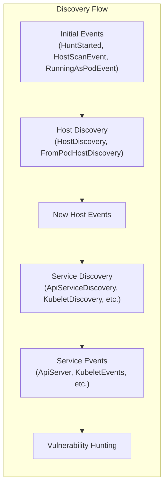
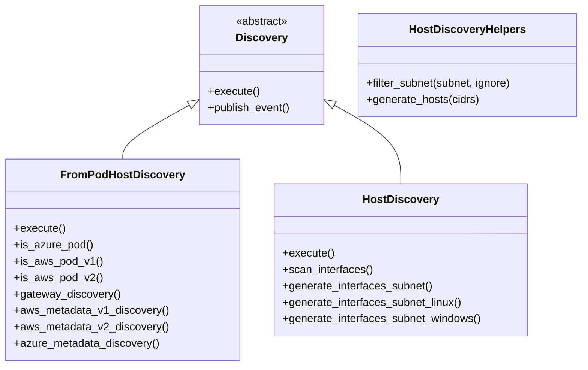
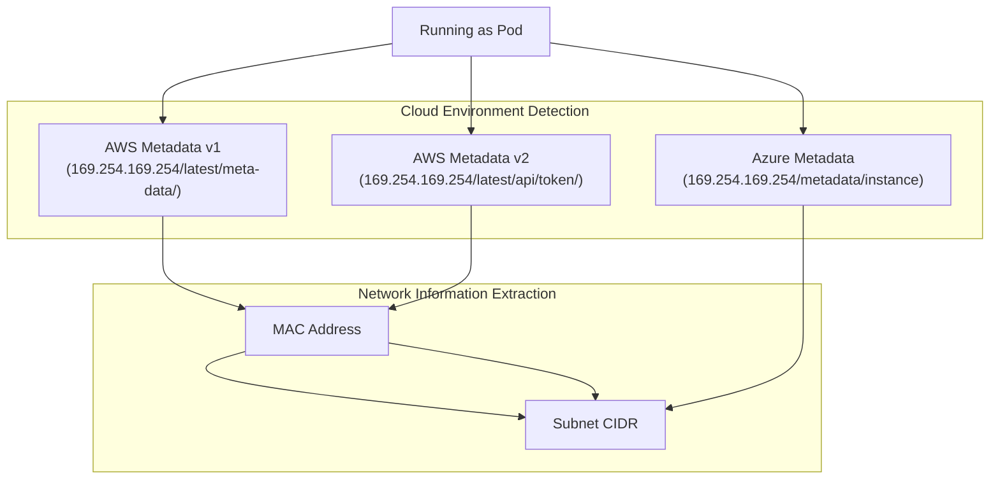
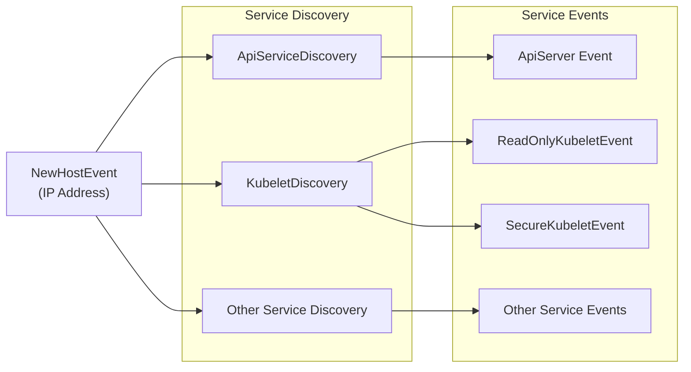
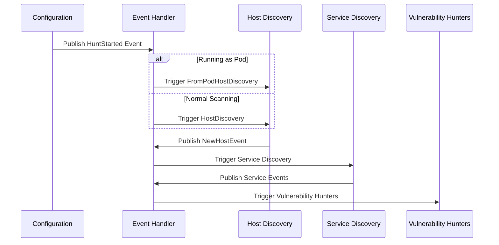
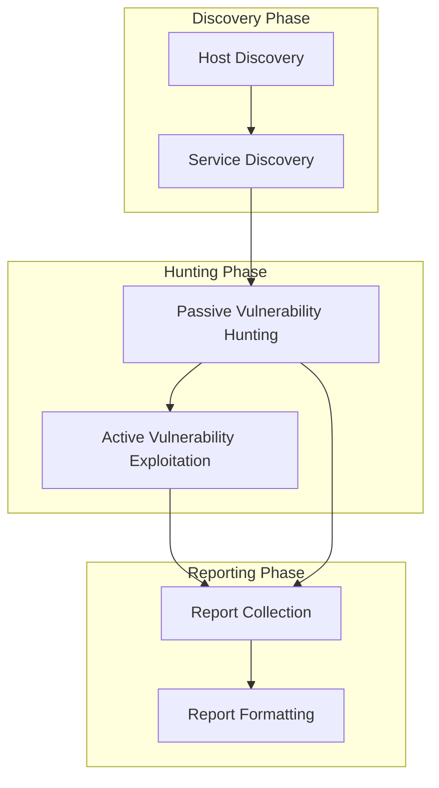

# Discovery System

Relevant source files

The following files were used as context for generating this wiki page:

- [kube_hunter/modules/discovery/hosts.py](https://github.com/aquasecurity/kube-hunter/blob/bc47f08e/kube_hunter/modules/discovery/hosts.py)
- [kube_hunter/modules/hunting/apiserver.py](https://github.com/aquasecurity/kube-hunter/blob/bc47f08e/kube_hunter/modules/hunting/apiserver.py)
- [kube_hunter/modules/hunting/kubelet.py](https://github.com/aquasecurity/kube-hunter/blob/bc47f08e/kube_hunter/modules/hunting/kubelet.py)
- [tests/discovery/test_apiserver.py](https://github.com/aquasecurity/kube-hunter/blob/bc47f08e/tests/discovery/test_apiserver.py)
- [tests/discovery/test_hosts.py](https://github.com/aquasecurity/kube-hunter/blob/bc47f08e/tests/discovery/test_hosts.py)
- [tests/hunting/test_apiserver_hunter.py](https://github.com/aquasecurity/kube-hunter/blob/bc47f08e/tests/hunting/test_apiserver_hunter.py)
- [tests/hunting/test_kubelet.py](https://github.com/aquasecurity/kube-hunter/blob/bc47f08e/tests/hunting/test_kubelet.py)

The Discovery System in kube-hunter is responsible for identifying potential targets in a Kubernetes environment. It represents the initial reconnaissance phase of kube-hunter's operation, locating hosts, pods, and services that may contain vulnerabilities before passing these targets to the hunting system for vulnerability assessment.

For information about how vulnerabilities are detected in discovered targets, see [Vulnerability Hunting](#4).

## Overview

The Discovery System consists of two main components:

1. **Host Discovery**: Identifies network hosts and Kubernetes nodes
2. **Service Discovery**: Identifies Kubernetes services like API Server, Kubelet, etcd, etc.

The discovery process works by generating events that trigger hunters, which can then discover more components or identify vulnerabilities.

Sources: [kube_hunter/modules/discovery/hosts.py:116-168](https://github.com/aquasecurity/kube-hunter/blob/bc47f08e/kube_hunter/modules/discovery/hosts.py#L116-L168), [kube_hunter/modules/discovery/hosts.py:334-356](https://github.com/aquasecurity/kube-hunter/blob/bc47f08e/kube_hunter/modules/discovery/hosts.py#L334-L356)

## Host Discovery Methods

Kube-hunter can discover hosts through multiple methods, depending on how and where it's deployed:

| Method | Description | Trigger |
|--------|-------------|---------|
| Pod Discovery | Discovers hosts when running as a pod within the cluster | `RunningAsPodEvent` |
| Interface Scanning | Scans all network interfaces on the machine | `HostScanEvent` with `--interface` flag |
| CIDR Scanning | Scans all hosts in a specified CIDR range | `HostScanEvent` with `--cidr` flag |
| Remote Host Scanning | Scans specific hosts provided as input | `HostScanEvent` with `--remote` flag |
| K8s Node Auto-discovery | Uses the Kubernetes API to find nodes | `HostScanEvent` with `--k8s-auto-discover-nodes` flag |

### Host Discovery Classes

The two primary classes responsible for host discovery are:

Sources: [kube_hunter/modules/discovery/hosts.py:89-112](https://github.com/aquasecurity/kube-hunter/blob/bc47f08e/kube_hunter/modules/discovery/hosts.py#L89-L112), [kube_hunter/modules/discovery/hosts.py:115-331](https://github.com/aquasecurity/kube-hunter/blob/bc47f08e/kube_hunter/modules/discovery/hosts.py#L115-L331), [kube_hunter/modules/discovery/hosts.py:334-419](https://github.com/aquasecurity/kube-hunter/blob/bc47f08e/kube_hunter/modules/discovery/hosts.py#L334-L419)

### Pod-Based Discovery

When running as a pod inside a Kubernetes cluster, kube-hunter uses `FromPodHostDiscovery` which is triggered by `RunningAsPodEvent`. This discovery method:

1. Attempts to read node information from the Kubernetes API using service account tokens
2. Checks for cloud provider metadata to identify cluster subnets
3. Identifies the pod's default gateway as a potential scanning target

`RunningAsPodEvent` collects information such as:
- Service account tokens and certificates
- Namespace information
- Kubernetes service host

Sources: [kube_hunter/modules/discovery/hosts.py:21-49](https://github.com/aquasecurity/kube-hunter/blob/bc47f08e/kube_hunter/modules/discovery/hosts.py#L21-L49), [kube_hunter/modules/discovery/hosts.py:115-168](https://github.com/aquasecurity/kube-hunter/blob/bc47f08e/kube_hunter/modules/discovery/hosts.py#L115-L168)

### Network-Based Discovery

When not running as a pod, kube-hunter uses `HostDiscovery` which is triggered by `HostScanEvent`. This class implements:

1. CIDR-based scanning using `generate_hosts` helper method
2. Interface scanning by enumerating network interfaces
3. Remote host scanning for specified targets
4. Kubernetes node auto-discovery using the API server

The `HostDiscoveryHelpers` class provides subnet generation and filtering capabilities to create lists of IP addresses to scan.

Sources: [kube_hunter/modules/discovery/hosts.py:89-112](https://github.com/aquasecurity/kube-hunter/blob/bc47f08e/kube_hunter/modules/discovery/hosts.py#L89-L112), [kube_hunter/modules/discovery/hosts.py:334-419](https://github.com/aquasecurity/kube-hunter/blob/bc47f08e/kube_hunter/modules/discovery/hosts.py#L334-L419)

## Cloud Environment Detection and Discovery

Kube-hunter includes specialized methods to detect when it's running in common cloud environments and exploit this for additional discovery.

### AWS Metadata Discovery

Kube-hunter implements two methods to discover AWS environment information:

1. **AWS Metadata API v1**: Accesses the legacy metadata service endpoint
   - Retrieves MAC address via `/latest/meta-data/mac`
   - Gets subnet CIDR via `/latest/meta-data/network/interfaces/macs/{mac_address}/subnet-ipv4-cidr-block`

2. **AWS Metadata API v2**: Uses the more secure IMDSv2 with token-based authentication
   - Obtains a token via PUT request
   - Uses token to authenticate subsequent metadata requests
   - Retrieves same information as v1 but with token-based auth

When AWS metadata is successfully accessed, kube-hunter reports an `AWSMetadataApi` vulnerability event indicating potential information exposure.

Sources: [kube_hunter/modules/discovery/hosts.py:157-176](https://github.com/aquasecurity/kube-hunter/blob/bc47f08e/kube_hunter/modules/discovery/hosts.py#L157-L176), [kube_hunter/modules/discovery/hosts.py:244-307](https://github.com/aquasecurity/kube-hunter/blob/bc47f08e/kube_hunter/modules/discovery/hosts.py#L244-L307)

### Azure Metadata Discovery

For Azure environments, kube-hunter:

1. Connects to the Azure metadata endpoint at `169.254.169.254/metadata/instance`
2. Extracts subnet information from network interfaces configuration
3. Publishes an `AzureMetadataApi` vulnerability event if successful

Sources: [kube_hunter/modules/discovery/hosts.py:202-215](https://github.com/aquasecurity/kube-hunter/blob/bc47f08e/kube_hunter/modules/discovery/hosts.py#L202-L215), [kube_hunter/modules/discovery/hosts.py:310-331](https://github.com/aquasecurity/kube-hunter/blob/bc47f08e/kube_hunter/modules/discovery/hosts.py#L310-L331)

### Gateway Discovery

In addition to cloud metadata, kube-hunter attempts to discover the pod's default gateway by:

1. Reading the routing table from the Linux kernel (using PyRoute2)
2. Using the gateway as a potential host to scan

This is particularly useful for identifying the host on which the pod is running.

Sources: [kube_hunter/modules/discovery/hosts.py:221-243](https://github.com/aquasecurity/kube-hunter/blob/bc47f08e/kube_hunter/modules/discovery/hosts.py#L221-L243)

## Service Discovery

Once hosts are discovered, kube-hunter attempts to identify Kubernetes services running on those hosts. The main service discovery components are:

### API Server Discovery

The `ApiServiceDiscovery` hunter identifies Kubernetes API servers by:

1. Attempting connections to common API ports (443 for HTTPS, 8080 for HTTP)
2. Checking for specific API server response patterns
3. Querying the `/version` endpoint to verify Kubernetes version

The discovery generates an `ApiServer` event when successful, which triggers API server vulnerability hunters.

Sources: [tests/discovery/test_apiserver.py:16-42](https://github.com/aquasecurity/kube-hunter/blob/bc47f08e/tests/discovery/test_apiserver.py#L16-L42), [tests/discovery/test_apiserver.py:44-83](https://github.com/aquasecurity/kube-hunter/blob/bc47f08e/tests/discovery/test_apiserver.py#L44-L83), [tests/discovery/test_apiserver.py:86-122](https://github.com/aquasecurity/kube-hunter/blob/bc47f08e/tests/discovery/test_apiserver.py#L86-L122)

### Kubelet Discovery

Kubelet discovery attempts to identify the Kubelet service on nodes by:

1. Connecting to Kubelet ports (10250 for secure, 10255 for read-only)
2. Checking for Kubelet-specific endpoints like `/pods` and `/healthz`

When a Kubelet is discovered, it publishes either:
- `ReadOnlyKubeletEvent`: For the read-only Kubelet port (10255)
- `SecureKubeletEvent`: For the secure Kubelet port (10250)

These events trigger Kubelet-specific vulnerability hunters.

Sources: [kube_hunter/modules/hunting/kubelet.py:240-300](https://github.com/aquasecurity/kube-hunter/blob/bc47f08e/kube_hunter/modules/hunting/kubelet.py#L240-L300), [kube_hunter/modules/hunting/kubelet.py:302-518](https://github.com/aquasecurity/kube-hunter/blob/bc47f08e/kube_hunter/modules/hunting/kubelet.py#L302-L518)

## Event Flow in the Discovery Phase

The discovery process is driven by a sequence of events that trigger discovery modules and eventually vulnerability hunters:

The discovery process follows these steps:

1. A `HuntStarted` event is published when kube-hunter starts
2. This triggers either `RunningAsPodEvent` or `HostScanEvent` based on deployment mode
3. Host discovery classes publish `NewHostEvent` for each discovered host
4. Service discovery hunters subscribe to `NewHostEvent` and attempt to identify services
5. Service discovery hunters publish service-specific events (e.g., `ApiServer`, `ReadOnlyKubeletEvent`)
6. Vulnerability hunters subscribe to service events to begin the hunting phase

Sources: [kube_hunter/modules/discovery/hosts.py:115-168](https://github.com/aquasecurity/kube-hunter/blob/bc47f08e/kube_hunter/modules/discovery/hosts.py#L115-L168), [kube_hunter/modules/discovery/hosts.py:334-356](https://github.com/aquasecurity/kube-hunter/blob/bc47f08e/kube_hunter/modules/discovery/hosts.py#L334-L356)

## Discovery Configuration Options

The discovery system behavior can be controlled with several configuration options:

| Option | Description | Triggers |
|--------|-------------|----------|
| `--remote HOSTS` | Scan specific remote hosts | `HostScanEvent` with remote targets |
| `--cidr CIDR` | Scan a CIDR range | `HostScanEvent` with CIDR range |
| `--interface` | Scan local network interfaces | `HostScanEvent` with interface scanning |
| `--pod` | Indicate running as a pod | `RunningAsPodEvent` |
| `--k8s-auto-discover-nodes` | Discover nodes via K8s API | K8s node auto-discovery |
| `--quick` | Use smaller subnet masks for faster scanning | Affects subnet scanning depth |
| `--service-account-token TOKEN` | Use specific service account token | Used for authenticated API access |

These options determine which discovery methods are used and how the discovery system behaves.

Sources: [kube_hunter/modules/discovery/hosts.py:28-33](https://github.com/aquasecurity/kube-hunter/blob/bc47f08e/kube_hunter/modules/discovery/hosts.py#L28-L33), [kube_hunter/modules/discovery/hosts.py:344-355](https://github.com/aquasecurity/kube-hunter/blob/bc47f08e/kube_hunter/modules/discovery/hosts.py#L344-L355)

## Discovery System Integration with Hunting

The discovery system doesn't operate in isolation - it's the first phase of kube-hunter's operation:

When discovery identifies a service (like an API server or Kubelet), it triggers:

1. **Passive Hunters**: Identify vulnerabilities without attempting exploitation
   - Example: `AccessApiServer` checks API access without making changes
   - Example: `ReadOnlyKubeletPortHunter` checks for exposed information

2. **Active Hunters** (if enabled): Try to exploit discovered vulnerabilities
   - Example: `AccessApiServerActive` attempts to create/modify resources
   - Example: `ProveAnonymousAuth` tries to demonstrate pod breaches

The handoff between discovery and hunting is seamless due to the event-driven architecture, where discovery events trigger appropriate hunters automatically.