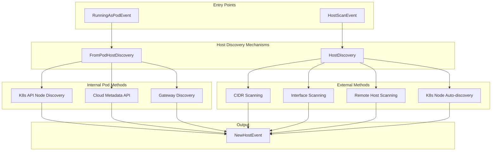
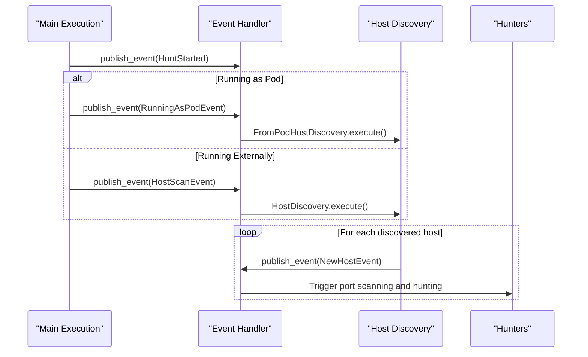
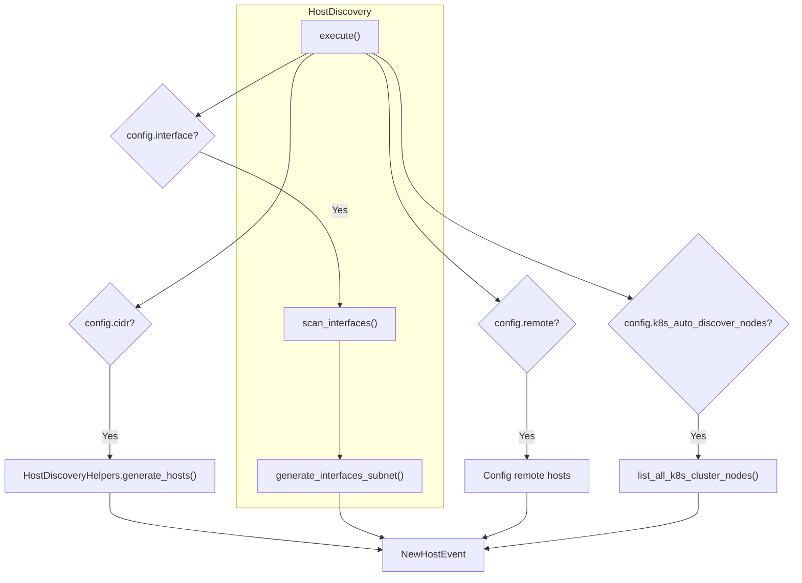
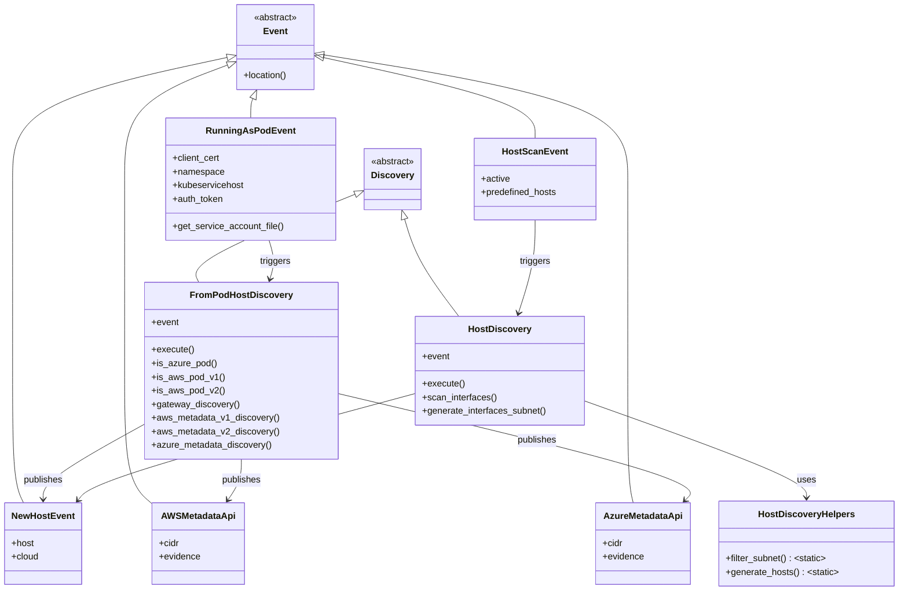

# Host Discovery

<details>
<summary>Relevant source files</summary>

The following files were used as context for generating this wiki page:

- [kube-hunter.py](https://github.com/aquasecurity/kube-hunter/blob/bc47f08e/kube-hunter.py)
- [kube_hunter/modules/discovery/hosts.py](https://github.com/aquasecurity/kube-hunter/blob/bc47f08e/kube_hunter/modules/discovery/hosts.py)
- [kube_hunter/modules/hunting/apiserver.py](https://github.com/aquasecurity/kube-hunter/blob/bc47f08e/kube_hunter/modules/hunting/apiserver.py)
- [kube_hunter/modules/hunting/kubelet.py](https://github.com/aquasecurity/kube-hunter/blob/bc47f08e/kube_hunter/modules/hunting/kubelet.py)
- [tests/hunting/test_kubelet.py](https://github.com/aquasecurity/kube-hunter/blob/bc47f08e/tests/hunting/test_kubelet.py)

</details>


This page explains how kube-hunter discovers potential Kubernetes hosts to scan for vulnerabilities. Host discovery is the initial phase of the kube-hunter scanning process, identifying targets for subsequent service discovery (see [Service Discovery](#3.2)) and vulnerability hunting.

## Overview

Host discovery in kube-hunter varies significantly depending on the deployment method. Different discovery mechanisms are employed when running from a pod inside a cluster versus running externally. The discovery phase outputs `NewHostEvent` events for each identified host, triggering port scanning and subsequent vulnerability detection.



Sources: [kube_hunter/modules/discovery/hosts.py:114-136](https://github.com/aquasecurity/kube-hunter/blob/bc47f08e/kube_hunter/modules/discovery/hosts.py#L114-L136), [kube_hunter/modules/discovery/hosts.py:333-356](https://github.com/aquasecurity/kube-hunter/blob/bc47f08e/kube_hunter/modules/discovery/hosts.py#L333-L356)

## Discovery Workflow

The discovery process begins in the main execution flow when kube-hunter determines whether it's running as a pod or not:



Sources: [kube-hunter.py:115-121](https://github.com/aquasecurity/kube-hunter/blob/bc47f08e/kube-hunter.py#L115-L121), [kube_hunter/modules/discovery/hosts.py:116-156](https://github.com/aquasecurity/kube-hunter/blob/bc47f08e/kube_hunter/modules/discovery/hosts.py#L116-L156), [kube_hunter/modules/discovery/hosts.py:334-355](https://github.com/aquasecurity/kube-hunter/blob/bc47f08e/kube_hunter/modules/discovery/hosts.py#L334-L355)

## Discovery Methods

The discovery methods vary significantly based on the execution environment. 

### Internal Pod Discovery

When kube-hunter runs as a pod inside a Kubernetes cluster, the `FromPodHostDiscovery` class handles host discovery through several techniques:

1. **Kubernetes API Node Discovery**: Attempts to list all nodes in the cluster using the service account token mounted in the pod.

2. **Cloud Metadata Discovery**:
   - **Azure**: Queries the Azure metadata API (169.254.169.254) to discover node subnets.
   - **AWS**: Uses either AWS metadata API v1 or v2 to discover subnet information.

3. **Gateway Discovery**: Identifies the pod's default gateway (usually the node it's running on).

```mermaid
graph TD
    subgraph "FromPodHostDiscovery"
        execute["execute()"]
        aws_v1["aws_metadata_v1_discovery()"]
        aws_v2["aws_metadata_v2_discovery()"]
        azure["azure_metadata_discovery()"]
        gateway["gateway_discovery()"]
    end

    execute --> k8s_api["list_all_k8s_cluster_nodes()"]
    execute --> isAzurePod{is_azure_pod()?}
    execute --> isAWSPodV1{is_aws_pod_v1()?}
    execute --> isAWSPodV2{is_aws_pod_v2()?}
    execute --> gateway_subnet["gateway_discovery()"]

    isAzurePod -->|Yes| azure
    isAWSPodV1 -->|Yes| aws_v1
    isAWSPodV2 -->|Yes| aws_v2

    k8s_api --> NewHostEvent["NewHostEvent(host=node)"]
    azure --> NewHostEvent
    aws_v1 --> NewHostEvent
    aws_v2 --> NewHostEvent
    gateway_subnet --> NewHostEvent

    isAzurePod -.->|Also publishes| AzureMetadataApi["AzureMetadataApi Event"]
    isAWSPodV1 -.->|Also publishes| AWSMetadataApi["AWSMetadataApi Event"]
    isAWSPodV2 -.->|Also publishes| AWSMetadataApi
```

Sources: [kube_hunter/modules/discovery/hosts.py:116-331](https://github.com/aquasecurity/kube-hunter/blob/bc47f08e/kube_hunter/modules/discovery/hosts.py#L116-L331)

#### Gateway Discovery

When running as a pod, kube-hunter attempts to find the default gateway of the pod's network, which is generally the node hosting the pod. This is done by examining the routing information in the Linux kernel.

```python
def gateway_discovery(self):
    """Retrieving default gateway of pod, which is usually also a contact point with the host"""
    if sys.platform in ["linux", "linux2"]:
        try:
            from pyroute2 import IPDB
            ip = IPDB()
            gateway_ip = ip.routes["default"]["gateway"]
            ip.release()
            return [gateway_ip, "24"]
        except Exception as x:
            logging.debug(f"Exception while fetching default gateway from container - {x}")
        finally:
            ip.release()
    else:
        logging.debug("Not running in a linux env, will not scan default subnet")
    return False
```

Sources: [kube_hunter/modules/discovery/hosts.py:222-243](https://github.com/aquasecurity/kube-hunter/blob/bc47f08e/kube_hunter/modules/discovery/hosts.py#L222-L243)

#### Cloud Metadata Discovery

Kube-hunter uses specialized techniques to discover hosts when running on major cloud providers:

**AWS Metadata API v1**:
```python
def aws_metadata_v1_discovery(self):
    # Get MAC address from metadata service
    mac_address = requests.get("http://169.254.169.254/latest/meta-data/mac", timeout=config.network_timeout).text
    # Get subnet CIDR using the MAC
    cidr = requests.get(f"http://169.254.169.254/latest/meta-data/network/interfaces/macs/{mac_address}/subnet-ipv4-cidr-block", timeout=config.network_timeout).text
    # Parse CIDR and report
    address, subnet = (cidr[0], cidr[1])
    # Generate NewHostEvent for each IP in the subnet
    return [(address, subnet)], "AWS"
```

**Azure Metadata API**:
```python
def azure_metadata_discovery(self):
    # Get machine metadata
    machine_metadata = requests.get("http://169.254.169.254/metadata/instance?api-version=2017-08-01", headers={"Metadata": "true"}, timeout=config.network_timeout).json()
    # Process network interfaces
    for interface in machine_metadata["network"]["interface"]:
        address, subnet = (interface["ipv4"]["subnet"][0]["address"], interface["ipv4"]["subnet"][0]["prefix"])
        # Generate NewHostEvent for each IP in each subnet
    return subnets, "Azure"
```

Sources: [kube_hunter/modules/discovery/hosts.py:246-331](https://github.com/aquasecurity/kube-hunter/blob/bc47f08e/kube_hunter/modules/discovery/hosts.py#L246-L331)

### External Scanning Methods

When running from outside a cluster, the `HostDiscovery` class provides several methods for finding Kubernetes hosts:

1. **CIDR Range Scanning**: Scan all IP addresses in specified CIDR range(s)
2. **Interface Scanning**: Scan subnets associated with the local network interfaces
3. **Remote Host Scanning**: Scan specific hosts provided via command line
4. **Kubernetes Node Auto-Discovery**: Use Kubernetes API to discover nodes



Sources: [kube_hunter/modules/discovery/hosts.py:334-355](https://github.com/aquasecurity/kube-hunter/blob/bc47f08e/kube_hunter/modules/discovery/hosts.py#L334-L355)

#### CIDR Scanning

CIDR scanning uses the `HostDiscoveryHelpers.generate_hosts()` method to generate a list of IP addresses from CIDR notation (e.g., "192.168.0.0/24"). It supports exclusions by prefixing CIDR ranges with "!".

```python
@staticmethod
def generate_hosts(cidrs):
    ignore = list()
    scan = list()
    for cidr in cidrs:
        try:
            if cidr.startswith("!"):
                ignore.append(IPNetwork(cidr[1:]))
            else:
                scan.append(IPNetwork(cidr))
        except AddrFormatError as e:
            raise ValueError(f"Unable to parse CIDR {cidr}") from e

    return itertools.chain.from_iterable(HostDiscoveryHelpers.filter_subnet(sb, ignore=ignore) for sb in scan)
```

Sources: [kube_hunter/modules/discovery/hosts.py:99-112](https://github.com/aquasecurity/kube-hunter/blob/bc47f08e/kube_hunter/modules/discovery/hosts.py#L99-L112)

#### Interface Scanning

Interface scanning enumerates all local network interfaces and scans the associated subnets. The implementation is platform-specific (Linux or Windows):

**Linux Interface Scanning**:
```python
def generate_interfaces_subnet_linux(self, sn="24"):
    try:
        from pyroute2 import IPRoute
        ip = IPRoute()
        for i in ip.get_addr():
            # Only scan IPv4 addresses
            if i["family"] == socket.AF_INET:
                ipaddress = i[0].get_attr("IFA_ADDRESS")
                # Skip localhost unless explicitly enabled
                if not self.event.localhost and ipaddress.startswith(InterfaceTypes.LOCALHOST.value):
                    continue
                ip_network = IPNetwork(f"{ipaddress}/{sn}")
                for ip in ip_network:
                    yield ip
    except Exception as x:
        logging.debug(f"Exception while generating subnet scan from local interfaces: {x}")
    finally:
        ip.release()
```

Sources: [kube_hunter/modules/discovery/hosts.py:369-391](https://github.com/aquasecurity/kube-hunter/blob/bc47f08e/kube_hunter/modules/discovery/hosts.py#L369-L391)

## Implementation Details

The host discovery system is built on the event-driven architecture of kube-hunter. Key classes and their relationships are shown below:



Sources: [kube_hunter/modules/discovery/hosts.py:21-45](https://github.com/aquasecurity/kube-hunter/blob/bc47f08e/kube_hunter/modules/discovery/hosts.py#L21-L45), [kube_hunter/modules/discovery/hosts.py:52-79](https://github.com/aquasecurity/kube-hunter/blob/bc47f08e/kube_hunter/modules/discovery/hosts.py#L52-L79), [kube_hunter/modules/discovery/hosts.py:82-88](https://github.com/aquasecurity/kube-hunter/blob/bc47f08e/kube_hunter/modules/discovery/hosts.py#L82-L88), [kube_hunter/modules/discovery/hosts.py:89-112](https://github.com/aquasecurity/kube-hunter/blob/bc47f08e/kube_hunter/modules/discovery/hosts.py#L89-L112), [kube_hunter/modules/discovery/hosts.py:116-331](https://github.com/aquasecurity/kube-hunter/blob/bc47f08e/kube_hunter/modules/discovery/hosts.py#L116-L331), [kube_hunter/modules/discovery/hosts.py:334-418](https://github.com/aquasecurity/kube-hunter/blob/bc47f08e/kube_hunter/modules/discovery/hosts.py#L334-L418)

## Configuration Options

The host discovery behavior in kube-hunter is controlled by several configuration options:

| Option | Description | Implementation Class |
|--------|-------------|---------------------|
| `--pod` | Run as a pod inside the cluster | `FromPodHostDiscovery` |
| `--cidr TEXT` | CIDR notation for a subnet scan (Example: 192.168.0.0/16) | `HostDiscovery` |
| `--remote TEXT` | Remote hosts to scan (separated by comma) | `HostDiscovery` |
| `--interface` | Scan subnets of all local network interfaces | `HostDiscovery` |
| `--k8s-auto-discover-nodes` | Discover nodes from Kubernetes API | `HostDiscovery` |
| `--service-account-token TEXT` | Use provided service account token | Affects `RunningAsPodEvent` configuration |
| `--quick` | Use smaller subnet mask (24 instead of discovered one) | Affects discovery subnet size |

Sources: [kube-hunter.py:16-35](https://github.com/aquasecurity/kube-hunter/blob/bc47f08e/kube-hunter.py#L16-L35), [kube_hunter/modules/discovery/hosts.py:124-156](https://github.com/aquasecurity/kube-hunter/blob/bc47f08e/kube_hunter/modules/discovery/hosts.py#L124-L156), [kube_hunter/modules/discovery/hosts.py:344-355](https://github.com/aquasecurity/kube-hunter/blob/bc47f08e/kube_hunter/modules/discovery/hosts.py#L344-L355)

## Common Host Discovery Patterns

Here are some common usage patterns for host discovery in kube-hunter:

1. **Scanning from Inside a Cluster**:
   - When run as a pod, kube-hunter automatically detects the cluster's subnets and endpoints
   - No additional configuration needed for this mode

2. **Targeting Specific Hosts**:
   - Use `--remote` to specify exact hosts to scan
   - Example: `--remote 10.0.0.1,api.k8s.cluster.local`

3. **Network Segment Scanning**:
   - Use `--cidr` to scan network ranges
   - Support for multiple ranges and exclusions
   - Example: `--cidr 192.168.0.0/16,!192.168.5.0/24`

4. **Local Network Scanning**:
   - Use `--interface` to scan subnets of all network interfaces
   - Particularly useful for "black box" discovery attempts