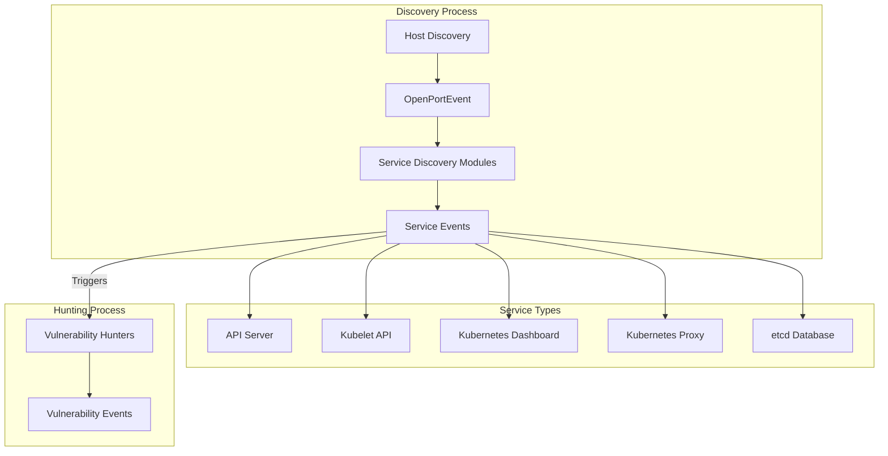
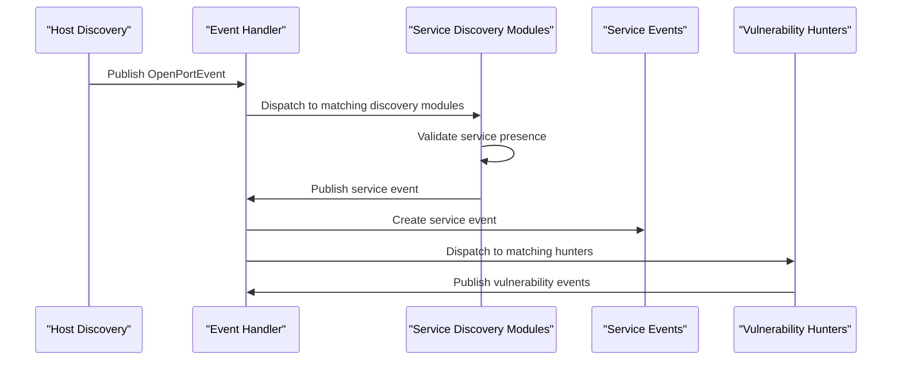
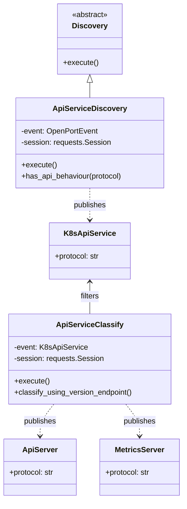
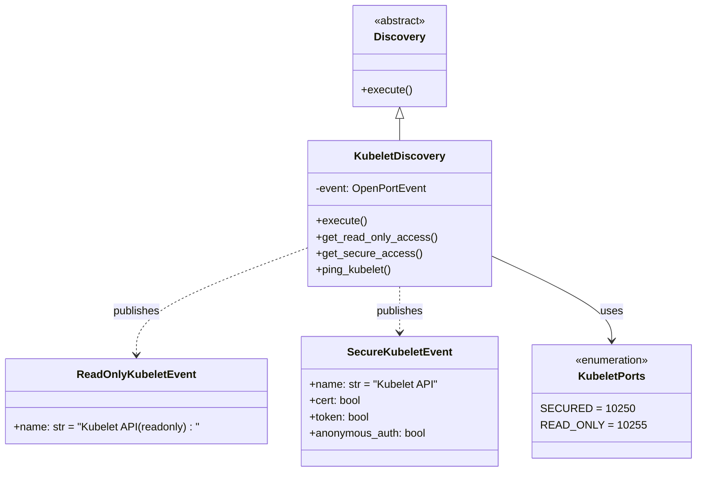
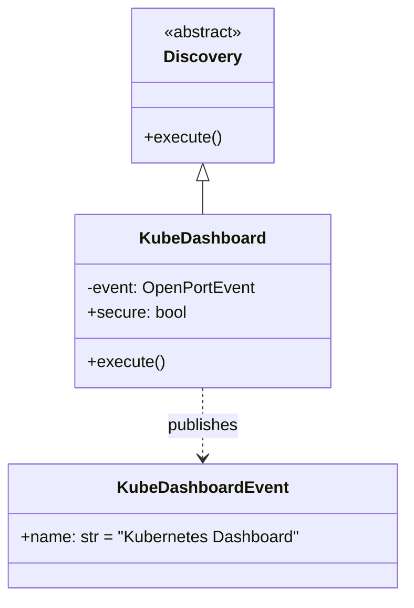
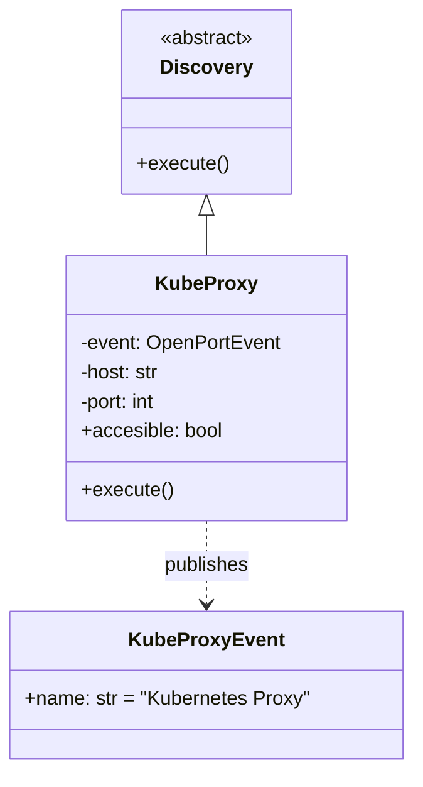
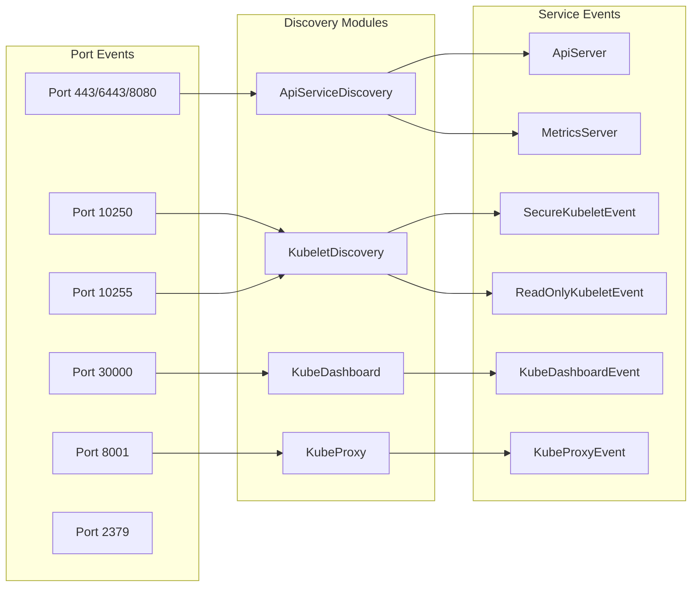
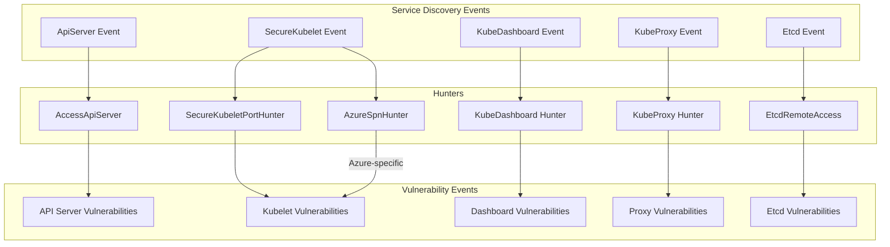
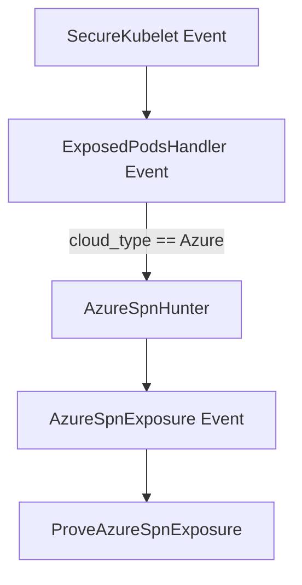

# Service Discovery

<details>
<summary>Relevant source files</summary>

The following files were used as context for generating this wiki page:

- [kube_hunter/modules/discovery/apiserver.py](https://github.com/aquasecurity/kube-hunter/blob/bc47f08e/kube_hunter/modules/discovery/apiserver.py)
- [kube_hunter/modules/discovery/dashboard.py](https://github.com/aquasecurity/kube-hunter/blob/bc47f08e/kube_hunter/modules/discovery/dashboard.py)
- [kube_hunter/modules/discovery/kubelet.py](https://github.com/aquasecurity/kube-hunter/blob/bc47f08e/kube_hunter/modules/discovery/kubelet.py)
- [kube_hunter/modules/discovery/proxy.py](https://github.com/aquasecurity/kube-hunter/blob/bc47f08e/kube_hunter/modules/discovery/proxy.py)
- [kube_hunter/modules/hunting/aks.py](https://github.com/aquasecurity/kube-hunter/blob/bc47f08e/kube_hunter/modules/hunting/aks.py)
- [kube_hunter/modules/hunting/dashboard.py](https://github.com/aquasecurity/kube-hunter/blob/bc47f08e/kube_hunter/modules/hunting/dashboard.py)
- [kube_hunter/modules/hunting/etcd.py](https://github.com/aquasecurity/kube-hunter/blob/bc47f08e/kube_hunter/modules/hunting/etcd.py)
- [kube_hunter/modules/hunting/proxy.py](https://github.com/aquasecurity/kube-hunter/blob/bc47f08e/kube_hunter/modules/hunting/proxy.py)
- [tests/discovery/test_apiserver.py](https://github.com/aquasecurity/kube-hunter/blob/bc47f08e/tests/discovery/test_apiserver.py)
- [tests/discovery/test_hosts.py](https://github.com/aquasecurity/kube-hunter/blob/bc47f08e/tests/discovery/test_hosts.py)
- [tests/hunting/test_aks.py](https://github.com/aquasecurity/kube-hunter/blob/bc47f08e/tests/hunting/test_aks.py)
- [tests/hunting/test_apiserver_hunter.py](https://github.com/aquasecurity/kube-hunter/blob/bc47f08e/tests/hunting/test_apiserver_hunter.py)

</details>


This document explains the service discovery system within kube-hunter, which is responsible for identifying Kubernetes services running in a target environment. The service discovery phase follows initial host discovery ([Host Discovery](#3.1)) and provides the foundation for subsequent vulnerability scanning and assessments.

## Overview

Service discovery in kube-hunter detects various Kubernetes components by analyzing responses from open ports identified during host discovery. This component recognizes common Kubernetes services including:

- Kubernetes API Server
- Kubelet API
- Kubernetes Dashboard
- Kubernetes Proxy
- etcd

These discovered services are then passed to the vulnerability hunting components for security analysis.



Sources: [kube_hunter/modules/discovery/apiserver.py](https://github.com/aquasecurity/kube-hunter/blob/bc47f08e/kube_hunter/modules/discovery/apiserver.py), [kube_hunter/modules/discovery/kubelet.py](https://github.com/aquasecurity/kube-hunter/blob/bc47f08e/kube_hunter/modules/discovery/kubelet.py), [kube_hunter/modules/discovery/dashboard.py](https://github.com/aquasecurity/kube-hunter/blob/bc47f08e/kube_hunter/modules/discovery/dashboard.py), [kube_hunter/modules/discovery/proxy.py](https://github.com/aquasecurity/kube-hunter/blob/bc47f08e/kube_hunter/modules/discovery/proxy.py)

## Service Discovery Architecture

Service discovery in kube-hunter operates on an event-driven architecture where discovery modules subscribe to `OpenPortEvent` instances with specific port predicates. The discovery process follows this sequence:

1. An `OpenPortEvent` is generated when an open port is found
2. Service discovery modules check if the port matches their predicate
3. If matched, the module performs validation to determine if the service is present
4. When a service is confirmed, a service-specific event is published
5. Vulnerability hunters subscribe to these service events to perform security testing



Sources: [kube_hunter/modules/discovery/apiserver.py:41-45](https://github.com/aquasecurity/kube-hunter/blob/bc47f08e/kube_hunter/modules/discovery/apiserver.py#L41-L45), [kube_hunter/modules/discovery/kubelet.py:40-44](https://github.com/aquasecurity/kube-hunter/blob/bc47f08e/kube_hunter/modules/discovery/kubelet.py#L40-L44), [kube_hunter/modules/discovery/dashboard.py:20-24](https://github.com/aquasecurity/kube-hunter/blob/bc47f08e/kube_hunter/modules/discovery/dashboard.py#L20-L24), [kube_hunter/modules/discovery/proxy.py:19-23](https://github.com/aquasecurity/kube-hunter/blob/bc47f08e/kube_hunter/modules/discovery/proxy.py#L19-L23)

## Service Discovery Modules

### API Server Discovery

The API Server discovery module (`ApiServiceDiscovery`) checks for Kubernetes API services on ports 443, 6443, and 8080. It attempts to connect to these ports and analyzes the responses to determine if they match API server characteristics.

Key features:
- Supports both HTTP and HTTPS protocols
- Identifies different API service types (main API Server vs. Metrics Server)
- Honors authentication tokens when available



Sources: [kube_hunter/modules/discovery/apiserver.py:11-14](https://github.com/aquasecurity/kube-hunter/blob/bc47f08e/kube_hunter/modules/discovery/apiserver.py#L11-L14), [kube_hunter/modules/discovery/apiserver.py:41-68](https://github.com/aquasecurity/kube-hunter/blob/bc47f08e/kube_hunter/modules/discovery/apiserver.py#L41-L68), [kube_hunter/modules/discovery/apiserver.py:80-126](https://github.com/aquasecurity/kube-hunter/blob/bc47f08e/kube_hunter/modules/discovery/apiserver.py#L80-L126)

### Kubelet Discovery

The Kubelet discovery module checks for the Kubelet API on ports 10250 (secured port) and 10255 (read-only port). It supports different authentication scenarios and identifies the level of access available.

Key characteristics:
- Detects both read-only and secure Kubelet APIs
- Identifies authentication requirements
- Reports different levels of access (anonymous, token-based, etc.)



Sources: [kube_hunter/modules/discovery/kubelet.py:17-37](https://github.com/aquasecurity/kube-hunter/blob/bc47f08e/kube_hunter/modules/discovery/kubelet.py#L17-L37), [kube_hunter/modules/discovery/kubelet.py:40-80](https://github.com/aquasecurity/kube-hunter/blob/bc47f08e/kube_hunter/modules/discovery/kubelet.py#L40-L80)

### Kubernetes Dashboard Discovery

The Dashboard discovery module checks for the Kubernetes Dashboard service, which usually runs on port 30000. It verifies if the dashboard is accessible and if it has proper security controls.



Sources: [kube_hunter/modules/discovery/dashboard.py:13-16](https://github.com/aquasecurity/kube-hunter/blob/bc47f08e/kube_hunter/modules/discovery/dashboard.py#L13-L16), [kube_hunter/modules/discovery/dashboard.py:20-44](https://github.com/aquasecurity/kube-hunter/blob/bc47f08e/kube_hunter/modules/discovery/dashboard.py#L20-L44)

### Kubernetes Proxy Discovery

The Proxy discovery module checks for the Kubernetes Proxy service on port 8001. It verifies if the proxy is accessible and exposes the Kubernetes API.



Sources: [kube_hunter/modules/discovery/proxy.py:12-16](https://github.com/aquasecurity/kube-hunter/blob/bc47f08e/kube_hunter/modules/discovery/proxy.py#L12-L16), [kube_hunter/modules/discovery/proxy.py:19-45](https://github.com/aquasecurity/kube-hunter/blob/bc47f08e/kube_hunter/modules/discovery/proxy.py#L19-L45)

## Service Discovery Flow

The service discovery process follows a standard pattern across all modules:

1. Subscribe to `OpenPortEvent` for specific ports
2. When triggered, make HTTP/HTTPS requests to validate the service
3. Analyze responses for service-specific characteristics
4. Publish appropriate service events



Sources: [kube_hunter/modules/discovery/apiserver.py:41-45](https://github.com/aquasecurity/kube-hunter/blob/bc47f08e/kube_hunter/modules/discovery/apiserver.py#L41-L45), [kube_hunter/modules/discovery/kubelet.py:40-44](https://github.com/aquasecurity/kube-hunter/blob/bc47f08e/kube_hunter/modules/discovery/kubelet.py#L40-L44), [kube_hunter/modules/discovery/dashboard.py:20-24](https://github.com/aquasecurity/kube-hunter/blob/bc47f08e/kube_hunter/modules/discovery/dashboard.py#L20-L24), [kube_hunter/modules/discovery/proxy.py:19-23](https://github.com/aquasecurity/kube-hunter/blob/bc47f08e/kube_hunter/modules/discovery/proxy.py#L19-L23)

## Detection Techniques

Each discovery module employs specific techniques to validate services:

### API Server Detection

The API server is identified by checking for:
1. JSON responses containing the `"code"` field for HTTP status codes
2. Error messages containing `"k8s"` text
3. A valid `/version` endpoint response with a `"major"` version field

```python
def has_api_behaviour(self, protocol):
    try:
        r = self.session.get(f"{protocol}://{self.event.host}:{self.event.port}", timeout=config.network_timeout)
        if ("k8s" in r.text) or ('"code"' in r.text and r.status_code != 200):
            return True
    except requests.exceptions.SSLError:
        logger.debug(f"{[protocol]} protocol not accepted on {self.event.host}:{self.event.port}")
    except Exception:
        logger.debug(f"Failed probing {self.event.host}:{self.event.port}", exc_info=True)
```

Sources: [kube_hunter/modules/discovery/apiserver.py:59-68](https://github.com/aquasecurity/kube-hunter/blob/bc47f08e/kube_hunter/modules/discovery/apiserver.py#L59-L68)

### Kubelet Detection

The Kubelet API is identified by:
1. Checking for a successful response on the `/pods` endpoint for read-only access
2. Checking for specific HTTP status codes (200, 401, 403) on the secure port

Sources: [kube_hunter/modules/discovery/kubelet.py:49-75](https://github.com/aquasecurity/kube-hunter/blob/bc47f08e/kube_hunter/modules/discovery/kubelet.py#L49-L75)

### Dashboard Detection

The Kubernetes Dashboard is detected by checking for:
1. A valid API response on `/api/v1/service/default`
2. Response containing `"listMeta"` with empty `"errors"` array

Sources: [kube_hunter/modules/discovery/dashboard.py:29-40](https://github.com/aquasecurity/kube-hunter/blob/bc47f08e/kube_hunter/modules/discovery/dashboard.py#L29-L40)

### Proxy Detection

The Kubernetes Proxy is identified by:
1. A valid response from `/api/v1` endpoint
2. Response text containing `"APIResourceList"`

Sources: [kube_hunter/modules/discovery/proxy.py:30-41](https://github.com/aquasecurity/kube-hunter/blob/bc47f08e/kube_hunter/modules/discovery/proxy.py#L30-L41)

## Service Events and Vulnerability Hunters

After services are discovered, service events trigger vulnerability hunting modules:

| Service Event | Hunter Classes | Vulnerabilities |
|---------------|---------------|-----------------|
| ApiServer | AccessApiServer, AccessApiServerWithToken | ServerApiAccess, ListNamespaces, ListPodsAndNamespaces, ListRoles, ListClusterRoles |
| SecureKubeletEvent | ExposedPodsHandler, SecureKubeletPortHunter | ExposedPods, ExposedContainerLogsHandler, ExposedRunHandler |
| KubeDashboardEvent | KubeDashboard | DashboardExposed |
| KubeProxyEvent | KubeProxy, ProveProxyExposed | KubeProxyExposed, K8sVersionDisclosure |



Sources: [tests/hunting/test_apiserver.py:31-132](https://github.com/aquasecurity/kube-hunter/blob/bc47f08e/tests/hunting/test_apiserver.py#L31-L132), [kube_hunter/modules/hunting/aks.py:30-70](https://github.com/aquasecurity/kube-hunter/blob/bc47f08e/kube_hunter/modules/hunting/aks.py#L30-L70), [kube_hunter/modules/hunting/dashboard.py:28-46](https://github.com/aquasecurity/kube-hunter/blob/bc47f08e/kube_hunter/modules/hunting/dashboard.py#L28-L46), [kube_hunter/modules/hunting/proxy.py:38-102](https://github.com/aquasecurity/kube-hunter/blob/bc47f08e/kube_hunter/modules/hunting/proxy.py#L38-L102), [kube_hunter/modules/hunting/etcd.py:84-176](https://github.com/aquasecurity/kube-hunter/blob/bc47f08e/kube_hunter/modules/hunting/etcd.py#L84-L176)

## Special Case: Azure Kubernetes Service

Kube-hunter includes a specialized detection path for Azure Kubernetes Service (AKS). The `AzureSpnHunter` subscribes to the `ExposedPodsHandler` event with a specific predicate for Azure cloud environments, then searches for containers with access to the Azure service principal (SPN) credentials.



Sources: [kube_hunter/modules/hunting/aks.py:30-127](https://github.com/aquasecurity/kube-hunter/blob/bc47f08e/kube_hunter/modules/hunting/aks.py#L30-L127)

## Integration with Event Handler System

The service discovery system integrates with kube-hunter's event handler using Python decorators to subscribe to events. This allows for a clean, modular design where each discovery component operates independently:

```python
@handler.subscribe(OpenPortEvent, predicate=lambda x: x.port in KNOWN_API_PORTS)
class ApiServiceDiscovery(Discovery):
    # Discovery logic
```

This pattern is consistent across all discovery modules, allowing them to be triggered automatically when matching events occur in the system.

Sources: [kube_hunter/modules/discovery/apiserver.py:41-45](https://github.com/aquasecurity/kube-hunter/blob/bc47f08e/kube_hunter/modules/discovery/apiserver.py#L41-L45), [kube_hunter/modules/discovery/kubelet.py:40-44](https://github.com/aquasecurity/kube-hunter/blob/bc47f08e/kube_hunter/modules/discovery/kubelet.py#L40-L44), [kube_hunter/modules/discovery/dashboard.py:20-24](https://github.com/aquasecurity/kube-hunter/blob/bc47f08e/kube_hunter/modules/discovery/dashboard.py#L20-L24), [kube_hunter/modules/discovery/proxy.py:19-23](https://github.com/aquasecurity/kube-hunter/blob/bc47f08e/kube_hunter/modules/discovery/proxy.py#L19-L23)

## Conclusion

Service discovery is a critical phase in kube-hunter's workflow, acting as the bridge between host discovery and vulnerability hunting. By identifying specific Kubernetes services, it provides the foundation for targeted security assessments. The modular, event-driven design allows for flexible and extensible service discovery capabilities.