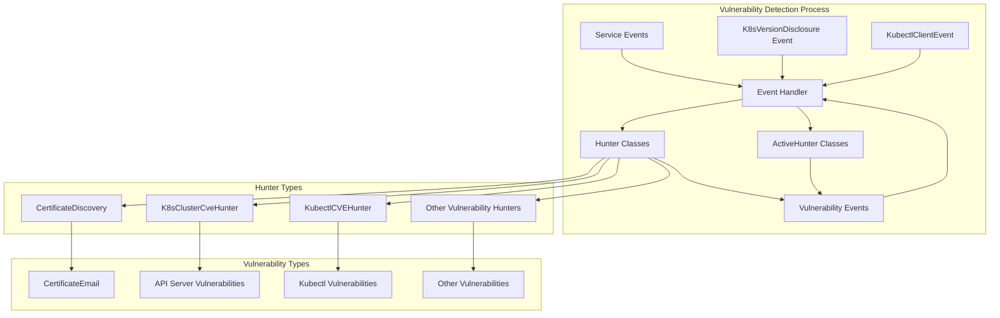
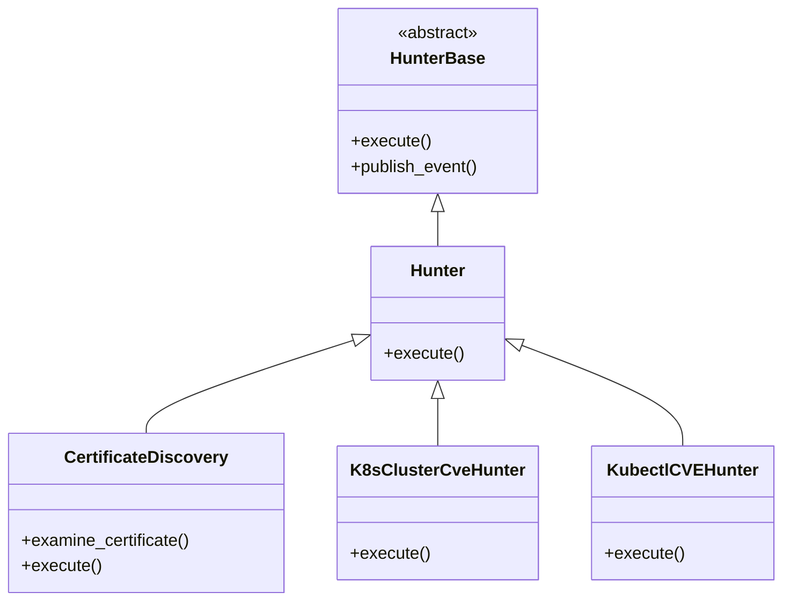
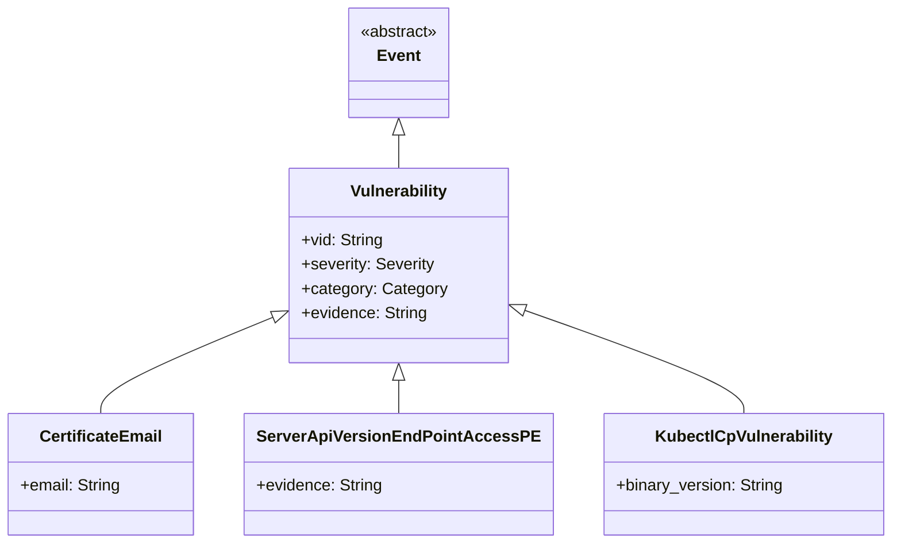
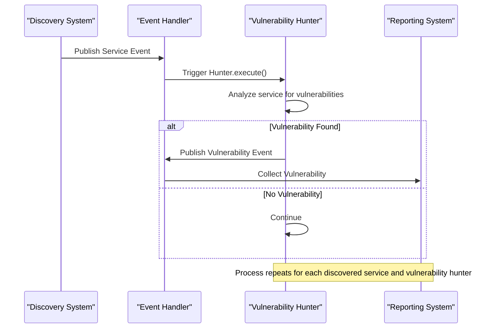
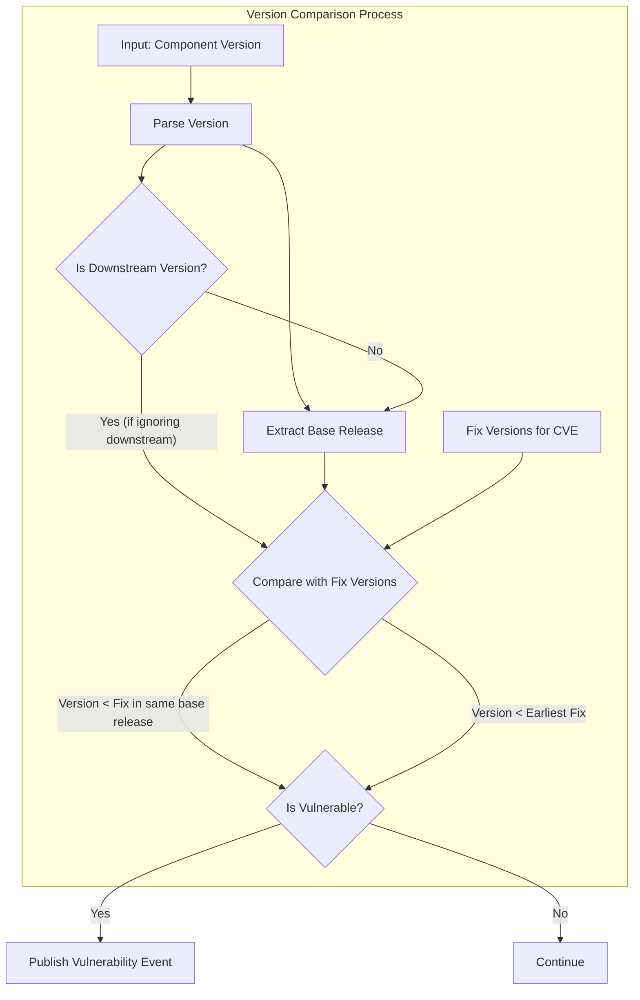

# Vulnerability Hunting

<details>
<summary>Relevant source files</summary>

The following files were used as context for generating this wiki page:

- [CONTRIBUTING.md](https://github.com/aquasecurity/kube-hunter/blob/bc47f08e/CONTRIBUTING.md)
- [kube_hunter/modules/hunting/certificates.py](https://github.com/aquasecurity/kube-hunter/blob/bc47f08e/kube_hunter/modules/hunting/certificates.py)
- [kube_hunter/modules/hunting/cves.py](https://github.com/aquasecurity/kube-hunter/blob/bc47f08e/kube_hunter/modules/hunting/cves.py)
- [tests/hunting/test_certificates.py](https://github.com/aquasecurity/kube-hunter/blob/bc47f08e/tests/hunting/test_certificates.py)

</details>


## Purpose and Scope

This document describes the vulnerability hunting system within kube-hunter, which is responsible for identifying security vulnerabilities in Kubernetes clusters. The system focuses on detecting both known CVEs and general security weaknesses in various Kubernetes components. For information about the initial discovery phase that identifies potential targets, see [Discovery System](#3).

The vulnerability hunting phase takes place after services are discovered, focusing on analyzing these services to identify security issues.

## Vulnerability Hunting Architecture

The vulnerability hunting system in kube-hunter follows an event-driven architecture that facilitates the detection of various security issues across a Kubernetes cluster.



Sources: [kube_hunter/modules/hunting/certificates.py](https://github.com/aquasecurity/kube-hunter/blob/bc47f08e/kube_hunter/modules/hunting/certificates.py), [kube_hunter/modules/hunting/cves.py](https://github.com/aquasecurity/kube-hunter/blob/bc47f08e/kube_hunter/modules/hunting/cves.py)

The diagram illustrates how service events and information disclosure events trigger various hunter classes. These hunters analyze services and report vulnerabilities found in the cluster. The event handler facilitates the communication between different components of the system.

## Hunter Classes and Vulnerability Types

The vulnerability hunting system is built around specialized hunter classes that detect specific types of security issues.

### Passive Hunters

Passive hunters observe services without modifying the cluster state. They report identified vulnerabilities without attempting exploitation.



Sources: [kube_hunter/modules/hunting/certificates.py:31-55](https://github.com/aquasecurity/kube-hunter/blob/bc47f08e/kube_hunter/modules/hunting/certificates.py#L31-L55), [kube_hunter/modules/hunting/cves.py:204-249](https://github.com/aquasecurity/kube-hunter/blob/bc47f08e/kube_hunter/modules/hunting/cves.py#L204-L249)

### Vulnerability Classes

Each vulnerability is represented by a specific class that inherits from the Vulnerability base class. These classes contain metadata about the vulnerability, including severity, category, and remediation information.



Sources: [kube_hunter/modules/hunting/certificates.py:14-28](https://github.com/aquasecurity/kube-hunter/blob/bc47f08e/kube_hunter/modules/hunting/certificates.py#L14-L28), [kube_hunter/modules/hunting/cves.py:22-125](https://github.com/aquasecurity/kube-hunter/blob/bc47f08e/kube_hunter/modules/hunting/cves.py#L22-L125)

## Core Vulnerability Hunting Categories

The vulnerability hunting system in kube-hunter focuses on several key categories of vulnerabilities:

### 1. Information Disclosure

Information disclosure vulnerabilities involve the unintentional exposure of sensitive data that could aid an attacker. The `CertificateDiscovery` hunter exemplifies this by checking for email addresses in SSL certificates that could provide information for social engineering attacks.

Example implementation:
```python
@handler.subscribe(Service)
class CertificateDiscovery(Hunter):
    """Certificate Email Hunting
    Checks for email addresses in kubernetes ssl certificates
    """
    def execute(self):
        try:
            cert = ssl.get_server_certificate((str(self.event.host), self.event.port))
        except ssl.SSLError:
            return
        self.examine_certificate(cert)
```

Sources: [kube_hunter/modules/hunting/certificates.py:31-48](https://github.com/aquasecurity/kube-hunter/blob/bc47f08e/kube_hunter/modules/hunting/certificates.py#L31-L48)

### 2. CVE Hunting

The CVE hunting system checks if the Kubernetes cluster components are vulnerable to known CVEs. This is implemented primarily through version checking:

```python
@handler.subscribe_once(K8sVersionDisclosure, is_register=config.enable_cve_hunting)
class K8sClusterCveHunter(Hunter):
    """K8s CVE Hunter
    Checks if Node is running a Kubernetes version vulnerable to
    specific important CVEs
    """
    def execute(self):
        logger.debug(f"Checking known CVEs for k8s API version: {self.event.version}")
        cve_mapping = {
            ServerApiVersionEndPointAccessPE: ["1.10.11", "1.11.5", "1.12.3"],
            ServerApiVersionEndPointAccessDos: ["1.11.8", "1.12.6", "1.13.4"],
            # ... other CVEs
        }
        for vulnerability, fix_versions in cve_mapping.items():
            if CveUtils.is_vulnerable(fix_versions, self.event.version, not config.include_patched_versions):
                self.publish_event(vulnerability(self.event.version))
```

Sources: [kube_hunter/modules/hunting/cves.py:204-226](https://github.com/aquasecurity/kube-hunter/blob/bc47f08e/kube_hunter/modules/hunting/cves.py#L204-L226)

### Key CVEs Detected

The system can identify several critical CVEs in Kubernetes components:

| Vulnerability ID | CVE            | Description                                           | Component   |
|------------------|----------------|-------------------------------------------------------|-------------|
| KHV022           | CVE-2018-1002105 | Critical privilege escalation vulnerability           | API Server  |
| KHV023           | CVE-2019-1002100 | Denial of service via crafted json-patch              | API Server  |
| KHV024           | CVE-2019-9512    | Ping flood attack in HTTP/2 implementation            | API Server  |
| KHV025           | CVE-2019-9514    | Reset flood attack in HTTP/2 implementation           | API Server  |
| KHV026           | CVE-2019-11247   | Arbitrary access to cluster-scoped resources          | API Server  |
| KHV027           | CVE-2019-11246   | Remote code execution via kubectl cp command          | kubectl     |
| KHV028           | CVE-2019-1002101 | Remote code execution via kubectl cp command          | kubectl     |

Sources: [kube_hunter/modules/hunting/cves.py:22-125](https://github.com/aquasecurity/kube-hunter/blob/bc47f08e/kube_hunter/modules/hunting/cves.py#L22-L125)

## Vulnerability Detection Workflow

The vulnerability detection process follows a specific workflow to identify and report security issues in a Kubernetes cluster.



Sources: [kube_hunter/modules/hunting/certificates.py:31-55](https://github.com/aquasecurity/kube-hunter/blob/bc47f08e/kube_hunter/modules/hunting/certificates.py#L31-L55), [kube_hunter/modules/hunting/cves.py:204-249](https://github.com/aquasecurity/kube-hunter/blob/bc47f08e/kube_hunter/modules/hunting/cves.py#L204-L249)

## Version Comparison for CVE Detection

A key aspect of CVE hunting is accurate version comparison to determine if a component is vulnerable. kube-hunter implements the `CveUtils` class to handle the complexities of Kubernetes version formats.



Sources: [kube_hunter/modules/hunting/cves.py:128-201](https://github.com/aquasecurity/kube-hunter/blob/bc47f08e/kube_hunter/modules/hunting/cves.py#L128-L201)

## Adding New Vulnerability Hunters

To extend kube-hunter's vulnerability detection capabilities, new hunters can be added to identify additional security issues. Following the contribution guidelines:

1. Specify the `Vulnerability` classes you plan to add in an issue
2. A maintainer will assign each `Vulnerability` a unique VID
3. Add a knowledge base article explaining the vulnerability and remediation steps
4. Implement the hunter class following the established pattern

Example template for a new hunter:

```python
@handler.subscribe(ServiceEvent)
class NewVulnerabilityHunter(Hunter):
    """Description of the hunter's purpose"""
    
    def __init__(self, event):
        self.event = event
        
    def execute(self):
        # Analyze the service for vulnerabilities
        if vulnerability_detected:
            self.publish_event(NewVulnerability(evidence="..."))
```

Example template for a new vulnerability class:

```python
class NewVulnerability(Vulnerability, Event):
    """Documentation explaining the vulnerability"""
    
    def __init__(self, evidence):
        Vulnerability.__init__(
            self,
            KubernetesComponent,
            name="Descriptive Name",
            category=VulnerabilityCategory,
            vid="KHVxxx",  # Assigned by maintainers
        )
        self.evidence = evidence
```

Sources: [CONTRIBUTING.md:33-39](https://github.com/aquasecurity/kube-hunter/blob/bc47f08e/CONTRIBUTING.md#L33-L39)

## Integration with Discovery and Reporting

The vulnerability hunting system is part of a larger workflow in kube-hunter:

1. **Discovery phase** identifies services and components in the cluster
2. **Vulnerability hunting phase** analyzes these services for security issues
3. **Reporting phase** collects and formats the findings

This modular architecture allows for specialized hunters that focus on specific types of vulnerabilities, making the system extensible and maintainable.