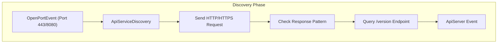
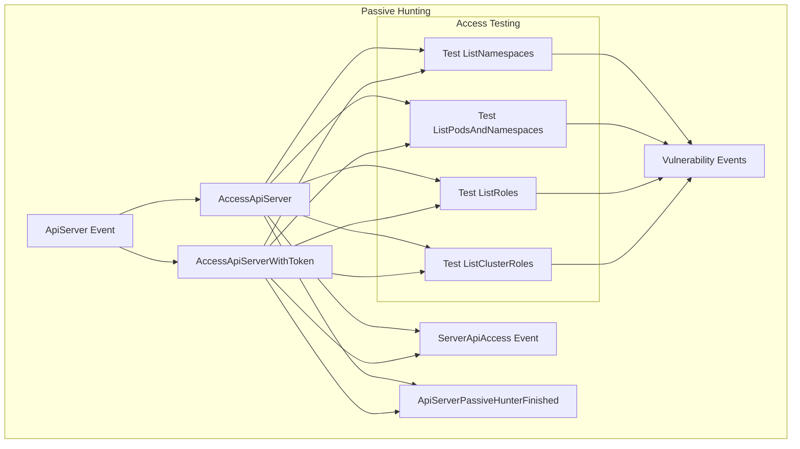
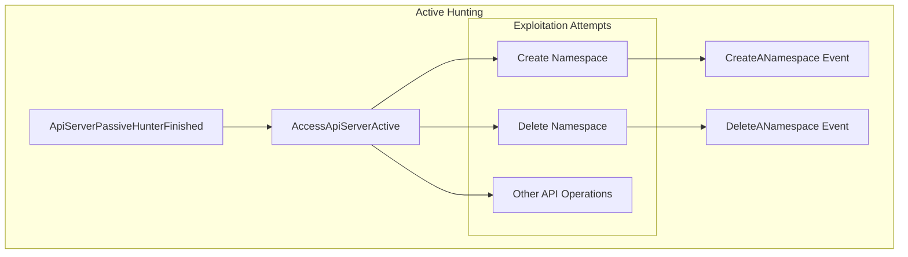
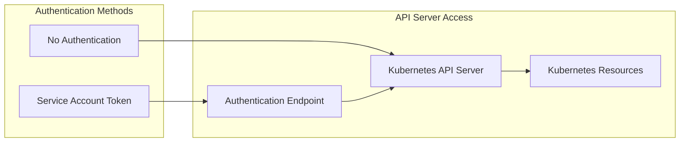

# API Server Vulnerabilities

Relevant source files

The following files were used as context for generating this wiki page:

- [docs/_kb/KHV003.md](https://github.com/aquasecurity/kube-hunter/blob/bc47f08e/docs/_kb/KHV003.md)
- [docs/_kb/KHV004.md](https://github.com/aquasecurity/kube-hunter/blob/bc47f08e/docs/_kb/KHV004.md)
- [docs/_kb/KHV005.md](https://github.com/aquasecurity/kube-hunter/blob/bc47f08e/docs/_kb/KHV005.md)
- [docs/_kb/KHV006.md](https://github.com/aquasecurity/kube-hunter/blob/bc47f08e/docs/_kb/KHV006.md)
- [docs/_kb/KHV007.md](https://github.com/aquasecurity/kube-hunter/blob/bc47f08e/docs/_kb/KHV007.md)
- [docs/_kb/KHV020.md](https://github.com/aquasecurity/kube-hunter/blob/bc47f08e/docs/_kb/KHV020.md)
- [docs/_kb/KHV021.md](https://github.com/aquasecurity/kube-hunter/blob/bc47f08e/docs/_kb/KHV021.md)
- [docs/_kb/KHV022.md](https://github.com/aquasecurity/kube-hunter/blob/bc47f08e/docs/_kb/KHV022.md)
- [docs/_kb/KHV023.md](https://github.com/aquasecurity/kube-hunter/blob/bc47f08e/docs/_kb/KHV023.md)
- [docs/_kb/KHV024.md](https://github.com/aquasecurity/kube-hunter/blob/bc47f08e/docs/_kb/KHV024.md)
- [tests/discovery/test_apiserver.py](https://github.com/aquasecurity/kube-hunter/blob/bc47f08e/tests/discovery/test_apiserver.py)
- [tests/discovery/test_hosts.py](https://github.com/aquasecurity/kube-hunter/blob/bc47f08e/tests/discovery/test_hosts.py)
- [tests/hunting/test_apiserver_hunter.py](https://github.com/aquasecurity/kube-hunter/blob/bc47f08e/tests/hunting/test_apiserver_hunter.py)

This document describes how kube-hunter identifies and exploits vulnerabilities in the Kubernetes API server. The API server is a critical component of Kubernetes, serving as the gateway for all cluster management operations. Due to its central role in cluster management, it's a high-value target for attackers. This page covers the discovery process, detection methods, and types of vulnerabilities that kube-hunter can identify in the API server.

For information about Kubelet-specific vulnerabilities, see [Kubelet Vulnerabilities](#4.2).

## API Server Discovery Process

Before hunting for vulnerabilities, kube-hunter must first discover API servers in the target environment. This is handled by the `ApiServiceDiscovery` class, which identifies potential Kubernetes API servers by examining network endpoints.

Sources: [tests/discovery/test_apiserver.py:9-41](https://github.com/aquasecurity/kube-hunter/blob/bc47f08e/tests/discovery/test_apiserver.py#L9-L41). 

The discovery process works as follows:

1. When an open port (typically 443 for HTTPS or 8080 for HTTP) is detected, the `ApiServiceDiscovery` hunter is triggered
2. The hunter sends requests to the endpoint to determine if it's a Kubernetes API server
3. It checks for API-specific response patterns, such as a 403 Forbidden status code or kubernetes API paths
4. It queries the `/version` endpoint to confirm and gather version information
5. If an API server is detected, an `ApiServer` event is published, which triggers vulnerability hunters

Both secure (HTTPS) and insecure (HTTP) API servers can be discovered, with insecure servers triggering specific vulnerability types.

## API Server Vulnerability Types

kube-hunter can identify several types of API server vulnerabilities:

| Vulnerability ID | Title | Category | Severity |
|------------------|-------|----------|----------|
| KHV005 | Access to Kubernetes API | Information Disclosure, Unauthenticated Access | High |
| KHV006 | Insecure (HTTP) access to Kubernetes API | Unauthenticated Access | High |
| KHV007 | Specific Access to Kubernetes API | Access Risk | High |
| KHV021 | Certificate Includes Email Address | Information Disclosure | Low |
| KHV022 | Critical Privilege Escalation CVE | Privilege Escalation | Critical |
| KHV023 | Denial of Service to Kubernetes API Server | Denial Of Service | Medium |
| KHV024 | Possible Ping Flood Attack | Denial Of Service | Medium |

Sources: [docs/_kb/KHV005.md:1-7](https://github.com/aquasecurity/kube-hunter/blob/bc47f08e/docs/_kb/KHV005.md#L1-L7), [docs/_kb/KHV006.md:1-7](https://github.com/aquasecurity/kube-hunter/blob/bc47f08e/docs/_kb/KHV006.md#L1-L7), [docs/_kb/KHV007.md:1-7](https://github.com/aquasecurity/kube-hunter/blob/bc47f08e/docs/_kb/KHV007.md#L1-L7), [docs/_kb/KHV021.md:1-7](https://github.com/aquasecurity/kube-hunter/blob/bc47f08e/docs/_kb/KHV021.md#L1-L7), [docs/_kb/KHV022.md:1-7](https://github.com/aquasecurity/kube-hunter/blob/bc47f08e/docs/_kb/KHV022.md#L1-L7), [docs/_kb/KHV023.md:1-7](https://github.com/aquasecurity/kube-hunter/blob/bc47f08e/docs/_kb/KHV023.md#L1-L7), [docs/_kb/KHV024.md:1-7](https://github.com/aquasecurity/kube-hunter/blob/bc47f08e/docs/_kb/KHV024.md#L1-L7)

## Passive Hunting Process

Once an API server is discovered, passive hunters attempt to identify vulnerabilities without making changes to the cluster.

Sources: [tests/hunting/test_apiserver_hunter.py:10-20](https://github.com/aquasecurity/kube-hunter/blob/bc47f08e/tests/hunting/test_apiserver_hunter.py#L10-L20), [tests/hunting/test_apiserver_hunter.py:43-91](https://github.com/aquasecurity/kube-hunter/blob/bc47f08e/tests/hunting/test_apiserver_hunter.py#L43-L91)

kube-hunter uses two main hunters for passive testing:

1. `AccessApiServer` - Tests API server access without authentication
2. `AccessApiServerWithToken` - Tests API server access using a service account token

Both hunters attempt to:

- List namespaces (`ListNamespaces` event)
- List pods and their namespaces (`ListPodsAndNamespaces` event)
- List roles and cluster roles (`ListRoles` and `ListClusterRoles` events)
- Determine what permissions are available to the current access context

The hunting process generates `ServerApiAccess` events with different vulnerability categories depending on whether access was unauthenticated (`ExposedSensitiveInterfacesTechnique`) or via token (`AccessK8sApiServerTechnique`).

When passive hunting is complete, an `ApiServerPassiveHunterFinished` event is published, which may trigger active hunting if enabled.

## Active Hunting Process

If active hunting is enabled, kube-hunter will attempt potentially destructive operations to test the extent of API server access.

Sources: [tests/hunting/test_apiserver_hunter.py:203-286](https://github.com/aquasecurity/kube-hunter/blob/bc47f08e/tests/hunting/test_apiserver_hunter.py#L203-L286)

The active hunting process:

1. Begins when an `ApiServerPassiveHunterFinished` event is received
2. The `AccessApiServerActive` hunter attempts operations such as:
   - Creating a namespace
   - Deleting a namespace
   - Other operations depending on available permissions
3. Successful operations trigger events like `CreateANamespace` or `DeleteANamespace`

Active hunting should only be used in test environments as it can modify cluster state.

## Authentication Mechanisms

kube-hunter can test API server access with different authentication contexts:

Sources: [tests/hunting/test_apiserver_hunter.py:31-45](https://github.com/aquasecurity/kube-hunter/blob/bc47f08e/tests/hunting/test_apiserver_hunter.py#L31-L45)

The authentication mechanisms tested include:

1. **Unauthenticated Access**: Testing what operations can be performed without any authentication
2. **Service Account Token Authentication**: Using a discovered service account token to access the API

kube-hunter can capture the service account token from:
- The pod it's running in (if deployed inside the cluster)
- A token explicitly provided in the configuration

## Vulnerability Details

### Unauthenticated API Access (KHV005, KHV006)

The API server may be accessible without proper authentication, either through:

- Anonymous access to the HTTPS endpoint (KHV005)
- Use of the insecure HTTP port (KHV006)

These vulnerabilities allow an attacker to interact with the Kubernetes API without providing credentials, potentially accessing sensitive information or making changes to the cluster.

Sources: [docs/_kb/KHV005.md:10-22](https://github.com/aquasecurity/kube-hunter/blob/bc47f08e/docs/_kb/KHV005.md#L10-L22), [docs/_kb/KHV006.md:10-24](https://github.com/aquasecurity/kube-hunter/blob/bc47f08e/docs/_kb/KHV006.md#L10-L24)

### Information Disclosure (KHV005, KHV021)

Information disclosure vulnerabilities may expose:

- Cluster information through the API server (KHV005)
- Email addresses in API server TLS certificates (KHV021)

These can provide attackers with valuable reconnaissance information for further attacks.

Sources: [docs/_kb/KHV005.md:1-26](https://github.com/aquasecurity/kube-hunter/blob/bc47f08e/docs/_kb/KHV005.md#L1-L26), [docs/_kb/KHV021.md:1-17](https://github.com/aquasecurity/kube-hunter/blob/bc47f08e/docs/_kb/KHV021.md#L1-L17)

### Denial of Service (KHV023, KHV024)

kube-hunter can detect vulnerabilities that could lead to denial of service:

- API server patch denial of service (CVE-2019-1002100, KHV023)
- HTTP/2 ping flood vulnerability (CVE-2019-9512, KHV024)

These vulnerabilities could allow attackers to disrupt the availability of the Kubernetes control plane.

Sources: [docs/_kb/KHV023.md:1-20](https://github.com/aquasecurity/kube-hunter/blob/bc47f08e/docs/_kb/KHV023.md#L1-L20), [docs/_kb/KHV024.md:1-21](https://github.com/aquasecurity/kube-hunter/blob/bc47f08e/docs/_kb/KHV024.md#L1-L21)

### Privilege Escalation (KHV022)

Critical privilege escalation vulnerabilities, such as CVE-2018-1002105 (KHV022), can allow attackers to gain elevated privileges within the cluster, potentially leading to complete cluster compromise.

Sources: [docs/_kb/KHV022.md:1-20](https://github.com/aquasecurity/kube-hunter/blob/bc47f08e/docs/_kb/KHV022.md#L1-L20)

## Remediation Recommendations

Based on the types of vulnerabilities kube-hunter detects, here are key remediation strategies:

1. **Secure API Server Authentication**:
   - Use proper authentication mechanisms (client certificates, OpenID Connect, or webhook tokens)
   - Review and restrict RBAC permissions for anonymous users and service accounts
   - Explicitly specify service accounts for workloads with minimal permissions

2. **Use TLS for API Server Access**:
   - Ensure the API server is only accessible via HTTPS
   - Disable the insecure HTTP port (`--insecure-port=0`)
   - Use certificates without personal information like email addresses

3. **Keep Kubernetes Updated**:
   - Regularly update to patch known vulnerabilities (e.g., CVE-2018-1002105, CVE-2019-1002100)
   - Monitor security announcements for new vulnerabilities

4. **Apply Network Controls**:
   - Use network policies to restrict access to the API server
   - Implement firewall rules to limit external access to the API server port

5. **Service Account Management**:
   - Use `automountServiceAccountToken: false` when a pod doesn't need API access
   - Create custom service accounts with minimal permissions for each workload