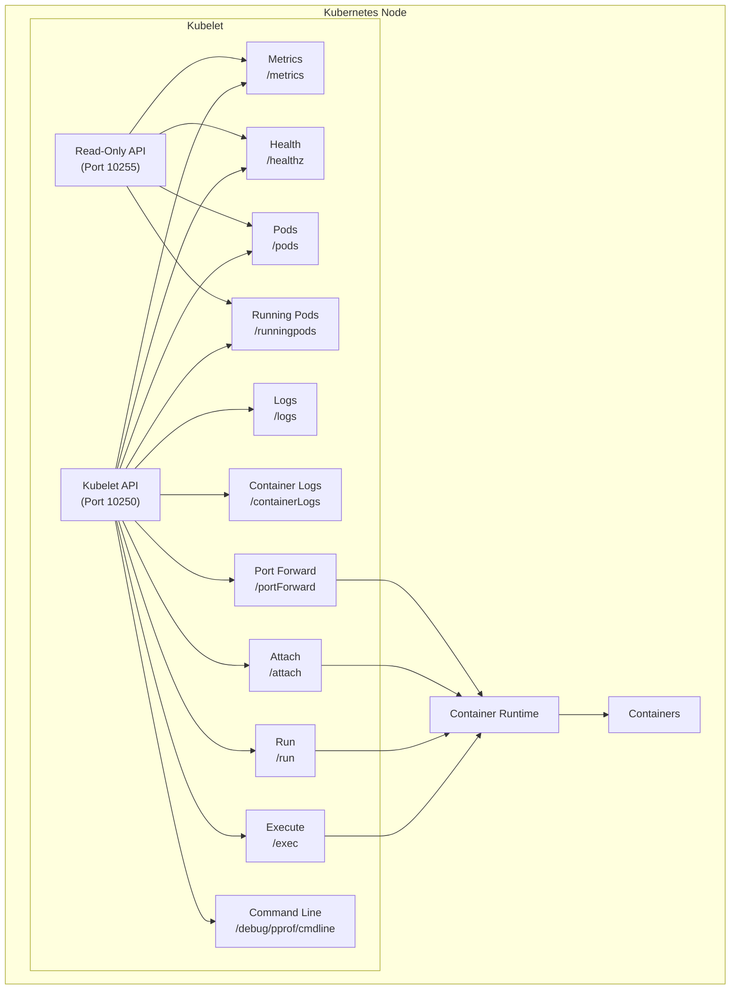
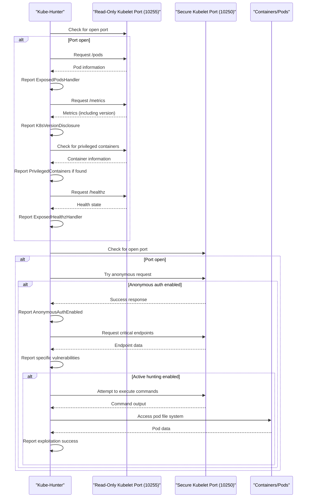
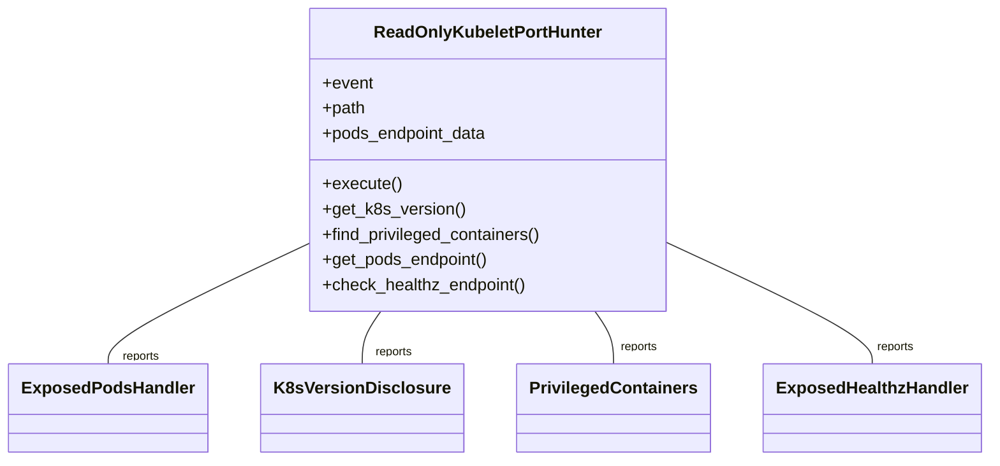
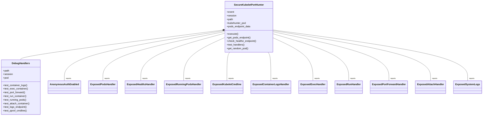
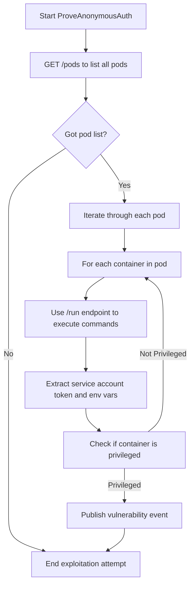
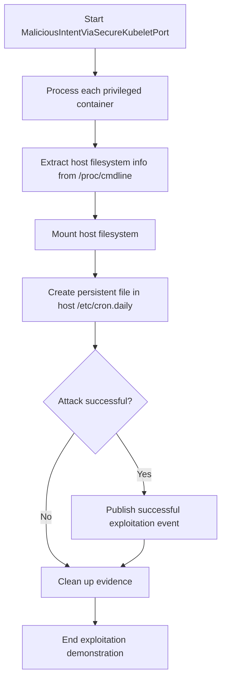
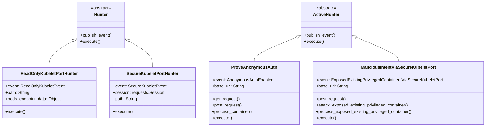

# Kubelet Vulnerabilities

Relevant source files

The following files were used as context for generating this wiki page:

- [docs/_kb/KHV002.md](https://github.com/aquasecurity/kube-hunter/blob/bc47f08e/docs/_kb/KHV002.md)
- [docs/_kb/KHV036.md](https://github.com/aquasecurity/kube-hunter/blob/bc47f08e/docs/_kb/KHV036.md)
- [docs/_kb/KHV052.md](https://github.com/aquasecurity/kube-hunter/blob/bc47f08e/docs/_kb/KHV052.md)
- [kube_hunter/modules/discovery/hosts.py](https://github.com/aquasecurity/kube-hunter/blob/bc47f08e/kube_hunter/modules/discovery/hosts.py)
- [kube_hunter/modules/hunting/apiserver.py](https://github.com/aquasecurity/kube-hunter/blob/bc47f08e/kube_hunter/modules/hunting/apiserver.py)
- [kube_hunter/modules/hunting/certificates.py](https://github.com/aquasecurity/kube-hunter/blob/bc47f08e/kube_hunter/modules/hunting/certificates.py)
- [kube_hunter/modules/hunting/cves.py](https://github.com/aquasecurity/kube-hunter/blob/bc47f08e/kube_hunter/modules/hunting/cves.py)
- [kube_hunter/modules/hunting/kubelet.py](https://github.com/aquasecurity/kube-hunter/blob/bc47f08e/kube_hunter/modules/hunting/kubelet.py)
- [tests/hunting/test_certificates.py](https://github.com/aquasecurity/kube-hunter/blob/bc47f08e/tests/hunting/test_certificates.py)
- [tests/hunting/test_kubelet.py](https://github.com/aquasecurity/kube-hunter/blob/bc47f08e/tests/hunting/test_kubelet.py)

This document explains how kube-hunter identifies and exploits vulnerabilities in the Kubernetes kubelet component. The kubelet is a critical component in the Kubernetes architecture that runs on each node and is responsible for managing containers and pods. Due to its capabilities and privileged position, a vulnerable kubelet can lead to serious security compromises within a cluster.

For information about API Server vulnerabilities, see [API Server Vulnerabilities](#4.1). For Cloud-specific vulnerabilities, see [Cloud-specific Vulnerabilities](#4.3).

## Kubelet Overview and Attack Surface

The kubelet is a node-level agent that communicates with the Kubernetes API server and container runtime to manage pods on its host. It exposes several HTTP endpoints that can be targeted by attackers:

- **Read-only port (default: 10255)**: Provides read-only access to pod data and metrics
- **Secure port (default: 10250)**: Provides full access to kubelet functionality, including executing commands in containers

Sources: [kube_hunter/modules/hunting/kubelet.py:219-237](https://github.com/aquasecurity/kube-hunter/blob/bc47f08e/kube_hunter/modules/hunting/kubelet.py#L219-L237)

## Vulnerability Categories

Kube-hunter identifies several types of kubelet vulnerabilities:

| Vulnerability | Description | Security Impact | KB ID |
|---------------|-------------|----------------|-------|
| Anonymous Authentication | Kubelet allows unauthenticated access to API | Enables multiple attack vectors | KHV036 |
| Exposed Pods | Access to pod information via `/pods` endpoint | Information disclosure | KHV052 |
| Exposed Container Logs | Access to container output logs | Information disclosure | KHV037 |
| Exposed Running Pods | List of running pods and their metadata | Information disclosure | KHV038 |
| Exposed Exec On Container | Ability to execute commands in containers | Remote code execution | KHV039 |
| Exposed Run Inside Container | Ability to run arbitrary commands | Remote code execution | KHV040 |
| Exposed Port Forward | Ability to set up port forwarding | Network access/pivoting | KHV041 |
| Exposed Attaching To Container | Ability to attach to running containers | Container compromise | KHV042 |
| Cluster Health Disclosure | Access to cluster health state | Information disclosure | KHV043 |
| Exposed Privileged Containers | Access to privileged containers | Host compromise | KHV051 |
| Exposed System Logs | Access to node system logs | Information disclosure | KHV045 |
| Exposed Kubelet Cmdline | Access to kubelet startup parameters | Information disclosure | KHV046 |

Sources: [kube_hunter/modules/hunting/kubelet.py:35-216](https://github.com/aquasecurity/kube-hunter/blob/bc47f08e/kube_hunter/modules/hunting/kubelet.py#L35-L216), [docs/_kb/KHV052.md](https://github.com/aquasecurity/kube-hunter/blob/bc47f08e/docs/_kb/KHV052.md), [docs/_kb/KHV036.md](https://github.com/aquasecurity/kube-hunter/blob/bc47f08e/docs/_kb/KHV036.md)

## Kubelet Vulnerability Detection Workflow

Kube-hunter employs a systematic approach to detect kubelet vulnerabilities:

Sources: [kube_hunter/modules/hunting/kubelet.py:240-493](https://github.com/aquasecurity/kube-hunter/blob/bc47f08e/kube_hunter/modules/hunting/kubelet.py#L240-L493)

## Read-Only Kubelet Port Hunter

The `ReadOnlyKubeletPortHunter` class targets the read-only port (typically 10255) to identify vulnerabilities without authentication requirements:

This hunter:
1. Attempts to access the `/pods` endpoint to get information about pods running on the node
2. Extracts Kubernetes version information from the `/metrics` endpoint
3. Examines pod data to identify privileged containers
4. Checks access to the `/healthz` endpoint which reveals cluster health state

Sources: [kube_hunter/modules/hunting/kubelet.py:240-300](https://github.com/aquasecurity/kube-hunter/blob/bc47f08e/kube_hunter/modules/hunting/kubelet.py#L240-L300)

## Secure Kubelet Port Hunter

The `SecureKubeletPortHunter` class targets the secure port (typically 10250) which offers more capabilities but usually requires authentication:

This hunter:
1. Tests whether anonymous authentication is enabled
2. If access is gained, probes various endpoints using a nested `DebugHandlers` class
3. Tests critical capabilities like executing commands in containers, accessing logs, and more
4. Reports on vulnerable configurations it discovers

Sources: [kube_hunter/modules/hunting/kubelet.py:302-518](https://github.com/aquasecurity/kube-hunter/blob/bc47f08e/kube_hunter/modules/hunting/kubelet.py#L302-L518)

## Active Exploitation

When running in active mode, kube-hunter attempts to demonstrate the impact of kubelet vulnerabilities:

### Anonymous Auth Exploitation

The `ProveAnonymousAuth` class attempts to demonstrate that anonymous authentication allows an attacker to gain a foothold:

This hunter:
1. Lists all pods using the `/pods` endpoint
2. For each pod, attempts to execute commands in each container to extract service account tokens
3. Identifies privileged containers that could be leveraged for further attacks
4. Reports on successful breaches with evidence

Sources: [kube_hunter/modules/hunting/kubelet.py:523-653](https://github.com/aquasecurity/kube-hunter/blob/bc47f08e/kube_hunter/modules/hunting/kubelet.py#L523-L653)

### Privileged Container Exploitation

The `MaliciousIntentViaSecureKubeletPort` class demonstrates how an attacker can leverage privileged containers to compromise the host:

This hunter demonstrates the full impact of a kubelet vulnerability by:
1. Accessing information about the host's root filesystem from within the container
2. Mounting the host filesystem inside the container
3. Creating a file in a sensitive location (like `/etc/cron.daily`) to demonstrate persistence
4. Showing how a real attacker could permanently compromise the host

Sources: [kube_hunter/modules/hunting/kubelet.py:656-722](https://github.com/aquasecurity/kube-hunter/blob/bc47f08e/kube_hunter/modules/hunting/kubelet.py#L656-L722)

## Common Remediation Strategies

To protect against kubelet vulnerabilities:

1. **Disable Anonymous Authentication**: 
   - Set `--anonymous-auth=false` kubelet flag
   - Implement proper authentication using `--client-ca-file` or `--authentication-token-webhook`

2. **Disable the Read-Only Port**:
   - Set `--read-only-port=0` kubelet flag

3. **Implement Network Policies**:
   - Restrict direct access to kubelet ports (10250, 10255)
   - Allow only authenticated API server traffic to communicate with kubelet

4. **Minimize Debug Information**:
   - Disable `--enable-debugging-handlers` kubelet flag

5. **Use Pod Security Policies/Standards**:
   - Restrict the use of privileged containers
   - Implement appropriate pod security contexts

Sources: [docs/_kb/KHV036.md](https://github.com/aquasecurity/kube-hunter/blob/bc47f08e/docs/_kb/KHV036.md), [docs/_kb/KHV052.md](https://github.com/aquasecurity/kube-hunter/blob/bc47f08e/docs/_kb/KHV052.md), [docs/_kb/KHV002.md](https://github.com/aquasecurity/kube-hunter/blob/bc47f08e/docs/_kb/KHV002.md)

## Kubelet Vulnerability Hunting Implementation

Kube-hunter's kubelet vulnerability hunting implementation consists of three main components:

Key implementation details:
1. Hunters subscribe to specific events using the event handler system
2. The read-only hunter targets basic information disclosure
3. The secure port hunter checks for anonymous access and endpoint availability
4. Active hunters demonstrate practical exploitation of discovered vulnerabilities
5. Each hunter publishes events that represent vulnerability findings

Sources: [kube_hunter/modules/hunting/kubelet.py:240-887](https://github.com/aquasecurity/kube-hunter/blob/bc47f08e/kube_hunter/modules/hunting/kubelet.py#L240-L887)

## Conclusion

Kubelet vulnerabilities represent a significant risk to Kubernetes clusters as they can provide an entry point for attackers to:
1. Gather sensitive information about the cluster
2. Execute commands within containers
3. Potentially escape to the host via privileged containers