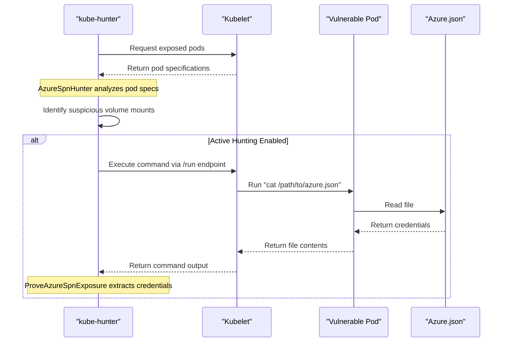
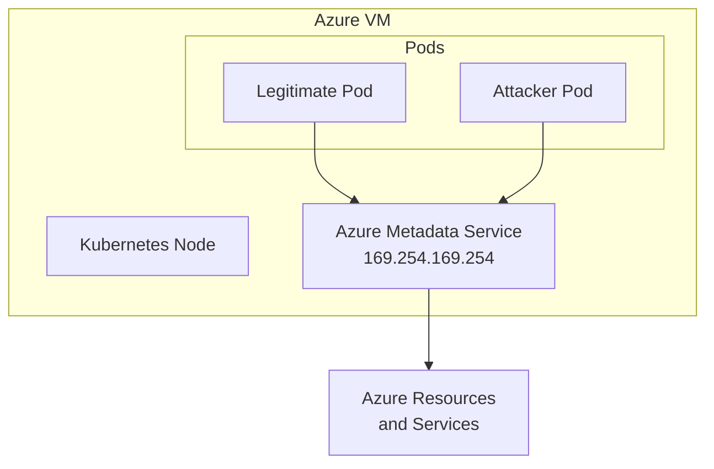
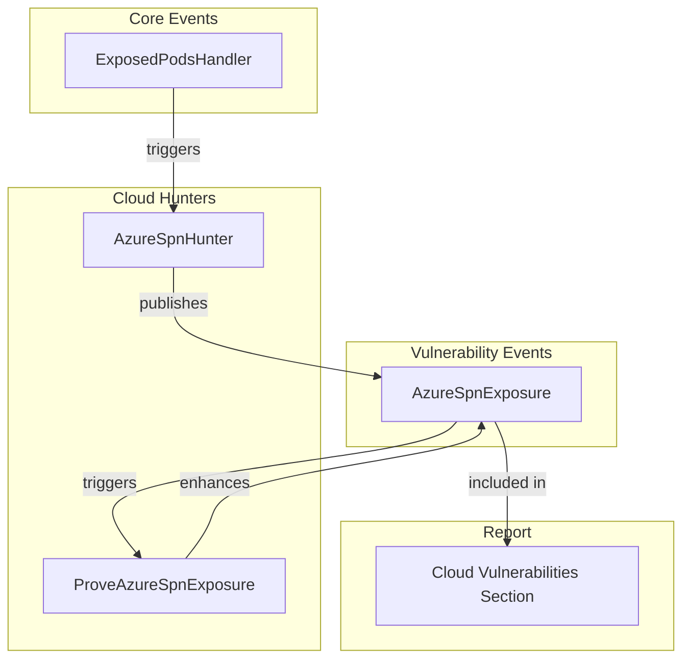

# Cloud-specific Vulnerabilities

Relevant source files

The following files were used as context for generating this wiki page:

- [docs/_kb/KHV003.md](https://github.com/aquasecurity/kube-hunter/blob/bc47f08e/docs/_kb/KHV003.md)
- [docs/_kb/KHV004.md](https://github.com/aquasecurity/kube-hunter/blob/bc47f08e/docs/_kb/KHV004.md)
- [docs/_kb/KHV005.md](https://github.com/aquasecurity/kube-hunter/blob/bc47f08e/docs/_kb/KHV005.md)
- [docs/_kb/KHV006.md](https://github.com/aquasecurity/kube-hunter/blob/bc47f08e/docs/_kb/KHV006.md)
- [docs/_kb/KHV007.md](https://github.com/aquasecurity/kube-hunter/blob/bc47f08e/docs/_kb/KHV007.md)
- [docs/_kb/KHV020.md](https://github.com/aquasecurity/kube-hunter/blob/bc47f08e/docs/_kb/KHV020.md)
- [docs/_kb/KHV021.md](https://github.com/aquasecurity/kube-hunter/blob/bc47f08e/docs/_kb/KHV021.md)
- [docs/_kb/KHV022.md](https://github.com/aquasecurity/kube-hunter/blob/bc47f08e/docs/_kb/KHV022.md)
- [docs/_kb/KHV023.md](https://github.com/aquasecurity/kube-hunter/blob/bc47f08e/docs/_kb/KHV023.md)
- [docs/_kb/KHV024.md](https://github.com/aquasecurity/kube-hunter/blob/bc47f08e/docs/_kb/KHV024.md)
- [kube_hunter/modules/discovery/apiserver.py](https://github.com/aquasecurity/kube-hunter/blob/bc47f08e/kube_hunter/modules/discovery/apiserver.py)
- [kube_hunter/modules/discovery/dashboard.py](https://github.com/aquasecurity/kube-hunter/blob/bc47f08e/kube_hunter/modules/discovery/dashboard.py)
- [kube_hunter/modules/discovery/kubelet.py](https://github.com/aquasecurity/kube-hunter/blob/bc47f08e/kube_hunter/modules/discovery/kubelet.py)
- [kube_hunter/modules/discovery/proxy.py](https://github.com/aquasecurity/kube-hunter/blob/bc47f08e/kube_hunter/modules/discovery/proxy.py)
- [kube_hunter/modules/hunting/aks.py](https://github.com/aquasecurity/kube-hunter/blob/bc47f08e/kube_hunter/modules/hunting/aks.py)
- [kube_hunter/modules/hunting/dashboard.py](https://github.com/aquasecurity/kube-hunter/blob/bc47f08e/kube_hunter/modules/hunting/dashboard.py)
- [kube_hunter/modules/hunting/etcd.py](https://github.com/aquasecurity/kube-hunter/blob/bc47f08e/kube_hunter/modules/hunting/etcd.py)
- [kube_hunter/modules/hunting/proxy.py](https://github.com/aquasecurity/kube-hunter/blob/bc47f08e/kube_hunter/modules/hunting/proxy.py)
- [tests/hunting/test_aks.py](https://github.com/aquasecurity/kube-hunter/blob/bc47f08e/tests/hunting/test_aks.py)

This page details the vulnerabilities specific to cloud environments that kube-hunter can identify and exploit. Currently, kube-hunter focuses on Azure Kubernetes Service (AKS) vulnerabilities, with potential to expand to other cloud providers in the future. For more general Kubernetes vulnerabilities, see other sections in the Vulnerability Hunting category.

## Azure Kubernetes Service (AKS) Vulnerabilities

Azure Kubernetes Service has unique vulnerabilities stemming from how AKS integrates with Azure's broader cloud infrastructure and authentication mechanisms.

### Azure Service Principal Exposure (KHV004)

Azure Kubernetes Service uses Service Principals (SPNs) to interact with Azure APIs for managing cloud resources like load balancers and persistent volumes. These credentials are typically stored in `/etc/kubernetes/azure.json` on each node.

#### Vulnerability Details

When a pod has access to the host path containing this credential file, attackers can extract the Azure SPN credentials, potentially allowing them to:

- Access and control Azure resources
- Manipulate the underlying infrastructure of the cluster
- Gain persistence in the environment
- Escalate privileges beyond the Kubernetes boundary

The vulnerability is tracked as KHV004 in kube-hunter.

```mermaid
flowchart TD
    subgraph "AzureSpnExposure Vulnerability"
        A["Pod with hostPath Volume"] --> B["Access to /etc/kubernetes/azure.json"]
        B --> C["Extract SPN Credentials"]
        C --> D["Control Azure Resources"]
    end
    
    subgraph "Detection Process"
        E["ExposedPodsHandler Event"] --> F["AzureSpnHunter"]
        F --> G["Examine Pod Volumes"]
        G --> H["Find hostPath to azure.json"]
        H --> I["AzureSpnExposure Event"]
        I --> J["ProveAzureSpnExposure\n(Active Hunter)"]
        J --> K["Attempt to read azure.json"]
        K --> L["Extract credentials"]
    end
```

Sources: [kube_hunter/modules/hunting/aks.py:15-69](https://github.com/aquasecurity/kube-hunter/blob/bc47f08e/kube_hunter/modules/hunting/aks.py#L15-L69), [docs/_kb/KHV004.md](https://github.com/aquasecurity/kube-hunter/blob/bc47f08e/docs/_kb/KHV004.md)

#### Detection Mechanism

kube-hunter uses a two-stage process to detect and verify this vulnerability:

1. **Passive Detection (AzureSpnHunter)**:
   - Triggered by `ExposedPodsHandler` events specific to Azure
   - Examines pod specifications for volumes with hostPath mounts
   - Identifies mounts that could access `/etc/kubernetes/azure.json`
   - Reports suspicious containers as `AzureSpnExposure` events

2. **Active Verification (ProveAzureSpnExposure)**:
   - Triggered by `AzureSpnExposure` events
   - Uses Kubelet's `/run` endpoint to execute commands in the vulnerable container
   - Attempts to read the azure.json file from the mounted path
   - Extracts Service Principal credentials (subscriptionId, aadClientId, aadClientSecret, tenantId)

Sources: [kube_hunter/modules/hunting/aks.py:71-127](https://github.com/aquasecurity/kube-hunter/blob/bc47f08e/kube_hunter/modules/hunting/aks.py#L71-L127)

#### Remediation

To address this vulnerability:

1. Use Azure Managed Identities instead of static SPNs (note: this functionality may be in preview/alpha)
2. Regularly update or rotate the cluster SPN credentials
3. Carefully restrict which pods can mount sensitive host paths
4. Apply the principle of least privilege to your workloads

### Azure Metadata Service Exposure (KHV003)

Microsoft Azure provides an instance metadata service (IMDS) that exposes cloud information to VMs via a non-routable IP address (169.254.169.254). This endpoint is accessible to all processes running on the VM, including Kubernetes pods.

#### Vulnerability Details

An attacker with the ability to run a pod in the cluster can query the metadata service to discover information about:

- The VM instance
- Network configurations
- Authentication tokens for Azure services
- Other sensitive environment details

This can provide attackers with valuable reconnaissance information and potentially authentication material for further attacks.

Sources: [docs/_kb/KHV003.md](https://github.com/aquasecurity/kube-hunter/blob/bc47f08e/docs/_kb/KHV003.md)

#### Remediation

As of Azure VHD Release 2020.10.15, AKS restricts pod CIDR access to the metadata endpoint, addressing the vulnerability tracked as CVE-2021-27075.

If you're running an older version, you should:

1. Update to the latest AKS version
2. Consider using network policies to restrict pod access to the metadata IP address
3. Implement proper RBAC to limit who can create pods in your cluster

## Other Cloud Services

While kube-hunter currently focuses mostly on Azure-specific vulnerabilities, Kubernetes clusters running in other cloud environments may have similar vulnerabilities related to:

1. Instance metadata services (AWS, GCP)
2. Service account credentials
3. Cloud provider integration points

### Cross-Cloud Kubernetes Vulnerabilities

Some vulnerabilities affect Kubernetes regardless of cloud provider, but may have cloud-specific implications:

| Vulnerability Type | Azure | AWS | GCP | Description |
|-------------------|-------|-----|-----|-------------|
| Service Account Exposure | SPN | IAM Roles | Service Accounts | Credentials that allow the cluster to interact with cloud APIs |
| Metadata Service Access | 169.254.169.254 | 169.254.169.254 | 169.254.169.254 | Internal endpoint providing instance information |
| Cloud Resource Access | Azure Resource Manager | AWS APIs | GCP APIs | APIs that control cloud resources |
| Node Identity | Managed Identity | Instance Profiles | VM Service Accounts | How nodes authenticate to cloud services |

## Integration with kube-hunter Architecture

The cloud vulnerability detection system integrates with the broader kube-hunter architecture as follows:

Sources: [kube_hunter/modules/hunting/aks.py](https://github.com/aquasecurity/kube-hunter/blob/bc47f08e/kube_hunter/modules/hunting/aks.py)

## Detection Classes and Implementation

The primary classes that implement cloud vulnerability detection in kube-hunter are:

### AzureSpnExposure

This class represents the vulnerability event for Azure SPN exposure. It's defined in `kube_hunter/modules/hunting/aks.py` and inherits from both `Vulnerability` and `Event`.

Key attributes:
- `container`: The container that has access to the Azure credentials
- `evidence`: String containing evidence of the vulnerability
- Category: `MountServicePrincipalTechnique`
- ID: KHV004

### AzureSpnHunter

This passive hunter class looks for pods that might have access to Azure credentials:

- Subscribes to `ExposedPodsHandler` events with Azure cloud type
- Analyzes pod specifications looking for suspicious volume mounts
- Identifies hostPath volumes that could access `/etc/kubernetes/azure.json`
- Uses the `get_key_container` method to find containers with suspicious mounts
- Publishes `AzureSpnExposure` events when vulnerabilities are found

### ProveAzureSpnExposure

This active hunter class attempts to verify and exploit the vulnerability:

- Subscribes to `AzureSpnExposure` events
- Tests if the Kubelet's `/run` endpoint is accessible
- Executes commands in the vulnerable container to read the Azure credentials file
- Extracts and validates the credentials
- Enhances the vulnerability event with the extracted information

Sources: [kube_hunter/modules/hunting/aks.py](https://github.com/aquasecurity/kube-hunter/blob/bc47f08e/kube_hunter/modules/hunting/aks.py)

## Future Developments

The cloud-specific vulnerability hunting in kube-hunter could be expanded to include:

1. AWS-specific vulnerabilities related to IAM roles and metadata service
2. GCP-specific vulnerabilities related to service accounts and metadata
3. Detection of cross-cloud vulnerabilities that affect multiple providers
4. Specialized active hunters for different cloud environments