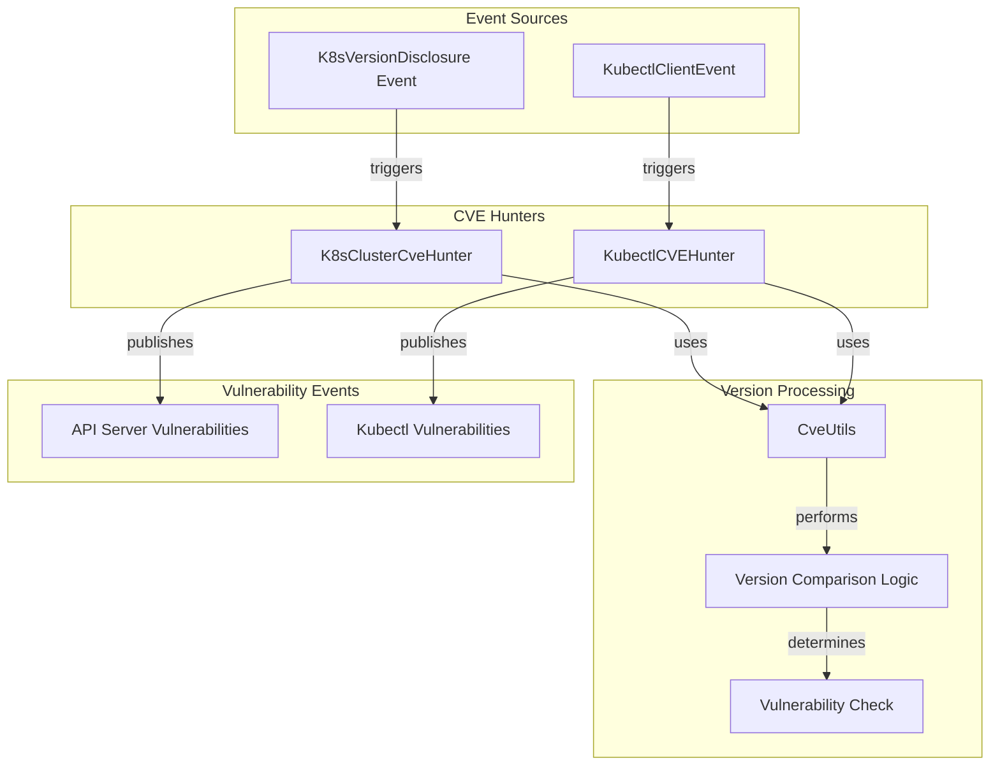
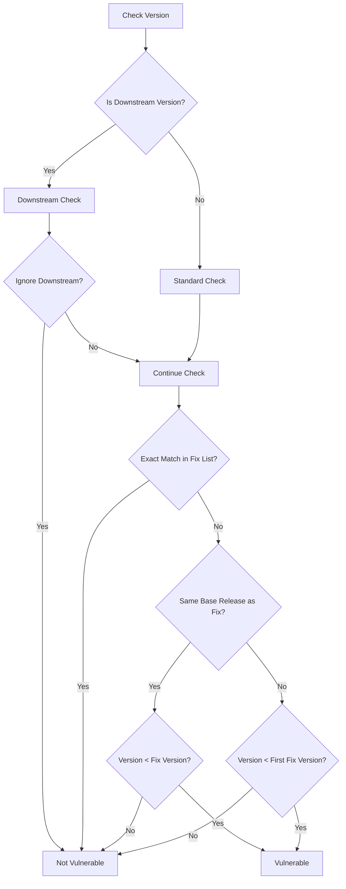
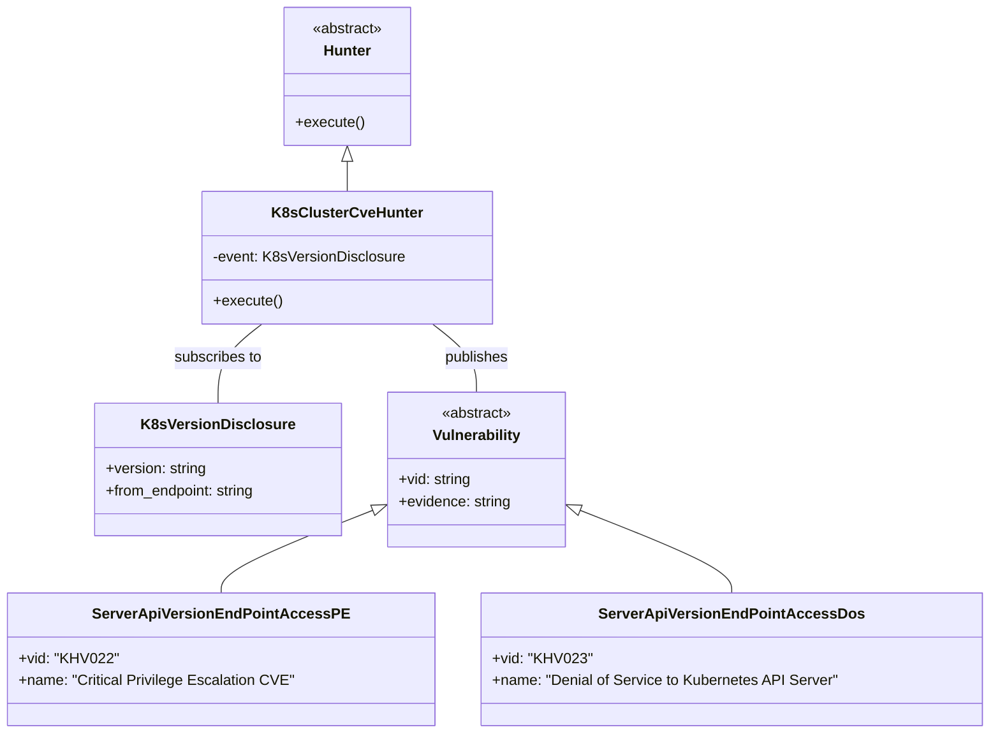
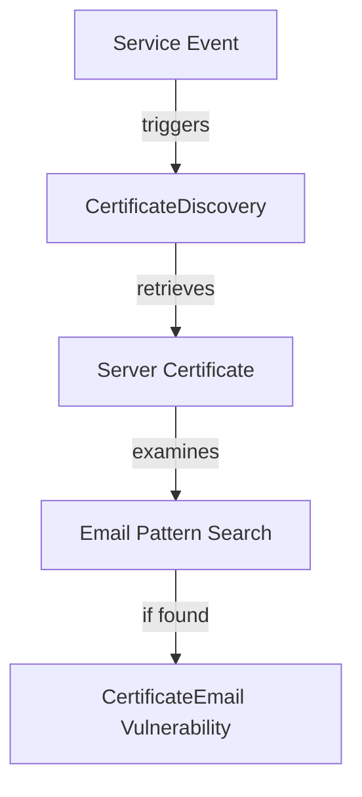

# CVE Hunting

<details>
<summary>Relevant source files</summary>

The following files were used as context for generating this wiki page:

- [kube_hunter/modules/hunting/certificates.py](https://github.com/aquasecurity/kube-hunter/blob/bc47f08e/kube_hunter/modules/hunting/certificates.py)
- [kube_hunter/modules/hunting/cves.py](https://github.com/aquasecurity/kube-hunter/blob/bc47f08e/kube_hunter/modules/hunting/cves.py)
- [tests/hunting/test_certificates.py](https://github.com/aquasecurity/kube-hunter/blob/bc47f08e/tests/hunting/test_certificates.py)
- [tests/hunting/test_cvehunting.py](https://github.com/aquasecurity/kube-hunter/blob/bc47f08e/tests/hunting/test_cvehunting.py)

</details>


This document describes how kube-hunter detects and reports known Common Vulnerabilities and Exposures (CVEs) in Kubernetes clusters. The focus is on the automated mechanisms used to identify vulnerabilities based on version information and other characteristics of the target Kubernetes environment.

For information about specific API Server vulnerabilities, see [API Server Vulnerabilities](#4.1).
For information about Kubelet-specific vulnerabilities, see [Kubelet Vulnerabilities](#4.2).

## Overview of CVE Detection Process

Kube-hunter includes specialized hunters that identify known CVEs in Kubernetes clusters and related components. The process works by:

1. Collecting version information from various components (API server, kubectl)
2. Comparing detected versions against known vulnerable versions
3. Reporting detected vulnerabilities

The detection is primarily based on version comparison, taking into account complex versioning schemes including downstream distributions.



Sources: [kube_hunter/modules/hunting/cves.py:204-227](https://github.com/aquasecurity/kube-hunter/blob/bc47f08e/kube_hunter/modules/hunting/cves.py#L204-L227), [kube_hunter/modules/hunting/cves.py:230-248](https://github.com/aquasecurity/kube-hunter/blob/bc47f08e/kube_hunter/modules/hunting/cves.py#L230-L248)

## CVE Detection Components

### CveUtils

The `CveUtils` class provides essential functionality for comparing versions and determining vulnerability status. It handles various versioning schemes, including:

- Standard semantic versioning (e.g., 1.13.5)
- Legacy versioning formats
- Downstream distribution versions (e.g., v1.13.9-gke.3)

Key methods include:

| Method | Purpose |
|--------|---------|
| `is_vulnerable` | Determines if a version is vulnerable by comparing to fix versions |
| `version_compare` | Compares two versions, handling legacy version differences |
| `is_downstream_version` | Checks if a version is from a downstream distribution |
| `get_base_release` | Extracts base release (major.minor) from a full version |

Sources: [kube_hunter/modules/hunting/cves.py:128-201](https://github.com/aquasecurity/kube-hunter/blob/bc47f08e/kube_hunter/modules/hunting/cves.py#L128-L201)

### Version Comparison Logic

The version comparison process is complex due to various versioning schemes used by Kubernetes and its distributions. The system:

1. Handles prefix characters (like 'v')
2. Compares versions by their components
3. Special-cases downstream distribution versions
4. Maps versions to specific CVEs and their fix versions



Sources: [kube_hunter/modules/hunting/cves.py:168-201](https://github.com/aquasecurity/kube-hunter/blob/bc47f08e/kube_hunter/modules/hunting/cves.py#L168-L201)

## K8s Cluster CVE Hunter

The `K8sClusterCveHunter` is triggered by `K8sVersionDisclosure` events and checks if the Kubernetes cluster is running a version vulnerable to specific CVEs.



The hunter maintains a mapping of vulnerability classes to their fix versions:

| Vulnerability Class | Fix Versions |
|---------------------|--------------|
| ServerApiVersionEndPointAccessPE | 1.10.11, 1.11.5, 1.12.3 |
| ServerApiVersionEndPointAccessDos | 1.11.8, 1.12.6, 1.13.4 |
| ResetFloodHttp2Implementation | 1.13.10, 1.14.6, 1.15.3 |
| PingFloodHttp2Implementation | 1.13.10, 1.14.6, 1.15.3 |
| ServerApiClusterScopedResourcesAccess | 1.13.9, 1.14.5, 1.15.2 |

Sources: [kube_hunter/modules/hunting/cves.py:204-227](https://github.com/aquasecurity/kube-hunter/blob/bc47f08e/kube_hunter/modules/hunting/cves.py#L204-L227)

## Kubectl CVE Hunter

The `KubectlCVEHunter` focuses on vulnerabilities in the kubectl client tool. It is triggered by `KubectlClientEvent` events and checks for specific kubectl-related CVEs.

Supported kubectl CVEs include:

| Vulnerability Class | Fix Versions | VID | Description |
|--------------------|--------------|-----|-------------|
| KubectlCpVulnerability | 1.11.9, 1.12.7, 1.13.5, 1.14.0 | KHV028 | Remote Code Execution (CVE-2019-1002101) |
| IncompleteFixToKubectlCpVulnerability | 1.12.9, 1.13.6, 1.14.2 | KHV027 | Remote Code Execution (CVE-2019-11246) |

Sources: [kube_hunter/modules/hunting/cves.py:230-248](https://github.com/aquasecurity/kube-hunter/blob/bc47f08e/kube_hunter/modules/hunting/cves.py#L230-L248)

## Supported CVEs

Kube-hunter can detect the following CVEs:

### API Server CVEs

| CVE ID | VID | Vulnerability Class | Description | Category |
|--------|-----|---------------------|-------------|----------|
| CVE-2018-1002105 | KHV022 | ServerApiVersionEndPointAccessPE | Critical privilege escalation vulnerability | Privilege Escalation |
| CVE-2019-1002100 | KHV023 | ServerApiVersionEndPointAccessDos | Denial of service vulnerability with crafted json-patch | Denial of Service |
| CVE-2019-9512 | KHV024 | PingFloodHttp2Implementation | Denial of service vulnerability in HTTP/2 implementation | Denial of Service |
| CVE-2019-9514 | KHV025 | ResetFloodHttp2Implementation | Denial of service vulnerability in HTTP/2 implementation | Denial of Service |
| CVE-2019-11247 | KHV026 | ServerApiClusterScopedResourcesAccess | API server allows access to custom resources via wrong scope | Privilege Escalation |

### Kubectl CVEs

| CVE ID | VID | Vulnerability Class | Description | Category |
|--------|-----|---------------------|-------------|----------|
| CVE-2019-1002101 | KHV028 | KubectlCpVulnerability | Remote code execution vulnerability in kubectl cp command | Remote Code Execution |
| CVE-2019-11246 | KHV027 | IncompleteFixToKubectlCpVulnerability | Incomplete fix for CVE-2019-1002101 | Remote Code Execution |

Sources: [kube_hunter/modules/hunting/cves.py:22-126](https://github.com/aquasecurity/kube-hunter/blob/bc47f08e/kube_hunter/modules/hunting/cves.py#L22-L126)

## Configuration Options

The CVE hunting functionality can be controlled through configuration options:

| Option | Description |
|--------|-------------|
| `enable_cve_hunting` | Toggle to enable/disable CVE hunting (default: enabled) |
| `include_patched_versions` | Whether to report vulnerabilities for downstream patched versions (default: false) |

CVE hunters are registered conditionally based on these configuration options:

```
@handler.subscribe_once(K8sVersionDisclosure, is_register=config.enable_cve_hunting)
class K8sClusterCveHunter(Hunter):
    # ...
```

Sources: [kube_hunter/modules/hunting/cves.py:204](https://github.com/aquasecurity/kube-hunter/blob/bc47f08e/kube_hunter/modules/hunting/cves.py#L204)

## Additional Information Disclosure Hunting

Beyond direct CVE detection, kube-hunter also checks for other security issues like information disclosure in certificates. The `CertificateDiscovery` hunter examines SSL certificates for potentially sensitive information such as email addresses.



Sources: [kube_hunter/modules/hunting/certificates.py:31-55](https://github.com/aquasecurity/kube-hunter/blob/bc47f08e/kube_hunter/modules/hunting/certificates.py#L31-L55)

## Testing CVE Detection

The CVE detection system is tested using the test files in the `tests/hunting` directory. These tests verify:

1. Correct identification of vulnerable versions
2. Proper handling of downstream/patched versions
3. Edge cases in version comparison

For example, the test for `K8sClusterCveHunter` confirms that:
- Version 1.10.1 is correctly identified as vulnerable to multiple CVEs
- Patched version v1.13.6-gke.13 is correctly identified as not vulnerable