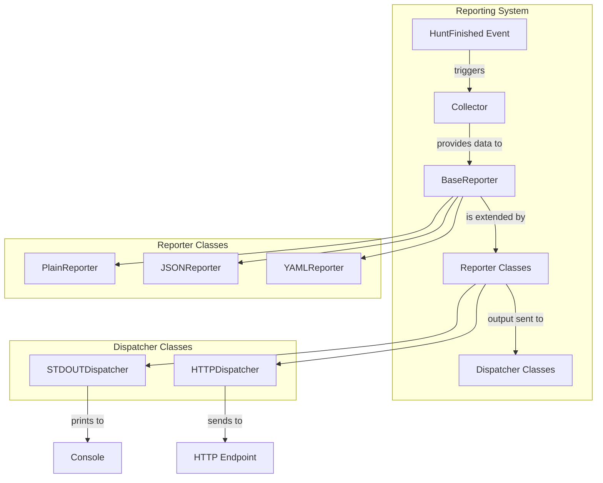
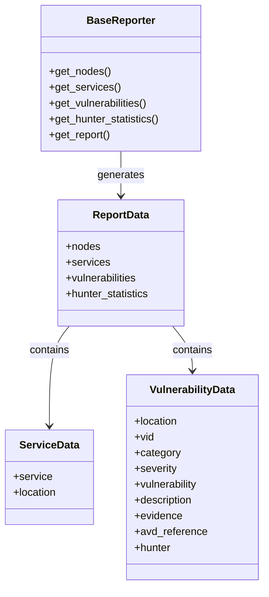
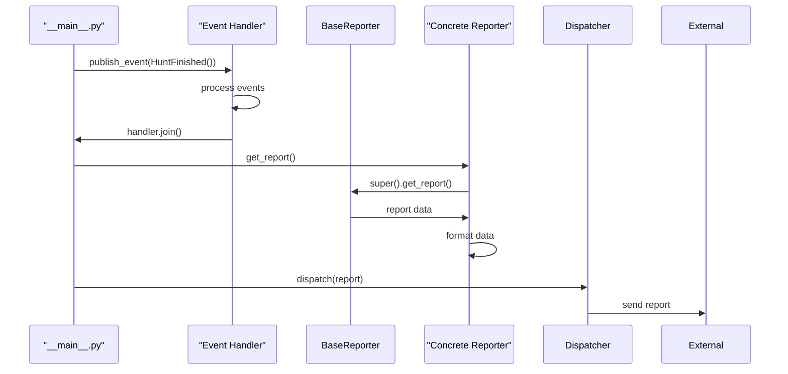
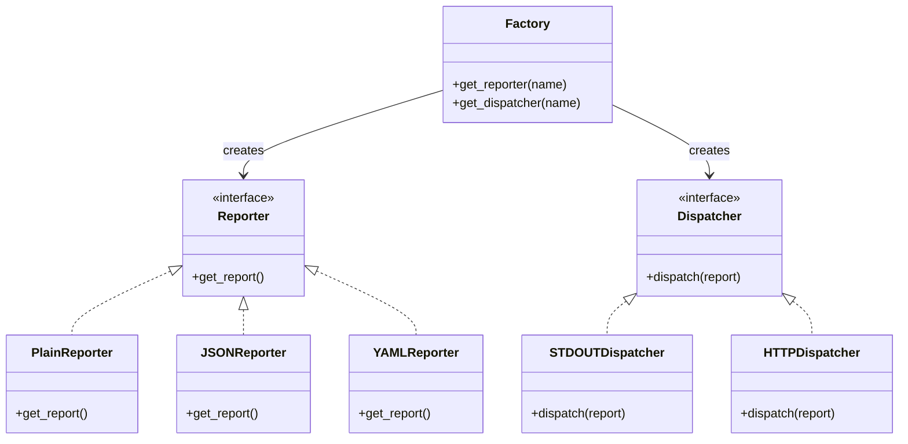
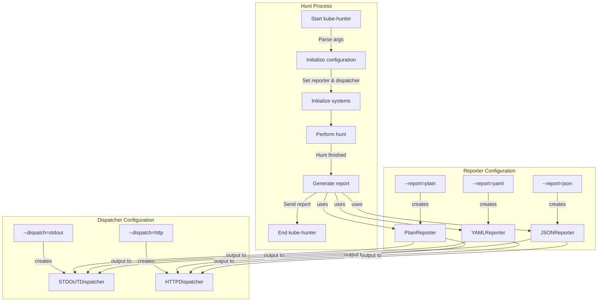

# Reporting System

Relevant source files

The following files were used as context for generating this wiki page:

- [kube_hunter/__main__.py](https://github.com/aquasecurity/kube-hunter/blob/bc47f08e/kube_hunter/__main__.py)
- [kube_hunter/conf/__init__.py](https://github.com/aquasecurity/kube-hunter/blob/bc47f08e/kube_hunter/conf/__init__.py)
- [kube_hunter/conf/parser.py](https://github.com/aquasecurity/kube-hunter/blob/bc47f08e/kube_hunter/conf/parser.py)
- [kube_hunter/modules/report/__init__.py](https://github.com/aquasecurity/kube-hunter/blob/bc47f08e/kube_hunter/modules/report/__init__.py)
- [kube_hunter/modules/report/base.py](https://github.com/aquasecurity/kube-hunter/blob/bc47f08e/kube_hunter/modules/report/base.py)
- [kube_hunter/modules/report/dispatchers.py](https://github.com/aquasecurity/kube-hunter/blob/bc47f08e/kube_hunter/modules/report/dispatchers.py)
- [kube_hunter/modules/report/factory.py](https://github.com/aquasecurity/kube-hunter/blob/bc47f08e/kube_hunter/modules/report/factory.py)
- [kube_hunter/modules/report/json.py](https://github.com/aquasecurity/kube-hunter/blob/bc47f08e/kube_hunter/modules/report/json.py)
- [kube_hunter/modules/report/plain.py](https://github.com/aquasecurity/kube-hunter/blob/bc47f08e/kube_hunter/modules/report/plain.py)
- [kube_hunter/modules/report/yaml.py](https://github.com/aquasecurity/kube-hunter/blob/bc47f08e/kube_hunter/modules/report/yaml.py)
- [tests/modules/test_reports.py](https://github.com/aquasecurity/kube-hunter/blob/bc47f08e/tests/modules/test_reports.py)

The Reporting System in kube-hunter is responsible for collecting, formatting, and dispatching findings from the security scan. It processes discovery results and detected vulnerabilities into structured reports that can be output in various formats and sent to different destinations. This page describes the architecture and components of the reporting system.

## Architecture Overview

The Reporting System is built around two main components:
1. **Reporters** - Format the scan results into different output formats (plain text, JSON, YAML)
2. **Dispatchers** - Send the formatted report to different destinations (stdout, HTTP endpoints)

Sources: [kube_hunter/modules/report/factory.py](https://github.com/aquasecurity/kube-hunter/blob/bc47f08e/kube_hunter/modules/report/factory.py), [kube_hunter/modules/report/base.py](https://github.com/aquasecurity/kube-hunter/blob/bc47f08e/kube_hunter/modules/report/base.py), [kube_hunter/__main__.py:133-138](https://github.com/aquasecurity/kube-hunter/blob/bc47f08e/kube_hunter/__main__.py#L133-L138)

## Report Data Collection

The reporting system collects data from three main sources:

1. **Services** - Kubernetes services discovered during the scan
2. **Vulnerabilities** - Security issues found during the hunting phase
3. **Hunters** - Statistics about hunters used during the scan (optional)

Sources: [kube_hunter/modules/report/base.py:14-70](https://github.com/aquasecurity/kube-hunter/blob/bc47f08e/kube_hunter/modules/report/base.py#L14-L70)

## Report Generation Flow

The reporting process is initiated when a hunt is completed. The `HuntFinished` event triggers the report generation process:

Sources: [kube_hunter/__main__.py:133-138](https://github.com/aquasecurity/kube-hunter/blob/bc47f08e/kube_hunter/__main__.py#L133-L138), [kube_hunter/modules/report/base.py:60-70](https://github.com/aquasecurity/kube-hunter/blob/bc47f08e/kube_hunter/modules/report/base.py#L60-L70)

## Reporter Classes

The reporting system includes three reporter classes that inherit from `BaseReporter`:

### BaseReporter

The `BaseReporter` class provides the foundation for all reporters. It collects data from the scan and structures it into a report.

Key methods:
- `get_nodes()` - Collects information about discovered nodes
- `get_services()` - Collects information about discovered services
- `get_vulnerabilities()` - Collects information about detected vulnerabilities
- `get_hunter_statistics()` - Collects statistics about hunters (optional)
- `get_report()` - Generates the complete report

Sources: [kube_hunter/modules/report/base.py:14-70](https://github.com/aquasecurity/kube-hunter/blob/bc47f08e/kube_hunter/modules/report/base.py#L14-L70)

### PlainReporter

The `PlainReporter` formats the report as plain text using PrettyTable to create readable tables.

Tables generated:
- Nodes table - Lists discovered nodes
- Services table - Lists discovered services
- Vulnerabilities table - Lists detected vulnerabilities
- Hunters table - Lists hunter statistics (optional)

Sources: [kube_hunter/modules/report/plain.py:16-133](https://github.com/aquasecurity/kube-hunter/blob/bc47f08e/kube_hunter/modules/report/plain.py#L16-L133)

### JSONReporter

The `JSONReporter` formats the report as a JSON string.

Sources: [kube_hunter/modules/report/json.py:6-9](https://github.com/aquasecurity/kube-hunter/blob/bc47f08e/kube_hunter/modules/report/json.py#L6-L9)

### YAMLReporter

The `YAMLReporter` formats the report as a YAML string.

Sources: [kube_hunter/modules/report/yaml.py:7-13](https://github.com/aquasecurity/kube-hunter/blob/bc47f08e/kube_hunter/modules/report/yaml.py#L7-L13)

## Dispatcher Classes

The reporting system includes two dispatcher classes:

### STDOUTDispatcher

The `STDOUTDispatcher` prints the report to the standard output.

Sources: [kube_hunter/modules/report/dispatchers.py:27-30](https://github.com/aquasecurity/kube-hunter/blob/bc47f08e/kube_hunter/modules/report/dispatchers.py#L27-L30)

### HTTPDispatcher

The `HTTPDispatcher` sends the report as a JSON payload to an HTTP endpoint.

Configuration is done through environment variables:
- `KUBEHUNTER_HTTP_DISPATCH_METHOD` - HTTP method to use (default: POST)
- `KUBEHUNTER_HTTP_DISPATCH_URL` - URL to send the report to (default: https://localhost/)

Sources: [kube_hunter/modules/report/dispatchers.py:8-25](https://github.com/aquasecurity/kube-hunter/blob/bc47f08e/kube_hunter/modules/report/dispatchers.py#L8-L25)

## Report Factory

The report system uses factory functions to create reporters and dispatchers based on configuration:

Sources: [kube_hunter/modules/report/factory.py:10-37](https://github.com/aquasecurity/kube-hunter/blob/bc47f08e/kube_hunter/modules/report/factory.py#L10-L37)

## Command-Line Configuration

The reporting system can be configured through command-line arguments:

| Argument | Description | Default |
|----------|-------------|---------|
| `--report` | Report format (plain, yaml, json) | plain |
| `--dispatch` | Where to send the report (stdout, http) | stdout |
| `--statistics` | Include hunter statistics in the report | false |

Sources: [kube_hunter/conf/parser.py:116-132](https://github.com/aquasecurity/kube-hunter/blob/bc47f08e/kube_hunter/conf/parser.py#L116-L132), [kube_hunter/__main__.py:48-49](https://github.com/aquasecurity/kube-hunter/blob/bc47f08e/kube_hunter/__main__.py#L48-L49)

## Integration with Main Flow

The reporting system is integrated into the main flow of kube-hunter:

1. Initialize reporter and dispatcher based on command-line arguments
2. Perform the hunt
3. Publish `HuntFinished` event when done
4. Generate and dispatch the report

Sources: [kube_hunter/__main__.py:98-139](https://github.com/aquasecurity/kube-hunter/blob/bc47f08e/kube_hunter/__main__.py#L98-L139)

## Report Content Structure

The structure of the report varies by format, but generally includes:

### Plain Text Report
- Nodes section - Table of discovered nodes
- Detected Services section - Table of discovered services
- Vulnerabilities section - Table of detected vulnerabilities with evidence
- Hunter Statistics section - Table of hunters and their findings (optional)

### JSON/YAML Report
- `nodes` - Array of discovered nodes
- `services` - Array of discovered services
- `vulnerabilities` - Array of detected vulnerabilities
- `hunter_statistics` - Array of hunters and their findings (optional)

Each vulnerability includes:
- `location` - Where the vulnerability was found
- `vid` - Vulnerability ID
- `category` - MITRE category
- `severity` - Severity level
- `vulnerability` - Name of the vulnerability
- `description` - Description of the vulnerability
- `evidence` - Evidence of the vulnerability
- `avd_reference` - Link to Aqua Security Vulnerability Database
- `hunter` - Name of the hunter that found the vulnerability

Sources: [kube_hunter/modules/report/base.py:60-70](https://github.com/aquasecurity/kube-hunter/blob/bc47f08e/kube_hunter/modules/report/base.py#L60-L70), [kube_hunter/modules/report/plain.py:17-46](https://github.com/aquasecurity/kube-hunter/blob/bc47f08e/kube_hunter/modules/report/plain.py#L17-L46)

## Vulnerability Knowledge Base

The reporting system links vulnerabilities to the Aqua Security Vulnerability Database:
- Base KB Link: `https://avd.aquasec.com/`
- Full KB Link: `https://avd.aquasec.com/kube-hunter/{vid}/`