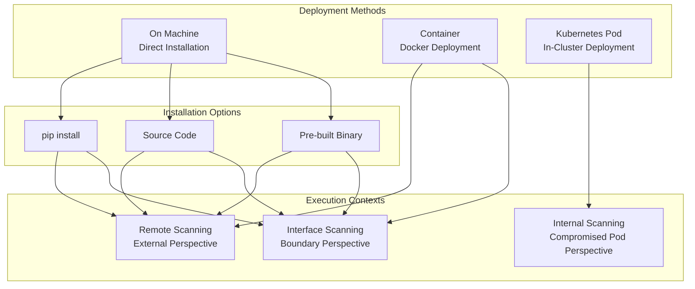
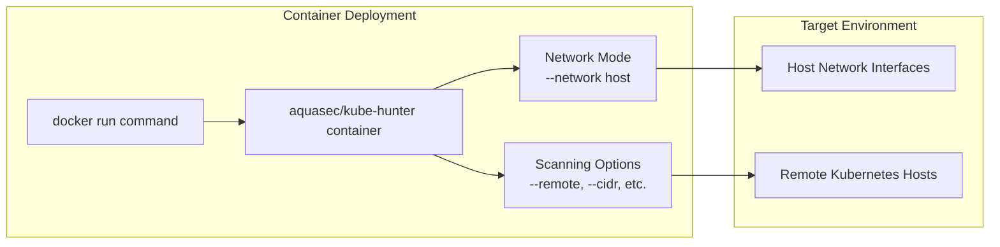
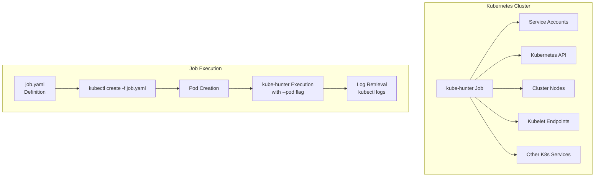
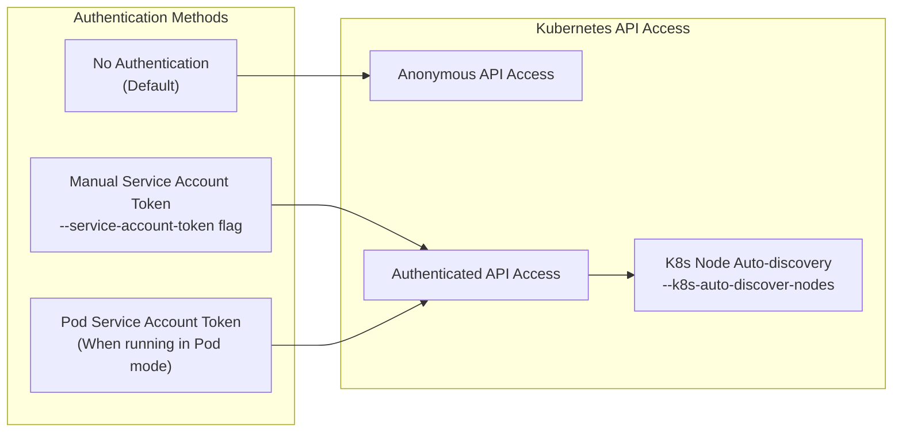

# Deployment Options

<details>
<summary>Relevant source files</summary>

The following files were used as context for generating this wiki page:

- [.flake8](https://github.com/aquasecurity/kube-hunter/blob/bc47f08e/.flake8)
- [.github/workflows/lint.yml](https://github.com/aquasecurity/kube-hunter/blob/bc47f08e/.github/workflows/lint.yml)
- [.github/workflows/publish.yml](https://github.com/aquasecurity/kube-hunter/blob/bc47f08e/.github/workflows/publish.yml)
- [.github/workflows/release.yml](https://github.com/aquasecurity/kube-hunter/blob/bc47f08e/.github/workflows/release.yml)
- [.github/workflows/test.yml](https://github.com/aquasecurity/kube-hunter/blob/bc47f08e/.github/workflows/test.yml)
- [.pre-commit-config.yaml](https://github.com/aquasecurity/kube-hunter/blob/bc47f08e/.pre-commit-config.yaml)
- [.yamllint](https://github.com/aquasecurity/kube-hunter/blob/bc47f08e/.yamllint)
- [Dockerfile](https://github.com/aquasecurity/kube-hunter/blob/bc47f08e/Dockerfile)
- [README.md](https://github.com/aquasecurity/kube-hunter/blob/bc47f08e/README.md)
- [job.yaml](https://github.com/aquasecurity/kube-hunter/blob/bc47f08e/job.yaml)
- [kube_hunter/conf/logging.py](https://github.com/aquasecurity/kube-hunter/blob/bc47f08e/kube_hunter/conf/logging.py)
- [kube_hunter/modules/hunting/__init__.py](https://github.com/aquasecurity/kube-hunter/blob/bc47f08e/kube_hunter/modules/hunting/__init__.py)
- [setup.cfg](https://github.com/aquasecurity/kube-hunter/blob/bc47f08e/setup.cfg)
- [tests/conf/test_logging.py](https://github.com/aquasecurity/kube-hunter/blob/bc47f08e/tests/conf/test_logging.py)
- [tests/core/test_handler.py](https://github.com/aquasecurity/kube-hunter/blob/bc47f08e/tests/core/test_handler.py)

</details>


This page documents the various ways to deploy and run kube-hunter in different environments. Kube-hunter is designed to be flexible in how it can be deployed, allowing users to choose the method that best fits their security assessment needs.

## Overview of Deployment Methods

Kube-hunter offers three primary deployment methods, each providing a different perspective for security assessments:



Sources: [README.md:188-254](https://github.com/aquasecurity/kube-hunter/blob/bc47f08e/README.md#L188-L254)

Each deployment method offers a unique vantage point for assessing Kubernetes cluster security:

1. **On Machine** - Run directly on your workstation or server
2. **Container** - Run as a Docker container
3. **Pod** - Run as a pod within the Kubernetes cluster

The choice of deployment method impacts what vulnerabilities can be discovered and provides different perspectives on cluster security.

## On Machine Deployment

Running kube-hunter directly on a workstation or server provides flexibility for scanning remote clusters or local networks.

### Prerequisites

To run kube-hunter directly on a machine, you'll need:
- Python 3.6 or later
- pip (Python package manager)

### Installation Options

There are three ways to install kube-hunter for direct machine use:

#### 1. Install with pip

The simplest method is to install kube-hunter from PyPI:

```bash
pip install kube-hunter
```

After installation, you can run kube-hunter with:

```bash
kube-hunter
```

Sources: [README.md:201-211](https://github.com/aquasecurity/kube-hunter/blob/bc47f08e/README.md#L201-L211), [setup.cfg:1-56](https://github.com/aquasecurity/kube-hunter/blob/bc47f08e/setup.cfg#L1-L56)

#### 2. Run from source

To run kube-hunter from source:

```bash
git clone https://github.com/aquasecurity/kube-hunter.git
cd ./kube-hunter
pip install -r requirements.txt
python3 kube_hunter
```

Sources: [README.md:213-230](https://github.com/aquasecurity/kube-hunter/blob/bc47f08e/README.md#L213-L230)

#### 3. Pre-built binary

A standalone executable is created for each release using PyInstaller and can be downloaded from the GitHub releases page.

Sources: [.github/workflows/release.yml:1-56](https://github.com/aquasecurity/kube-hunter/blob/bc47f08e/.github/workflows/release.yml#L1-L56)

## Container Deployment

Running kube-hunter as a container isolates its dependencies and provides a consistent execution environment.



Sources: [README.md:232-245](https://github.com/aquasecurity/kube-hunter/blob/bc47f08e/README.md#L232-L245), [Dockerfile:1-32](https://github.com/aquasecurity/kube-hunter/blob/bc47f08e/Dockerfile#L1-L32)

### Container Usage Examples

#### Basic container execution:

```bash
docker run -it --rm aquasec/kube-hunter
```

This runs kube-hunter in interactive mode, allowing you to select a scanning option.

#### Scanning a specific CIDR range:

```bash
docker run --rm aquasec/kube-hunter --cidr 192.168.0.0/24
```

#### Network access considerations

When using Docker for Mac/Windows, be aware that the `--network host` option gives kube-hunter access to the Docker VM's network interfaces, not your host machine's interfaces.

```bash
docker run -it --rm --network host aquasec/kube-hunter
```

Sources: [README.md:232-245](https://github.com/aquasecurity/kube-hunter/blob/bc47f08e/README.md#L232-L245)

## Kubernetes Pod Deployment

Running kube-hunter as a pod within your Kubernetes cluster provides the perspective of what a compromised pod might be able to discover or exploit.



Sources: [README.md:246-254](https://github.com/aquasecurity/kube-hunter/blob/bc47f08e/README.md#L246-L254), [job.yaml:1-18](https://github.com/aquasecurity/kube-hunter/blob/bc47f08e/job.yaml#L1-L18)

### Pod Deployment Process

1. Use the provided `job.yaml` file or create your own Kubernetes job definition
2. Deploy the job in your cluster with `kubectl create -f job.yaml`
3. Find the pod name with `kubectl describe job kube-hunter`
4. View the test results with `kubectl logs <pod name>`

The example job.yaml file defines a Job that runs kube-hunter with the `--pod` flag:

```yaml
apiVersion: batch/v1
kind: Job
metadata:
  name: kube-hunter
spec:
  template:
    metadata:
      labels:
        app: kube-hunter
    spec:
      containers:
        - name: kube-hunter
          image: aquasec/kube-hunter:0.6.8
          command: ["kube-hunter"]
          args: ["--pod"]
      restartPolicy: Never
```

Sources: [job.yaml:1-18](https://github.com/aquasecurity/kube-hunter/blob/bc47f08e/job.yaml#L1-L18), [README.md:246-254](https://github.com/aquasecurity/kube-hunter/blob/bc47f08e/README.md#L246-L254)

### Pod Mode Special Considerations

When running in pod mode:

1. Kube-hunter automatically discovers attack surface IP addresses using Pod-based environment techniques
2. It uses the service account token mounted inside the pod to authenticate to services it finds
3. It can automatically discover Kubernetes nodes in the cluster
4. It provides the perspective of what an attacker could do if they compromised a pod

Pod mode is crucial for understanding the potential impact of a container escape or application vulnerability that leads to pod compromise.

Sources: [README.md:60-104](https://github.com/aquasecurity/kube-hunter/blob/bc47f08e/README.md#L60-L104)

## Deployment Method Comparison

Each deployment method provides different insights into cluster security:

| Deployment Method | Perspective | Use Case | Network Access | Considerations |
|------------------|-------------|----------|---------------|----------------|
| On Machine (Remote) | External attacker | External attack surface assessment | Access to target cluster over network | Limited to externally exposed services |
| On Machine (Interface) | Network boundary | Scanning from trusted network position | Access to network interfaces | Requires network connectivity to cluster |
| Container | Similar to On Machine | Container-isolated scanning | Based on Docker network config | May need `--network host` for full access |
| Pod | Compromised pod | Internal attack surface from pod perspective | Full access to cluster networks | Shows impact of container escape |

## Authentication and Service Account Usage

When running kube-hunter, it mimics an attacker in its early stages by requiring no authentication for the hunt by default. However, there are options to use service account tokens:

1. When running with the `--pod` flag, kube-hunter uses the service account token mounted inside the pod
2. You can manually provide a service account token with the `--service-account-token` flag



Sources: [README.md:92-104](https://github.com/aquasecurity/kube-hunter/blob/bc47f08e/README.md#L92-L104), [README.md:86-89](https://github.com/aquasecurity/kube-hunter/blob/bc47f08e/README.md#L86-L89)

## Integration with CI/CD Pipelines

Kube-hunter can be integrated into CI/CD pipelines to provide continuous security testing:

1. The container image can be used in pipeline steps
2. Output can be formatted as JSON for integration with other tools
3. Results can be dispatched to HTTP endpoints for centralized tracking

Sources: [README.md:126-138](https://github.com/aquasecurity/kube-hunter/blob/bc47f08e/README.md#L126-L138), [.github/workflows/test.yml:1-56](https://github.com/aquasecurity/kube-hunter/blob/bc47f08e/.github/workflows/test.yml#L1-L56), [.github/workflows/publish.yml:1-96](https://github.com/aquasecurity/kube-hunter/blob/bc47f08e/.github/workflows/publish.yml#L1-L96)

## Conclusion

Choosing the right deployment method for kube-hunter depends on your specific security assessment goals:

- Use the **On Machine** method for flexibility and direct control
- Use the **Container** method for isolation and portability
- Use the **Pod** method to simulate attacks from a compromised pod perspective

For a comprehensive security assessment, consider running kube-hunter using all three deployment methods to gain multiple perspectives on your cluster's security posture.